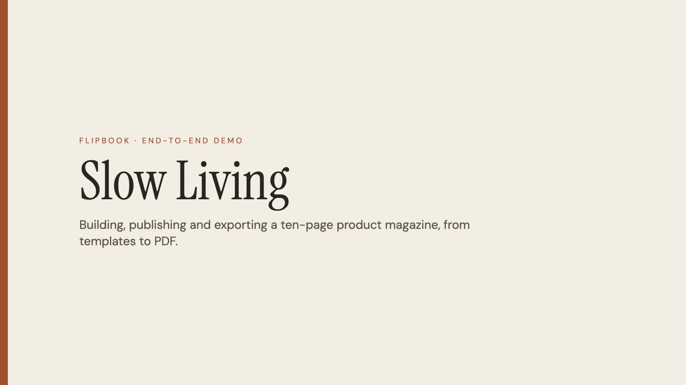
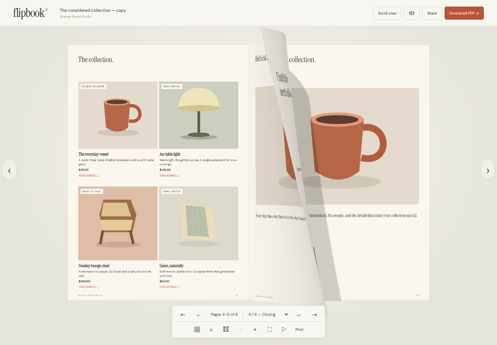
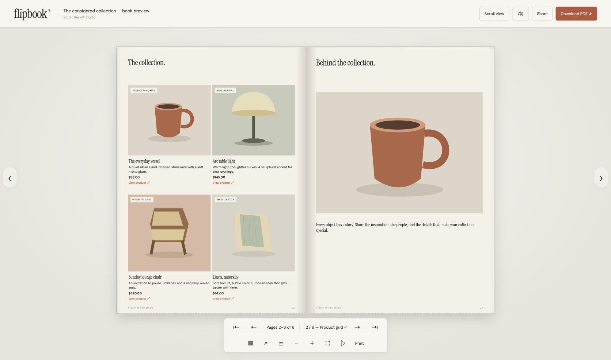
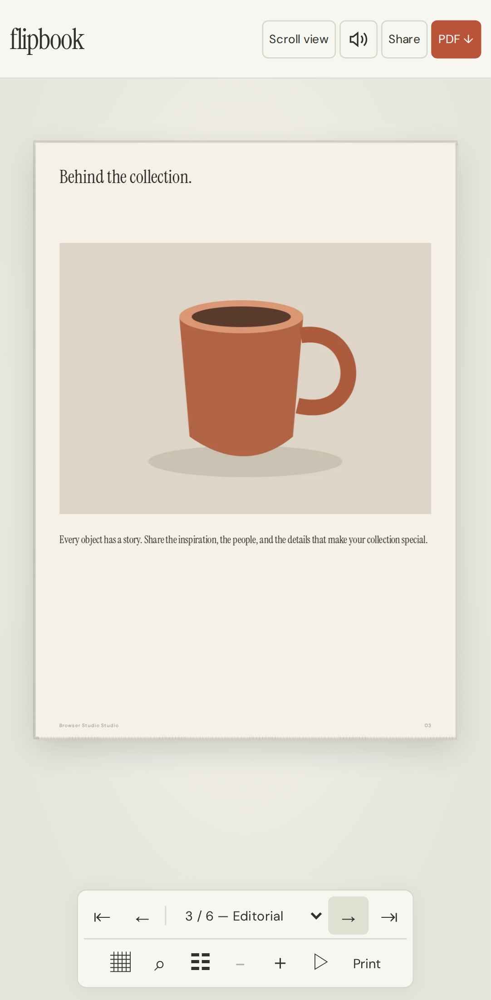

# Flipbook

**Turn a product catalog into an interactive, shoppable digital magazine, then publish it as a 3D page-turning book and export it as a PDF.**

Flipbook is a self-hosted publishing studio. You build pages from templates, add products and images, edit everything in a visual editor, publish an immutable edition that readers flip through in the browser, and download an A4 PDF of the same content. It runs as a single Node.js container with SQLite and local files. You don't need cloud accounts, API keys or external services.

## Demo

<p align="center">
  <a href="docs/media/flipbook-demo.mp4">
    
  </a>
  <br>
  <a href="docs/media/flipbook-demo.mp4"><b>▶ Watch the end-to-end demo</b></a> (5 min, narrated, 1080p MP4)
</p>

The demo builds a ten-page product magazine from templates. Its 14 scenes cover:

- templates, branding, typography and layout tools
- images and hotspots, and CSV catalog import
- design checks, draft history, and review and approval
- publishing, the 3D page-turning reader on desktop and phone, PDF export, and private drafts You can regenerate it with [tools/demo-video](tools/demo-video/README.md).

<p align="center">
  
</p>

<p align="center">
  
  &nbsp;
  
</p>

## Contents

- [Demo](#demo)
- [Features](#features)
- [Tech stack](#tech-stack)
- [Prerequisites](#prerequisites)
- [Quick start (Docker)](#quick-start-docker)
- [Local development (without Docker)](#local-development-without-docker)
- [Running tests](#running-tests)
- [Configuration](#configuration)
- [Operating a local install](#operating-a-local-install)
- [Repository layout](#repository-layout)
- [Documentation](#documentation)
- [Troubleshooting](#troubleshooting)
- [Contributing](#contributing)
- [License](#license)

## Features

- **Editor:** seven page layouts; rich text, images, product cards, galleries, hotspots, shapes, icons, video and audio. It also has layers, grouping, alignment and snapping, undo/redo, autosave with conflict protection, draft history, and review and approval.
- **Products and brand:** a reusable product catalog with CSV import, brand kits, themes, master headers and footers, 14 built-in fonts, and your own TTF/OTF/WOFF uploads.
- **Reader:** curved WebGL paper with drag-to-turn, hard or soft covers and spiral binding. It also includes a 2D, slide and scroll fallback, thumbnails, contents, search, zoom and pinch, RTL, autoplay, fullscreen and print.
- **Publishing:** pre-publish checks, immutable published editions, and instant unpublish. First-party analytics (sessions, product clicks, page depth) stay on your machine.
- **PDF export:** a background worker generates A4 pages with embedded fonts and images, selectable text and clickable links. It needs no headless browser.
- **Security:** local accounts with scrypt hashes, cookie sessions, CSRF and origin checks, and per-account isolation. The container is read-only and drops all capabilities.

For the full feature list, see [flipbook/README.md](flipbook/README.md#what-you-can-do) and the [editor delivery matrix](flipbook/EDITOR_DELIVERY.md).

## Tech stack

| Layer | Choice |
|---|---|
| Runtime | Node.js 24 (ES modules) |
| Backend | Express 5 |
| Frontend | React 19 and Vite 7. The reader uses Three.js (WebGL). |
| Database | Node's built-in `node:sqlite` in WAL mode |
| PDF | PDFKit, Sharp and fontkit |
| Jobs | Durable SQLite queue with one worker thread |
| Tests | Vitest, React Testing Library and jsdom, `node --test`, Playwright |
| Packaging | Docker multi-stage image and Docker Compose |

## Prerequisites

Pick **one** of the two ways to run the app.

### Option A: Docker (recommended for running the app)

| Requirement | Notes |
|---|---|
| Docker Engine with **Compose v2** | Docker Desktop on macOS or Windows, or Docker Engine plus the Compose plugin on Linux. [Colima](https://github.com/abiosoft/colima) also works on macOS. |
| 2 CPUs and 4 GiB RAM for the Docker VM | The app container is capped at 1 GiB of memory and 2 CPUs. |
| Free port **3000** | Configurable; see [Configuration](#configuration). |
| Internet access for the first build | Needed only to pull the base image and npm packages. |

On **Windows**, run all commands inside **WSL2** with Docker Desktop's WSL integration turned on.

> You can skip installing Docker yourself: `./scripts/install.sh` sets it up for you. On macOS it reuses Docker Desktop or installs Homebrew, Colima, Docker and Compose. On Ubuntu and Debian it adds Docker's official apt repository. It may prompt for your password.

### Option B: Native Node.js (for development)

| Requirement | Notes |
|---|---|
| **Node.js 24.x** | Required: the app uses the built-in `node:sqlite` module. `package.json` pins `>=24 <25`. An [`.nvmrc`](flipbook/.nvmrc) is included, so run `nvm use` or `mise use node@24`. |
| npm 10 or later | Bundled with Node 24. |
| Git | To clone the repository. |
| Playwright Chromium | Needed only for browser tests: `npx playwright install chromium --only-shell`. |

## Quick start (Docker)

```bash
git clone https://github.com/coderArchitech/flipbook.git
cd flipbook/flipbook          # the application lives in the flipbook/ subfolder

./scripts/install.sh          # first time: prepares Docker, builds, starts, waits for health
# or, if Docker is already running:
./scripts/start.sh            # same as: docker compose up -d --build --wait
```

Then:

1. Open **http://localhost:3000**.
2. Choose **Create an account**. Each new account starts with a sample magazine, four products and sample illustrations. There are no default credentials.
3. Edit the magazine, click **Publish**, open the reader link, and download the PDF.

To stop the app, run `./scripts/stop.sh`. Your data is kept in the `flipbook-data` Docker volume.

## Local development (without Docker)

```bash
cd flipbook
nvm use                       # or: mise use node@24  (Node 24 is required)
npm ci
npm run dev
```

| URL | What runs there |
|---|---|
| http://localhost:5173 | Vite dev server for the editor, with hot reload |
| http://localhost:3000 | API and public reader. Vite proxies `/api`, `/reader`, `/m`, `/fonts` and `/book-*` here. |

The dev script also rebuilds the reader bundle and restarts the API whenever files change. Stop everything with `Ctrl+C`.

Production-style run without Docker:

```bash
npm run build                 # Vite client build and reader bundle, written to dist/
npm start                     # serves everything at http://localhost:3000
```

Native runs store data in `flipbook/data/`, which is gitignored.

### npm scripts

| Script | Purpose |
|---|---|
| `npm run dev` | Editor (Vite), API (watch mode) and reader bundle (watch) |
| `npm run build` | Production build into `dist/` |
| `npm start` | Start the server from the built output |
| `npm test` | Unit tests plus API integration tests |
| `npm run test:unit` | Vitest (frontend and backend) and shared document tests |
| `npm run test:frontend` / `test:backend` | One Vitest suite only |
| `npm run test:integration` | Real HTTP, SQLite, publishing and PDF-job tests |
| `npm run test:e2e` | Build, then run Playwright (desktop and phone Chromium) |
| `npm run test:e2e:headed` | Same, with a visible browser |
| `npm run test:report` | Open the last Playwright HTML report |
| `npm run test:all` | Every test above |

## Running tests

```bash
cd flipbook
npm ci
npm test                                        # unit and integration tests (about 10 s)

npx playwright install chromium --only-shell    # one-time; on Linux add --with-deps
npm run test:e2e                                # browser end-to-end tests
npm run test:report                             # view the HTML report
```

To run everything in Docker without installing Node or browsers, use `./scripts/test.sh`. It uses the version-matched Playwright image and writes reports to `test-results/docker/`.

The tests use temporary databases and never touch your studio data. Playwright starts its own server on port **4179**; set `PLAYWRIGHT_PORT` to change it. For coverage details and the last recorded results, see [VERIFICATION.md](flipbook/VERIFICATION.md).

**CI:** [`.github/workflows/ci.yml`](.github/workflows/ci.yml) runs on every push and pull request. It runs `npm ci`, `npm audit` (production dependencies, high severity), the unit and integration tests, the Playwright end-to-end tests, and a Docker image build. Reports are uploaded as build artifacts.

## Configuration

Docker Compose reads `flipbook/.env`. Start from the example:

```bash
cp flipbook/.env.example flipbook/.env
```

| Variable | Default | Used by | Purpose |
|---|---|---|---|
| `FLIPBOOK_PORT` | `3000` | Compose | Host port; it binds to `127.0.0.1` only |
| `PORT` | `3000` | Server | Port the server listens on |
| `HOST` | `127.0.0.1` | Server | Bind address. Keep it local for native runs; Docker sets `0.0.0.0` inside the container. |
| `DATA_DIR` | `./data` | Server | SQLite, uploads, exports and the signing secret. Docker uses `/app/data`. |
| `PUBLIC_URL` | `http://localhost:$PORT` | Server | Origin used for links and origin checks |
| `COOKIE_SECURE` | `false` | Server | Set to `true` when the app is served over HTTPS |
| `PLAYWRIGHT_PORT` | `4179` | Tests | Port for the end-to-end test server |

## Operating a local install

Run these from `flipbook/`:

```bash
./scripts/start.sh     # build and start, wait for health
./scripts/stop.sh      # stop, keep data
./scripts/logs.sh      # follow logs
./scripts/doctor.sh    # diagnose Docker, configuration and service status
./scripts/backup.sh    # briefly stop, archive the data volume to backups/, restart
```

> ⚠️ `docker compose down` keeps your data, but **`docker compose down -v` deletes it**. Backups contain account data, so keep them private. Restore steps are in [flipbook/README.md](flipbook/README.md#everyday-commands).

The app is intended for **local use**. A `localhost` reader link is not a public website. Before exposing Flipbook to a network, put it behind HTTPS and set `COOKIE_SECURE=true` and `PUBLIC_URL`.

## Repository layout

```text
.
├── README.md                  ← you are here
├── CONTRIBUTING.md            how to propose changes
├── SECURITY.md                how to report vulnerabilities
├── LICENSE                    MIT
├── .github/
│   ├── workflows/ci.yml       CI: tests, audit, e2e, Docker build
│   ├── ISSUE_TEMPLATE/        bug report and feature request forms
│   └── pull_request_template.md
├── docs/
│   ├── PRD.md                 product requirements
│   ├── TECHNICAL_DESIGN.md    current architecture (HLD/LLD, APIs, storage, jobs, security)
│   ├── archive/               superseded designs, kept for decision history
│   ├── images/                screenshots and the demo poster
│   └── media/                 demo video (flipbook-demo.mp4)
├── flipbook/                  the application
│   ├── client/                React editor (Vite)
│   ├── server/                Express API, auth, SQLite, jobs, PDF worker
│   ├── shared/                document model, layout, rendering, validation (client and server)
│   ├── public/                standalone reader: WebGL book, navigation, styles
│   ├── scripts/               install, start, stop, logs, doctor, backup, test, dev
│   ├── tests/                 frontend, backend, API and Playwright e2e tests
│   ├── verification/          recorded test evidence
│   ├── Dockerfile, compose.yaml, compose.test.yaml
│   └── README.md              detailed user and operator guide
└── tools/
    └── demo-video/            optional script that records a narrated demo video (macOS)
```

## Documentation

Read these in roughly this order:

| Document | What it covers |
|---|---|
| [docs/PRD.md](docs/PRD.md) | **Product requirements:** problem, users, goals, MVP scope, acceptance criteria, and the DearFlip feature comparison |
| [docs/TECHNICAL_DESIGN.md](docs/TECHNICAL_DESIGN.md) | **Technical design (v4.0):** architecture, module map, data model, REST APIs, publishing model, job queue, PDF pipeline, security and limits |
| [flipbook/README.md](flipbook/README.md) | **User and operator guide:** every feature, advanced editing, shortcuts, everyday commands, backup and restore, troubleshooting |
| [flipbook/EDITOR_DELIVERY.md](flipbook/EDITOR_DELIVERY.md) | Editor feature matrix and test coverage for each capability |
| [flipbook/VERIFICATION.md](flipbook/VERIFICATION.md) | What was verified, how to rerun it, and the recorded results |
| [tools/demo-video/README.md](tools/demo-video/README.md) | How to regenerate the narrated demo video |
| [docs/archive/](docs/archive/) | Superseded designs: the [original cloud/AWS proposal](docs/archive/TECHNICAL_DESIGN_CLOUD_PROPOSAL.md) and [local design v2.0](docs/archive/TECHNICAL_DESIGN_LOCAL_v2.md) |

## Troubleshooting

| Problem | Fix |
|---|---|
| `Docker is not reachable` | Open Docker Desktop, or run `colima start --cpu 2 --memory 4`, then `./scripts/doctor.sh`. |
| Port 3000 already in use | Set `FLIPBOOK_PORT` in `flipbook/.env` and restart. |
| `No such built-in module: node:sqlite` or an engine warning | You're on the wrong Node version. Switch to Node 24 (`nvm use`). |
| The image build can't download its base image | Check Docker's internet, proxy and registry access, then retry. |
| 3D reader is slow or unavailable | In the reader, choose **View options → 2D book** or **Scroll reader**. It also falls back automatically when WebGL fails. |
| Playwright can't launch Chromium | Run `npx playwright install chromium --only-shell` (add `--with-deps` on Linux), or use `./scripts/test.sh`. |

More fixes are listed in [flipbook/README.md](flipbook/README.md#troubleshooting).

## Contributing

Issues and pull requests are welcome. See [CONTRIBUTING.md](CONTRIBUTING.md) for the development workflow and the checks your change needs to pass. Report security issues privately as described in [SECURITY.md](SECURITY.md).

## License

[MIT](LICENSE). Bundled fonts are distributed under their own open licenses (SIL OFL); third-party reader notices are in [flipbook/public/reader-licenses.txt](flipbook/public/reader-licenses.txt).
