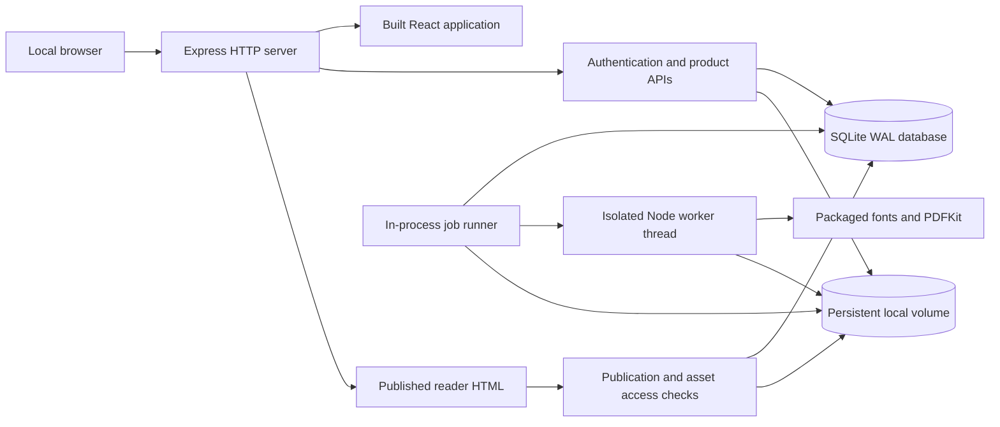
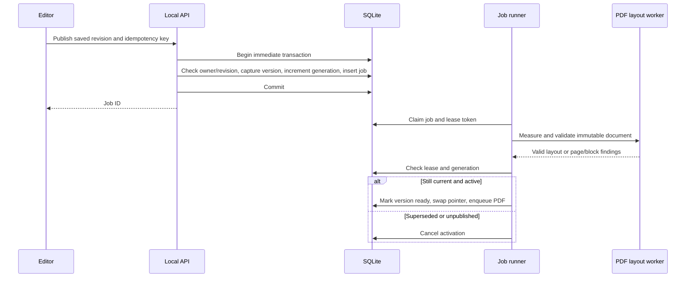

# Flipbook — Local Monolith Technical Design

**Version:** 4.0 — advanced editor · **Updated:** 27 October 2026  
**Architecture:** One repository, one application container, SQLite, persistent local files  
**Product requirements:** [README.md](PRD.md)  
**Implementation:** [flipbook/](../flipbook/)  
**Installation guide:** [flipbook/README.md](../flipbook/README.md)

This design replaces the earlier cloud deployment proposal following the decision to implement and run the full MVP locally. It describes the implemented architecture and its operational limits. AWS services, PostgreSQL, a separate message broker, hosted identity, a CDN, and Chromium are not runtime requirements. Verification results are recorded in the implementation README as checks finish.

## 1. Scope and engineering decisions

The MVP is a local publishing studio: users create an account, manage reusable product information and images, compose magazines from page templates, publish a browser reader, and generate a downloadable PDF. The application runs entirely on the user’s computer. Published URLs work where that local server is reachable; a `localhost` link is not internet hosting.

| Concern | Decision | Rationale |
|---|---|---|
| Repository | One package/repository with frontend, backend, shared code, scripts, and tests | Simple installation and a single dependency lockfile |
| Runtime | One Node.js application container | Keeps local process and configuration overhead low |
| Frontend | React and Vite; built files served by Express | No separate frontend runtime in normal use |
| Backend | Express 5, ES modules | Straightforward REST routes and domain modules |
| Database | Node.js built-in SQLite, WAL mode | No database container or database account setup |
| Files | Named Docker volume mounted at `/app/data` | Uploads, originals, and PDFs survive container replacement |
| Jobs | SQLite jobs table, one polling runner, one CPU worker thread at a time | Durable retries without Redis or SQS |
| Reader animation | Lazy Three.js WebGL curved sheet; semantic HTML and CSS fallback | Client-side only; no extra runtime container |
| PDF | PDFKit + Sharp + locally packaged fonts | Creates text/vector PDFs directly; no browser installation |
| Authentication | Local accounts, scrypt passwords, opaque cookie sessions | No cloud identity credentials or external login dependency |
| Access model | Each account owns one isolated personal workspace | Matches the single-owner MVP |
| Publishing | Immutable version document plus live-version pointer and generation fence | Draft edits never silently change the reader |
| Analytics | First-party events in SQLite, queried on demand | Appropriate for local usage without extra services |
| Implementation language | JavaScript ES modules and JSX | Runs directly on Node; shared validation is enforced at runtime |

The source is a modular monolith. Modules are logical boundaries inside a single application, with no service-to-service network calls. A monorepo does not require multiple deployable services.

## 2. Supported environment and resource budget

### Host prerequisites

- macOS on Apple Silicon or Intel: Docker Desktop, or Colima with Docker CLI and Compose.
- Ubuntu/Debian Linux: Docker Engine and Compose plugin.
- Windows: WSL2 with Docker Desktop integration; run the Bash scripts inside WSL2.
- Internet access is needed for initial package/image installation. Normal authoring and export use local dependencies after installation.
- Native development additionally needs Node.js 24 and npm; Docker users do not need host Node, npm, SQLite, or PDF tools.

### Local resource targets

| Item | Default/target |
|---|---|
| Application containers | 1 |
| External service containers | 0 |
| Application memory cap | 1 GiB in Compose |
| CPU cap | 2 CPUs |
| PDF worker JS heap | 384 MiB; native image buffers also consume container memory |
| Background job concurrency | 1 |
| Suggested Docker/Colima VM | 2 CPUs, 4 GiB RAM, 20 GiB disk allocation |
| Persistent data | One named volume; budget additional disk for image originals/backups |
| Web port | `127.0.0.1:3000`, configurable through `FLIPBOOK_PORT` |
| Deployment target | One local host and a small number of simultaneous users/editors |

These are configuration limits and planning targets, not benchmark results. A low-memory machine may need smaller publications or more memory for exports. The original PRD’s cloud-scale load assumptions do not apply to this local deployment.

### Enforced content bounds

- 100 pages/publication, 50 blocks/page, approximately 2 MiB document/request limit.
- Title 160 characters; subtitle 300; publisher name 160.
- Product name 200, summary 500, description 10,000; up to eight images/product.
- Text block 20,000 characters; font size 10–64 logical pixels.
- JPEG, PNG, static WebP; 20 MiB input; 40-megapixel decoder limit; maximum dimension 12,000 px.
- One GiB accounted media per account; originals plus processed image bytes count toward storage.
- At most 10 queued/running jobs per account admitted by publish.
- PDF timeout 180 seconds; maximum output 100 MiB.

## 3. High-level architecture



All application components inside the diagram run in the same container. The PDF worker is a thread with its own JS heap; it is not another service/container. SQLite and files are colocated on the persistent volume. The HTTP server continues responding while CPU-intensive PDF work runs in the worker thread.

### Data flow

1. Browser loads the compiled React application from Express.
2. Local account login establishes a session cookie and a CSRF token.
3. Editor saves the canonical document to SQLite through an authenticated revision-checked API.
4. Uploads are validated and re-encoded by Sharp; files are stored on the local volume.
5. Publish captures an immutable document version and creates a durable job in the same SQLite transaction.
6. The runner validates fixed-page layout using the PDF renderer. On success it atomically switches the live pointer and creates the PDF export job.
7. The public reader resolves that live version and gates every image/PDF request against publication state.
8. PDF jobs write an immutable attempt file and record the winning path only after checking job ownership and publication lifecycle.

## 4. Repository and module map

```text
flipbook/
  client/
    main.jsx                 React library/editor/catalog/analytics UI
    api.js                   HTTP, CSRF, image-upload helpers
    components/              Shared React preview and accessible modal
    style.css                Creator application styles
  server/
    index.mjs                HTTP routes, authorization boundaries, startup
    db.mjs                   SQLite initialization and transaction helpers
    auth.mjs                 Passwords, sessions, CSRF/origin checks, rate limits
    seed.mjs                 Synthetic starter products/images/publication
    jobs.mjs                 Durable queue runner and fenced job completion
    pdf-worker.mjs           PDF layout measurement and PDFKit generation
    reader.mjs               Server-rendered published reader shell
  shared/
    document.mjs             Templates, document construction, validation
    layout.mjs               Canonical page/grid geometry
    render.mjs               Safe HTML page renderer and page CSS
  public/
    reader.js                Reader navigation, product dialog, analytics
    reader.css               Reader shell styles
    book-model.js            Pure cover/spread pagination helpers
    book-viewer.js            Shared DOM reader/preview controller
    book-viewer.css           Book, fallback, responsive and print presentation
    paper-geometry.js         Pure bend, release, duration and centering math
    paper-renderer.js         Lazy WebGL surface, textures, shadows and cleanup
    reader-model.js           Validated preferences and local publication search
    reader-navigation.js      Navigation panels, view options, autoplay and print
    flip-sound.js             Gesture-driven local audio synthesis and mute
  scripts/                   Install/start/stop/logs/doctor/backup/dev
  tests/                     Frontend/backend units, document/API tests, Playwright E2E
  vitest.config.mjs          Frontend/backend unit test isolation
  playwright.config.mjs      Desktop/phone projects and isolated test server
  compose.test.yaml          Optional disposable Chromium test container
  Dockerfile
  compose.yaml
  package.json
  package-lock.json
```

The shared document validator is used by the editor and server. The HTML renderer escapes user text and emits only supported block markup. PDFKit has a separate rendering adapter over the same content and geometry; this is intentionally documented as two adapters, not one browser engine producing identical pixels.

## 5. Canonical document contract

```ts
type Document = {
  schemaVersion: 1;
  title: string;
  subtitle: string;
  publisher: string;
  language: 'en';
  theme: 'editorial' | 'modern' | 'botanical';
  pages: Page[];
};
type Page = {
  id: string;
  template: 'cover' | 'feature' | 'grid' | 'story' | 'divider' | 'closing' | 'blank';
  title: string;
  blocks: Block[]; // semantic reading order
};
type Block = {
  id: string;
  type: 'text' | 'image' | 'product' | 'button' | 'divider';
  rect: [column: number, row: number, columns: number, rows: number];
  text: string;
  size: number;
  bold: boolean;
  align: 'left' | 'center' | 'right';
  assetId: string | null;
  alt: string;
  decorative: boolean;
  crop: { x: number; y: number; zoom: number };
  product?: ProductContent;
  url?: string;
};
type ProductContent = {
  name: string; summary: string; description: string;
  price: string; currency: string;
  sku: string; category: string; badge: string;
  url: string; images: string[];
};
```

IDs are UUIDs. All page/block IDs in a document must be unique. Document content contains asset IDs, never arbitrary filesystem paths. Product prices are decimal strings for display, with no payment arithmetic in this application. Currency is a validated three-letter code and formatting uses the currency’s decimal convention. The supported editor currency picker offers USD, EUR, GBP, INR, CAD, AUD, JPY, and AED.

Selecting a product copies its content into that page block. Catalog edits do not propagate to existing blocks or published versions. Users can explicitly select a catalog product again to refresh that placement. This gives reliable offline PDF values and avoids unexpected price/copy changes.

Product cards contain name, summary, primary image, optional price/badge, and merchant link. The full description and additional images appear in the digital reader’s product dialog. Put extended text/images on pages when they must appear in the PDF; reader dialogs themselves are not exported.

## 6. Layout, templates, and rendering

### Fixed-page layout

The logical canvas is 794 × 1,123 units, corresponding approximately to an A4 page at 96 CSS pixels/inch. The canvas has 45-unit padding and a 12-column × 36-row grid with seven-unit gaps. Schema-1 blocks use integer grid coordinates. Schema 2 supports finite fractional coordinates, with a quarter-grid drag snap and three-decimal command rounding.

```text
columnStep = (794 - 2 × 45 + 7) / 12
rowStep    = (1123 - 2 × 45 + 7) / 36
x          = 45 + column × columnStep
y          = 45 + row × rowStep
width      = columnSpan × columnStep - 7
height     = rowSpan × rowStep - 7
```

Blocks must stay within bounds. Schema 1 rejects overlap; edits upgrade a copy to schema 2, where ordered layers intentionally overlap. Drag/resize operate on the selected group bounds and snap against page/neighbor edges. The inspector exposes the same coordinates numerically, which also provides a keyboard-accessible way to position/resize. Reading-order controls change the block array independently from visual position.

### Templates

| Template | Contents |
|---|---|
| Cover | Eyebrow, image, title, subtitle |
| Product feature | Heading and one large product card |
| Product grid | Heading and four product cards |
| Editorial/story | Heading, large image, body copy |
| Category divider | Eyebrow, headline, image |
| Closing/contact | Heading, copy, HTTPS action |
| Blank | Empty constrained grid |

Templates instantiate editable blocks; after insertion the creator owns the content and arrangement. They are code-owned definitions in schema/renderer version 1. Future layout changes must create an explicit renderer/schema revision and preserve retained version behavior rather than silently changing existing definitions.

### Fonts and themes

Instrument Serif provides editorial headings and DM Sans provides interface/body text. Authors can choose from 14 built-in fonts: sans serif (DM Sans, Inter, Montserrat, Work Sans, Space Grotesk), serif (Instrument Serif, Playfair Display, Lora, Cormorant Garamond, Libre Baskerville), display (Bebas Neue, Abril Fatface), handwriting (Caveat) and monospace (Space Mono). All are SIL OFL 1.1, packaged from Fontsource (Latin subset) and served locally.

`shared/fonts.mjs` is the single registry. Each entry has a stable document key (`sans`, `serif`, `playfair`, …), a family, a CSS fallback, a picker category, and whether a bold or italic is packaged. Everything else is derived from it:
- `FONT_CHOICES` for validation.
- The CSS stacks.
- The `@font-face` rules: injected by the editor client and inlined in reader HTML.
- The `/fonts/<key>[-bold][-italic].woff2` routes.
- The files the PDF worker registers (the `.woff` twin, which fontkit parses).

The PDF uses the closest packaged style. A missing bold is drawn with a fine fill-and-stroke outline; a missing italic stays upright, as it does in the browser with `font-synthesis: weight`. Adding a font is one registry line plus its `@fontsource` package, and `tests/backend/builtin-fonts.test.mjs` checks that every file exists, has the declared weight and style, and embeds in the PDF.

IBM Plex Mono was trialled and dropped because fontkit 2.0.4 fails to lay out glyphs from its `.woff` files. Theme definitions control paper, ink, accent, and heading family. Arbitrary CSS is outside this release.

### Responsive reader and rendering layers

The published reader and React editor preview share `BookViewer`. Resting pages are the original semantic HTML, so text stays selectable and product buttons, links, accessible names and keyboard focus remain available. Desktop opens on a centered front cover and then facing pages. Phones below 760 px use one page. Explicit single/double-page layout overrides automatic selection. Scroll mode removes fixed positions and reflows blocks into a readable column; slide mode advances one page with a short transition.

A lazily imported `PaperRenderer` supplies the 3D animation layer using Three.js WebGL. It temporarily paints the stationary pages and both sides of the turning sheet onto an inert, accessibility-hidden canvas. Canonical HTML becomes visible again at completion. This is a custom cylindrical paper approximation, not DearFlip's proprietary renderer or a physical paper simulation. [Three.js documentation](https://threejs.org/docs/).

The editor's main JavaScript bundle is approximately 302 kB minified / 94 kB gzip in this build. The optional 3D chunk is approximately 540 kB / 138 kB gzip. Vite reports its normal >500 kB chunk warning; this chunk is intentionally lazy and is not needed to edit a document. Browser-side rendering adds no server process or runtime container. The public reader is independently bundled by esbuild; chunk URLs are rooted at `/reader/` even when the entry point is served at `/reader.js`. Development watches that bundle alongside Vite and the API.

### Pagination and controller contract

`public/book-model.js` is the pure pagination model. Indices are zero-based:

- Page 0 is the front cover. Interior spreads begin on odd indices and include their successor when present: visible page numbers `1`, `2–3`, `4–5`, etc.
- An even count ends on a single back cover; odd counts end on a full spread. No synthetic page changes the page count.
- Single/slide/scroll navigation advances one index. Spread navigation advances past the current pair. Both clamp to document bounds.
- Deep links identify a page UUID, including either member of a spread. Resize preserves the selected page.
- RTL reverses physical page placement, arrow-key mapping and turn direction; logical numbering and URLs remain stable. This is navigation support, not full Arabic/Hebrew typesetting or interface localization.

`BookViewer(root, {initialIndex, onChange, onTurn, single, settings, rendererFactory})` owns presentation only. `rendererFactory` is an injectable unit-test boundary. Its state includes `{index, visible, total, busy, flow, mode, zoom, renderer, canPrevious, canNext, label}`. Public URL, analytics, PDF and product-dialog effects remain in `reader.js`.

The 794 × 1123 logical page scales to available width and height. Covers use the same scale as spreads, avoiding a size jump on opening. Zoom ranges from 1× fit to 3× in 0.25 steps. Zoomed pointers pan the scroll container; two pointers pinch, and Ctrl+wheel adjusts zoom. Zoom disables page dragging. Width-only `ResizeObserver` updates avoid resize feedback loops.

### Paper geometry and GPU lifecycle

`paper-geometry.js` contains pure geometry, centering, release and timing functions. For normalized coordinates `(u,v)` and progress `p`, the spine is `u=0`. A smooth envelope `sin(πp)` controls the bend. The surface integrates a varying tangent angle across `u`, producing a cylinder-like curl with approximately preserved horizontal arc length. A small corner-dependent twist varies the angle along `v`. Hard covers set bend and twist to zero; soft/spiral sheets bend. At `p=0` and `p=1` every vertex lands on the exact flat page boundary. RTL mirrors the X coordinate. The model clamps Z above the desk plane.

The mesh has 48 horizontal × 12 vertical segments (637 vertices), separate front/back materials and mirrored back UVs. Mild perspective and a 22% overscan keep lifted corners inside the canvas. Stationary page planes, thin paper stacks, a 1024² directional shadow map and ambient light provide depth. Spiral mode adds small ring meshes; hard mode treats cover transitions as rigid. Interior pages remain flexible.

Page textures come from our own HTML via `html-to-image`, after local fonts and images decode. Theme variables and fixed logical dimensions are copied into an offscreen inert snapshot; original editor/reader nodes are never rasterized in place. Image assets are same-origin and already pass the existing upload validation. Rasterization is sequential, deduplicated by page index, and prewarms visible/adjacent pages. An LRU cache holds at most eight 794 × 1123 textures, approximately 27 MiB of RGBA pixels excluding browser/GPU overhead and one temporary back-face texture. Current turn textures are protected from eviction. Device pixel ratio is capped at 1.5. [html-to-image implementation/API](https://github.com/bubkoo/html-to-image).

`PaperRenderer.prepare()` obtains source/destination textures and creates a scene. `render(progress)` updates vertices and normals. `animate(from,to)` runs requestAnimationFrame with smoothstep easing, 720 ms for a full turn and a 140 ms minimum settle. There is no continuous animation loop when idle. A preparation generation and controller work token prevent late texture promises from reviving a cancelled or destroyed turn. `hide()` invalidates preparation; disposal frees geometries, materials, textures, WebGL renderer and context.

### Interaction state machine

| State | Visible presentation | Input and exit |
|---|---|---|
| Idle | Interactive canonical HTML | Button/key navigation enters preparation; horizontal drag starts after 8 px |
| Preparing | Previous HTML remains painted, inert; navigation stays enabled | Await local textures; record live drag progress or latest requested destination |
| Dragging | Canvas follows pointer progress continuously | Release commits at ≥32% page width, or a forward flick >0.45 px/ms after >5%; reverse/short drag rolls back |
| Settling | Canvas eases to 0 or 1 | Commit/rollback restores canonical nodes and then executes the latest queued destination |
| Fallback | HTML plus CSS transition | Same controls and destinations; no GPU drag curl required |

Pointer cancellation always rolls back; an abandoned drag makes no flip sound. Product links/buttons do not start a page turn. A single `pendingIndex` coalesces repeated presses, including reversals, instead of accumulating an animation backlog. Resize, layout, zoom and scroll changes cancel old work and preserve the latest requested destination. Context loss restores HTML and switches future turns to CSS. Snapshot/WebGL failures also fall back. A failed snapshot must not strand an inert book.

The 2D fallback uses a two-sided Web Animations leaf for 420 ms between spreads, retaining the old stationary page until landing, and a 280 ms cover/single-page overlay. Reduced-motion users get instant page changes in all modes and can still use touch, keys and controls. The first interaction may use fallback while the optional GPU module loads. These choices target perceptual smoothness; they are not a measured 60 fps guarantee.

### Reader tools and local preferences

`reader-navigation.js` manages thumbnails, contents, search, first/last controls, view settings, printing and autoplay. Thumbnail clones are inert, stripped of IDs, and enclosed in labeled navigation buttons. Contents uses page titles. The current page/spread is marked `aria-current`; mobile selection closes the panel, and Escape/close restores the opening control's focus.

`reader-model.js` validates and persists only enumerated settings in localStorage: `mode` (`3d|2d|slide|scroll`), `layout` (`auto|single|spread`), `direction` (`ltr|rtl`), `binding` (`hard|soft|spiral`), and `background` (`warm|light|dark`). Invalid JSON, unknown values or blocked storage safely default. Settings are per browser/origin and do not modify a published version or its PDF.

Search runs locally over the immutable document: page titles, text, image descriptions, product name/summary/description/SKU/category. It uses NFKC/case normalization, a 200-character query cap, 120 ms debounce, and at most 100 page-level results. Results use `textContent`, never HTML. It does not search image pixels or send queries to analytics/the server.

Autoplay is off by default, advances every four seconds, waits while a turn is busy, and stops at the end, on manual navigation/reading gestures, or when the tab becomes hidden. It does not resume automatically. Sound is separately controlled by `flip-sound.js`: a lazy Web Audio context synthesizes a 220 ms filtered-noise rustle, reuses its buffer, and persists mute. Initial load and cancelled drags are silent; blocked audio is nonfatal. [Web Audio best practices](https://developer.mozilla.org/en-US/docs/Web/API/Web_Audio_API/Best_practices).

Browser Print temporarily removes reflow styling, cancels a turn, exposes all canonical pages at A4 geometry, and hides controls/canvas. It restores the prior reading mode after the print dialog. Browser printing depends on the user's print settings; PDFKit remains the authoritative downloadable PDF path. Browser tests intercept `window.print` and inspect print CSS without opening an OS dialog.

Page labels use an ARIA live region. Keyboard handling ignores interactive descendants; Home/End and direction-aware arrows work on the book. Native fullscreen is offered where supported. Product dialogs, sharing selected-page links, PDF download and unpublish revocation continue using their existing contracts. No new backend mutation or schema migration is needed for these reader features.

## 7. SQLite persistence design

Database: `/app/data/flipbook.sqlite`. Settings: `journal_mode=WAL`, `foreign_keys=ON`, `busy_timeout=5000`, `synchronous=FULL`. Write transactions use `BEGIN IMMEDIATE` and commit all related state together. Never hold a write transaction across image processing, filesystem I/O, or PDF work.

SQLite WAL permits readers alongside a writer but still has one writer at a time. The data volume must be local to the host; a network filesystem is not supported for this design. [SQLite WAL documentation](https://www.sqlite.org/wal.html).

### Tables

The executable schema is in [db.mjs](../flipbook/server/db.mjs). This table summarizes its implementation contract.

| Table | Key fields and role |
|---|---|
| `schema_migrations` | Applied database migrations and time; migration 2 adds editor history/resources/review tables |
| `users` | UUID, unique normalized email, display name, salted password hash, creation time |
| `sessions` | Hashed opaque token, user FK, CSRF secret, expiry |
| `publications` | Owner FK, unique slug, title, mutable document JSON, revision, lifecycle state, live-version ID, generation, timestamps |
| `versions` | Publication FK, immutable document JSON, captured revision/generation, build status, timestamp |
| `assets` | Owner FK, original/processed paths, MIME, dimensions, accounted bytes, timestamp |
| `products` | Owner FK, current reusable product content JSON, revision, timestamps |
| `jobs` | Owner/publication/version FKs, kind, status, stage, attempts, lease token/expiry, next attempt, error, winning artifact path |
| `idempotency` | Composite user/scope/key PK, body hash, stored response, creation time |
| `events` | Unique event ID, publication/version FKs, session ID, type, page/block ID, active time, timestamp |
| `reports` | Publication FK, bounded report text, timestamp |

Indexes support owner publication lists, queued jobs, event date queries, and one job per version/kind. Pages and blocks are embedded in the bounded JSON document, so one revision represents an atomic complete draft. This local implementation has no PostgreSQL RLS; every authenticated query/reference must explicitly check the current owner.

### Ownership and references

- Every creator API scopes the publication/product/asset/job to the authenticated account.
- Every asset ID in a document is checked before save/publish.
- A reader asset route checks current publication state, version, asset membership in that document, and asset owner.
- Asset IDs are immutable; replacing an image creates a new asset record/file.
- Product deletion removes the catalog record; embedded product copies remain intact.
- Publication deletion is soft deletion and immediately removes reader access. The local data backup retains recovery material.
- Original images are private and are never served by public reader routes.

Future database changes must be explicit versioned migrations executed before HTTP readiness; do not rely on `CREATE TABLE IF NOT EXISTS` to modify existing columns. Back up before migrations. Migration rollback requires a compatible code version or restoring a consistent volume backup.

## 8. Authentication and request security

Passwords are hashed with Node’s scrypt using a random per-password salt. Session tokens are random 256-bit values; only their SHA-256 hashes are stored. Session cookies are HttpOnly and SameSite=Lax. For the localhost HTTP configuration they are not marked Secure; an HTTPS deployment must enable `COOKIE_SECURE=true` and change the public URL/origin configuration.

Each mutating authenticated request needs the session’s CSRF token in `X-CSRF-Token`. Origin checks allow the configured local public origin and controlled development origins. No permissive cross-origin API is enabled. Login/registration and uploads have in-memory rate limits. Passwords and tokens are not logged.

The server sets no-store headers on API and reader documents, prevents framing, and uses nosniff/referrer headers. User text is escaped in generated HTML. Links accept HTTPS without embedded credentials. The server does not fetch merchant URLs or arbitrary image URLs. Raw SVG/HTML uploads are rejected.

This is a local application. Internet-facing service operation additionally requires HTTPS, hardened account lifecycle/reset, sustained abuse controls, deployment monitoring, and a privacy/retention decision. The Compose binding to `127.0.0.1` is intentional.

## 9. API contracts

All routes below are under `/api` unless explicitly stated. Success uses JSON values directly. Error shape: `{ error, code?, findings?, revision? }`. Validation findings carry `{ message, pageId?, blockId? }`. Authentication errors return 401; ownership misses return 404; revision conflicts 409; invalid content 422; limits 413/429.

### Creator APIs

| Method/path | Input | Behavior |
|---|---|---|
| `GET /health` | None | Database readiness and application version |
| `POST /auth/register` | Name, email, password | Creates local account and synthetic starter content; session cookie + CSRF |
| `POST /auth/login` | Email, password | Verifies account and creates session |
| `POST /auth/logout` | CSRF | Revokes session and clears cookie |
| `GET /session` | Cookie | Current user and CSRF token |
| `GET /publications` | Cookie | Owner’s non-deleted publications |
| `POST /publications` | Title, theme, idempotency key | Creates publication and initial cover draft |
| `GET /publications/:id` | Cookie | Document, revision, lifecycle, latest jobs |
| `PUT /publications/:id/draft` | Document, expected revision, idempotency key | Atomic replacement with optimistic concurrency |
| `POST /publications/:id/duplicate` | Optional local recovery document, idempotency key | New draft/slug and fresh page/block IDs |
| `POST /publications/:id/publish` | Saved revision, idempotency key | Captures version and returns durable publish job |
| `POST /publications/:id/unpublish` | Idempotency key | Clears pointer and increments generation |
| `POST /publications/:id/archive` | Idempotency key | Archives and unpublishes |
| `POST /publications/:id/unarchive` | Idempotency key | Returns to active draft; does not republish |
| `POST /publications/:id/delete` | Idempotency key | Soft-deletes and revokes reader access |
| `POST /publications/:id/export` | None beyond authentication/CSRF | Returns the current live version’s existing/new PDF job |
| `GET /jobs/:id` | Cookie | Status, stage, parsed error, no private file path |
| `POST /jobs/:id/retry` | CSRF | Requeues eligible failed job; rejects obsolete publish generation |
| `GET /jobs/:id/download` | Cookie | Downloads authorized ready PDF |
| `GET /products` | Cookie | Reusable catalog |
| `POST /products` | Product content | Creates validated product |
| `PUT /products/:id` | Content and expected revision | Updates catalog; stale revision conflicts |
| `DELETE /products/:id` | CSRF | Removes catalog record without modifying page snapshots |
| `GET /assets` | Cookie | Image library metadata |
| `POST /assets` | Raw image bytes, MIME, encoded filename, CSRF | Validates/processes image and returns new asset |
| `GET /assets/:id` | Cookie | Owner’s processed image |
| `GET /publications/:id/analytics` | UTC from/to dates | Local session/depth/click/time totals and daily sessions |

### Public reader APIs

| Route | Behavior |
|---|---|
| `GET /m/:slug` | Server-rendered current publication, navigation, product details data |
| `GET /api/reader/:slug/status` | Live version ID, or unavailable |
| `GET /api/reader/:slug/assets/:id?version=...` | Current-version-gated processed image |
| `GET /api/reader/:slug/pdf` | Ready PDF, 202 while preparing, or explicit error |
| `POST /api/reader/events` | Signed reader token + bounded event |
| `POST /api/reader/:slug/reports` | Bounded content report, rate limited |

### Save example

```http
PUT /api/publications/{id}/draft
Content-Type: application/json
X-CSRF-Token: {session-csrf}
Idempotency-Key: {uuid-for-this-batch}

{"revision":17,"document":{"schemaVersion":2,"title":"Spring edit","...":"..."}}
```

Success: `{ "revision": 18, "savedAt": "2026-10-27T10:00:00.000Z" }`. A retry must use the same body/key. The idempotency lookup occurs before revision comparison, so a successfully committed request whose response was lost is replayed safely. A key reused with different content returns 409.

## 10. Editor low-level design

The editor has a page rail, scaled fixed-page canvas, selection/resize overlay, contextual inspector, insertion toolbar, publication settings, preview, and publish/job status. Page templates and block content are plain serializable objects.

### Editing behavior

- Add, duplicate, remove, and reorder pages. The last remaining page cannot be deleted through the UI.
- Edit text in the inspector or by double-clicking a text element; adjust size, weight, and alignment.
- Add/replace images, set alternative text/decorative status, and adjust crop focus/zoom.
- Add a catalog product to a block or edit its embedded fields independently.
- Add text, image, product, button, divider, shape, gallery, hotspot and media layers. Prefer free space; use an overlapping central position when no free rectangle remains.
- Drag/resize a bounded selection or group, or set numerical coordinates. Intentional overlaps are allowed; layer order controls paint and reading order.
- Undo/redo restores document snapshots; retain up to 100 history entries in the current editing session.
- Preview supports fixed pages and phone/reflow layout. Publication settings expose publisher, subtitle, theme, live URL, and unpublish.

### Autosave and recovery

1. Apply the edit to the current in-memory document and record an undo snapshot.
2. Persist local recovery content and its base server revision in browser localStorage, scoped to user/publication.
3. Debounce a network save by 900 ms; a five-second periodic flush prevents endless typing from postponing all saves.
4. Freeze one request body/key while it is in flight. Further edits remain in the local document.
5. On acknowledgement, advance revision and remove only the acknowledged recovery state. If newer edits exist, save them next.
6. On ambiguous network failure, retry the frozen body/key; do not invent a new key for the same attempt.
7. On revision conflict, pause writes. Offer saving local content as another publication or explicitly discarding local edits and using the saved server version.
8. On reload, restore compatible local edits; if the server revision differs, enter conflict resolution.
9. Publish waits for outstanding saves and references the acknowledged revision.

Browser storage is best effort and can be full or cleared. A visible warning is required if recovery persistence fails. It is not a backup. Logout clears this account’s local recovery entries. Closing the tab with unsaved content triggers a browser warning.

The MVP does not merge simultaneous edits automatically. Multiple tabs/accounts do not imply real-time collaboration.

## 11. Publishing state and transactional consistency

Publication lifecycle: `active`, `archived`, or `deleted`. A publication is live only when active with a ready `live_version`. It can have a live version and newer draft content simultaneously.



Every publish request increments `generation`. Unpublish, archive, and delete increment it too. The worker can activate only the generation it captured. Therefore a delayed job cannot undo a later lifecycle action. If a new publish fails, the previous live version remains available.

The immutable document includes embedded product values. Readers do not query the current catalog while rendering a published page. Original asset IDs/files are immutable and retained, so replacing an image in a draft does not alter live content.

### Reader revocation

Local reader documents and asset/PDF responses are no-store. Every public image/download resolves active publication state and current-version membership. No permanent public object URLs exist. New requests are denied immediately after unpublish commits. Already-downloaded data and already-started transfers cannot be recalled. Open readers recheck status periodically and show an updated-edition/unavailable message.

## 12. Image pipeline

The browser uploads raw file bytes to an authenticated endpoint, with upload progress. The server limits bytes before decoding, verifies actual format using Sharp, rejects animated/unsupported images, and enforces decoded pixel/dimension limits. It applies orientation, strips derivative metadata, resizes to at most 2,400 × 2,400 without upscaling, and writes a WebP derivative.

Both original and processed bytes are retained in the local volume. Readers and editors receive the processed derivative; PDFKit receives a PNG conversion inside the worker because its image support is JPEG/PNG. That conversion remains internal and does not change source content. [PDFKit image support](https://pdfkit.org/docs/images.html).

The local MVP has one processed resolution rather than a cloud rendition service. For larger deployments, add multiple responsive renditions through a storage adapter while preserving asset immutability and publication references.

## 13. PDF export design

### Why PDFKit

PDFKit supports positioned text, font embedding, text measurement, image placement, outlines, and link annotations. It avoids a browser process and its installation/runtime overhead. It embeds the same packaged fonts used by the HTML renderer. [PDFKit text and fonts](https://pdfkit.org/docs/text.html).

### Pipeline

1. Load an immutable version and resolve all assets against the job’s owner.
2. Start a bounded Node worker thread with only the document, approved asset paths, and approved font paths.
3. Convert image derivatives to PNG in memory and register packaged WOFF fonts. Browser CSS uses the WOFF2 variants; PDFKit/fontkit uses WOFF because the tested WOFF2 subset path failed on a multi-page product fixture. Both variants are bundled from the same font families and weights.
4. Convert canonical grid rectangles to A4 PDF coordinates.
5. Measure text using the selected fonts/line heights. Compute product image/copy regions. Reject text overflow or a product image area below the supported minimum.
6. Resolve masters, shared styles and visibility; draw backgrounds/gradients, crops/frames, rich runs/lists, vector shapes, galleries, product presentation and media posters. Apply opacity/rotation/flips, then add HTTPS annotations, internal named destinations and outlines.
7. Check expected page count and output byte limit. Return the PDF bytes or structured findings.
8. Write to an attempt-specific temporary file and atomically rename to the immutable attempt path.
9. Commit the winning path only if the worker still owns its job lease and lifecycle permits completion.

Publish preflight uses this layout measurement before activating a version. PDF export uses the same PDF adapter and captured version afterward. Exact PDF results are cached by the unique `(version_id, kind=pdf)` job. Duplicate requests return the existing job/result.

### Fidelity and limits

- A canonical page maps to exactly one A4 portrait PDF page.
- Text remains text, not a flattened page screenshot. Images are embedded; URLs remain clickable.
- Paper/ink/accent, content, order, grid positions, crop intent, and fonts are shared with the reader.
- Browser and PDF engines can differ in line breaking and font rasterization. Supported template fixtures must be visually compared; the document does not promise pixel-identical HTML/PDF output.
- Reader navigation, popups, and animations are excluded from the PDF. Put all required offline content onto pages.
- RGB screen-oriented output only; no CMYK/bleed/crop marks/PDF-UA conformance claim.
- Unsupported glyphs/scripts and very long content need explicit validation/fixtures before adding language support.

## 14. Durable job runner

SQLite stores both the business change and the job in one transaction, so a separate outbox/broker is unnecessary for this single-database local runtime.

Job states: `queued`, `running`, `succeeded`, `failed`, `cancelled`. The runner polls once per second, prioritizes publish checks over PDFs, and runs one job at a time. Claim increments attempt and assigns a random lease token with a 60-second expiry. The main thread extends the lease every 15 seconds while the PDF worker runs. Process restart can reclaim expired running jobs.

Completion checks the lease token and publication generation/state. Deterministic content/layout failures surface immediately. Transient failures retry up to three executions with persisted delay; the user can retry an eligible failed job through the UI. A cancelled/superseded publish must be replaced by a fresh publish command.

The worker thread has a 180-second hard deadline. It is terminated on timeout/completion/error. A stale attempt’s file has a distinct name and cannot overwrite another attempt’s committed PDF. Orphan-file cleanup is maintenance work; never delete a file referenced by a ready job/version.

## 15. Reader and analytics

The reader is server-rendered HTML using the shared safe page renderer and the shared book controller described in Section 6. It offers cover/spread navigation, animated page turns, jump-to-page, touch/pointer swipes, zoom/fit, fullscreen, scroll mode, product details with gallery, share/copy link, and PDF download. Product dialogs manage focus and close with Escape. Reduced-motion preferences are respected.

A publication link is stable across updates. Image routes reject a request for a noncurrent version. An already-open reader periodically detects version changes and offers a reload instead of mixing old and new content.

### Metrics

The server signs an event token scoped to publication, version, random visit/session ID, and two-hour expiry. Events carry unique IDs and are inserted once. Page and block IDs must exist in that version. Events do not include email or raw IP in the analytics table.

| Metric | Definition |
|---|---|
| Reader sessions/views | One accepted view event per session |
| Pages/session | Distinct logical pages seen divided by sessions |
| Product clicks | Outbound product CTA events |
| Active time | Bounded foreground heartbeat contributions |
| Click-through rate | Sessions with a product click divided by sessions |
| Daily sessions | View events grouped by UTC date |

The dashboard supports date windows. Events are retained 30 days and totals are computed directly for local scale. Sessions are not unique people. Network loss, blocked scripts, and closed tabs can make measurement incomplete. Local analytics is not a billing-grade measurement system.

## 16. Installation, startup, and storage

### Commands

```bash
cd outputs/flipbook
./scripts/install.sh       # First-time prerequisite setup, image build, startup
./scripts/start.sh         # Build if needed and start; wait for health
./scripts/stop.sh          # Stop, preserving data
./scripts/logs.sh          # Follow bounded application logs
./scripts/doctor.sh        # Check runtime, Compose configuration, service state
./scripts/backup.sh        # Stop briefly, archive the complete volume, restart
```

With a working Docker/Compose installation, the equivalent startup is `docker compose up -d --build --wait`. `scripts/common.sh` also detects Docker Desktop’s bundled CLI and Compose binary when they are not on PATH.

On macOS, the installer reuses Docker Desktop when installed; otherwise it installs Homebrew if necessary, then Colima, Docker CLI, and Compose. Colima is the lightweight default for a new runtime. Ubuntu/Debian installation uses Docker’s signed official package repository. Host runtime installation may require administrator approval, a first-launch dialog, or group membership activation; the script explains those steps instead of pretending they can always be completed unattended.

Docker Desktop includes its engine, CLI, and Compose. Compose healthchecks are needed because a running process alone does not establish readiness. [Docker installation](https://docs.docker.com/compose/install/), [Compose readiness](https://docs.docker.com/compose/how-tos/startup-order/).

### Persistent volume

```text
/app/data/
  flipbook.sqlite
  flipbook.sqlite-wal
  flipbook.sqlite-shm
  .secret                    Local event-signing secret
  assets/{uuid}.original
  assets/{uuid}.webp
  exports/{version}.{attempt}.pdf
  backups/
```

The volume survives `docker compose stop`, normal `down`, and image rebuilds. `docker compose down -v` deletes persistent data and must not be used as a routine stop command. Do not copy only the SQLite main file while it is open in WAL mode. The backup script stops the application before archiving the complete volume.

### Container controls

The app runs as the non-root Node user, with a read-only root filesystem, dropped capabilities, no-new-privileges, a writable data volume, and temporary memory-backed `/tmp`. Logs rotate. Health checks query the HTTP readiness route. The published host port binds only to loopback.

## 17. Development and delivery

Native development: `npm ci`, `npm run dev`. Vite serves the interface and proxies API/reader requests to the local Express process. Normal production-like native use: `npm run build` then `npm start`. Native data defaults to `./data`; Docker uses its named volume.

The multi-stage Docker build installs from the lockfile, builds the frontend, removes development dependencies, and copies only runtime source/dependencies/assets into the final image. The application image has no Chromium runtime or download. The optional `browser-tests` Docker build target uses Microsoft’s version-matched Playwright image and development dependencies solely for automated checks. Test sources mount read-only into that disposable container; application data is not mounted. Tests and development data are excluded from the normal image build context.

Before release: validate source syntax, build the UI, run document/API/job tests, check Compose configuration, run the actual container when an engine is available, and exercise the browser journey. Dependency upgrades must retain the lockfile and repeat PDF/template compatibility checks.

## 18. Verification requirements

| Area | Required evidence |
|---|---|
| Authentication | Registration/login/logout, wrong password, CSRF and cross-account denial |
| Editing | Template/page/block operations, text/images/products, undo/redo, saved reload |
| Persistence | Same mutation retried once, stale revision rejected, local recovery |
| Publishing | Draft remains separate; generation fencing prevents late activation |
| Images | MIME/decode/size limits, private originals, cross-account asset rejection |
| PDF | Correct page count, selectable text, embedded images, merchant links, visible supported layouts |
| Reader | Cover/spreads, two-sided turns, odd/single-page books, keyboard/deep links, phone single-page/swipe/resize, reduced motion, reflow, details/gallery, revoked assets after unpublish |
| Analytics | Deduplication, valid dimensions, expected session/click/depth totals |
| Docker | Build, healthy startup, restart persistence, backup archive validity |

The test record must distinguish native application checks from Docker checks. A successful native build does not prove container startup, and a stopped/unavailable Docker engine is an environment limitation to report explicitly.

### Executable test design

- `npm test` runs frontend/backend unit tests, shared document contracts, and real API integration checks. `npm run test:frontend` and `npm run test:backend` run the Vitest subsets; `npm run test:unit` also runs the Node shared-contract tests. `npm run test:integration` runs the real HTTP/job suite. A child server receives a unique temporary SQLite directory and available loopback port. Tests seed their own accounts, run real publish/PDF jobs, and clean up only their own data.
- `npm run test:e2e` builds the frontend and runs Playwright. The config starts a dedicated test server on port 4179 (`PLAYWRIGHT_PORT` can change it), explicitly refuses to reuse an existing server, and shuts down the server on completion.
- Frontend units use Vitest with jsdom and React Testing Library for the actual preview/modal components, API client, book controller, sound helper, paper geometry, preferences/search and autoplay. Injected renderer tests cover asynchronous texture preparation, drag commit/rollback, stale work, snapshot failure and context loss. Resize, animation completion, and audio APIs are controlled in unit fixtures; browser behavior is verified separately by Playwright. Backend units mock only the database boundary to isolate password hashing, session/CSRF/origin policy and rate limiting; real SQLite behavior remains in integration tests. Reader escaping, versioned asset URLs, and shared layout geometry also have unit coverage. Unit files use one worker and do not touch the studio database. [Vitest environments](https://vitest.dev/guide/environment.html), [React Testing Library setup](https://testing-library.com/docs/react-testing-library/setup/).
- Desktop Chromium and Pixel 7 Chromium projects run with one worker. Browser fixtures create isolated accounts and independent draft copies; published fixtures wait for real background job completion. Product/upload/editor assertions use the browser UI. API calls prepare fixtures and confirm persisted results.
- Failure evidence includes screenshots, video, and traces; an HTML report gives the test-level result. Successful publication/mobile tests also capture screenshots. Tests do not accept a build success as evidence of browser behavior.
- `./scripts/test.sh` runs Vitest, Node and Playwright checks in the optional `browser-tests` image. It publishes no ports, uses a temporary database, and writes reports into `test-results/docker/`. The browser image is larger than the application image and is only pulled on explicit test runs. Its 2 GiB memory cap is independent of the application container's 1 GiB cap.
- Keep `@playwright/test` in development dependencies and the pinned lockfile. Match downloaded browser binaries and the Docker Playwright image tag to the installed Playwright version. [Playwright configuration](https://playwright.dev/docs/test-configuration), [test web server](https://playwright.dev/docs/test-webserver), [official Docker image](https://playwright.dev/docs/docker).

Actual results, environment-specific blockers, and retained evidence are tracked in [the verification record](../flipbook/VERIFICATION.md).

## 19. PRD mapping and boundaries

The implemented MVP covers local accounts, publication library/lifecycle, six curated templates plus blank pages, text/image/product editing, page ordering, constrained movement/resizing, autosave/recovery/conflicts, undo/redo, previews, immutable publish versions, responsive reader, product actions/details, PDF generation/download, and basic session/product analytics.

The product-level capabilities remain the same after moving to a local architecture. The editor expansion in section 21 now includes CSV import, version-history UI, saved designs and review workflows. Remaining later-release features are ecommerce connectors, invitations/roles, simultaneous coediting, password-protected reader, scheduled publishing, custom domains, website embeds, print-production profiles, billing, PDF import, platform plugins, and wider-script typesetting/localization. RTL page navigation is implemented.

Internet hosting is a separate deployment step. A future hosted version can retain the document model and UI while introducing explicit workspace membership, a server database, an object-storage adapter, a durable external queue where needed, and a managed identity/access policy. Those services are not prerequisites for the local MVP.

## 20. Implementation change log

| Date | Change | Reason / implementation consequence |
|---|---|---|
| 2026-10-27 | Local monolith replaces proposed cloud infrastructure | One Node app, SQLite, local files, SQLite jobs, Docker setup/start scripts |
| 2026-10-27 | Direct PDFKit worker replaces headless-browser PDF runtime | Smaller application image; shared geometry/font assets with a distinct PDF layout adapter |
| 2026-10-27 | PDF embedding uses WOFF, browser uses WOFF2 | Multi-page PDF fixture exposed a fontkit WOFF2 subsetting failure; WOFF fixture exports correctly |
| 2026-10-27 | Book reader and shared preview | User requested a Flipsnack-style book experience; custom lightweight controller implements covers, spreads, turns, mobile mode, zoom and fullscreen |
| 2026-10-27 | Node/API and Playwright suites, separate Docker test target | User requested Playwright cases; isolated fixture databases and retained reports support reproducible checks without adding Chromium to the app image |
| 2026-10-27 | Responsive turns and optional paper sound | Keep the stationary page until landing; 420/280 ms compositor transitions, adjacent image decode, bounded input queue, gesture-only Web Audio and persistent mute |
| 2026-10-27 | Frontend/backend units and component extraction | Preview/modal moved to testable React components; jsdom, API client, audio, auth/session/CSRF/origin/rate-limit and HTML escaping tests; malformed password hashes now fail closed |
| 2026-10-27 | Sharp pinned to 0.35.5 | Resolve the image-processing dependency advisory; repeat upload and PDF checks |

| 2026-10-27 | DearFlip-inspired reader upgrade | Custom curved WebGL paper, pointer scrubbing/rollback, fallback, thumbnails/contents/search, view modes, RTL navigation, zoom/pan/pinch, bindings, autoplay and print; no DearFlip source or demo assets copied |

Current test totals, environment, results and limitations are recorded in [VERIFICATION.md](../flipbook/VERIFICATION.md).


## 21. Advanced editor implementation contract

This records the implementation of PRD E01–E19. The existing reader, deployment and auth design remains in force. [EDITOR_DELIVERY.md](../flipbook/EDITOR_DELIVERY.md) maps every feature to its modules and verification evidence.

### Document version and shared model

Schema 2 adds optional bounded authoring fields. Schema 1 remains accepted; upgrading a draft is an explicit pure copy operation. No destructive database/content migration is permitted. Existing immutable versions retain their original JSON.

- `pages[].blocks[]` defines back-to-front stacking and semantic reading order. `name`, `hidden`, `locked` and page-local `groupId` add layer metadata. Intentional overlaps are valid in schema 2; bounds/size/ID validation still applies.
- Text stores paragraphs with inline runs (`text`, `bold`, `italic`, `underline`, `color`, `href`) plus a synchronized plain-text projection for search and legacy tools. Paragraph kind is plain, bullet or number. No arbitrary HTML/CSS is persisted. Font choices map to packaged fonts, not user-provided CSS or network fonts.
- Common appearance stores opacity, rotation, flip axes, border and radius. Image cropping stores normalized focus and zoom. Shapes/frames use enumerated built-in geometry. Gallery blocks store an ordered list of owned image IDs and descriptions.
- Document brand settings contain approved colors/fonts/logo and named styles. Blocks reference a style ID; intentional local overrides are explicit. Updating a linked style updates all references. Resource saves allow kit reuse across publications.
- Page background is a tagged union of solid/gradient/image with validated colors, gradient angle, normalized crop and overlay. Master pages contain reusable blocks; pages reference a master ID. Runtime expansion clones master blocks into a render-only page and expands page-number/publisher tokens without modifying the persisted draft.
- Product presentation stores visible fields and card/price/badge styling separately from product values. Applying a design copies presentation only, preserving each product's data.
- Hotspot action is URL/page/product with validated destination and label. Internal references are remapped during page/selection duplication; removed destinations produce actionable validation findings.
- Media blocks store kind (video/audio), HTTPS URL, title, description and optional owned poster. Reader native players do not autoplay; GPU snapshots use static poster content. PDF uses poster/title plus a clickable link.

### Command and editor architecture

Reusable editor commands live in `shared/editor-commands.mjs` and dedicated inspector/panel components. Commands operate on cloned documents and return one bounded mutation; selection, clipboard and drag previews remain transient UI state. A command is one undo checkpoint. Pointer cancellation does not commit. Numeric transforms reject NaN and clamp groups within the page while retaining relative placement.

Selection is an ordered set of block IDs, expanded to group membership unless explicitly ungrouping. Shift-click toggles membership; locked blocks remain available in Layers but cannot be transformed or deleted accidentally. Copy/paste regenerates block/group IDs and remaps internal selected-block references. Alignment/distribution use the existing 12×36 grid; guides indicate snapped page/neighbor edges. Rotation is visual, with overflow checks for rotated bounds.

Rich text uses a controlled model and an isolated formatting component; browser selection offsets map to inline runs. Text pasted into the textarea is plain text; formatting is applied through the controlled toolbar. Arbitrary pasted HTML is never injected. Plain-text editing keeps rich content synchronized. Image crop preview uses the same focus/zoom math as HTML/PDF.

### Persistence additions

Additive SQLite migration 2 introduces tables with owner checks through publication ownership or explicit `user_id`:

| Table | Purpose and constraints |
|---|---|
| `draft_revisions` | Publication/revision unique, immutable JSON, timestamp, reason; retain the most recent 100 draft snapshots per publication |
| `design_resources` | User-owned page/group/brand templates, name, bounded JSON, revision and timestamps |
| `review_comments` | Publication, page/block anchor, author, text, resolved state, timestamps; content remains private |
| `review_approvals` | Publication + draft revision, approver and timestamp; approval never applies to a later revision |

Draft save and snapshot insertion occur in the same transaction/idempotency scope. Restoring validates ownership, document and assets, checks the current revision, retains current content, writes a new revision and does not republish. Review-required publishing checks approval for the exact saved revision within the existing publish transaction. Existing publication generation fencing remains unchanged.

### HTTP contracts

All mutations retain authenticated cookies, CSRF/origin checks, owner isolation and bounded JSON. Module: `server/editor-routes.mjs`, registered before generic publication actions.

| Route | Contract |
|---|---|
| `GET /api/publications/:id/history` | Revision metadata; detail endpoint retrieves one authorized snapshot |
| `GET /api/publications/:id/history/:revision` | Immutable revision document for preview |
| `POST /api/publications/:id/restore` | `{sourceRevision, revision}` → new current revision; stale revision 409 |
| `GET/POST /api/design-resources` | List/create a page, group or brand kit; validate owned image references |
| `PUT/DELETE /api/design-resources/:id` | Revision-checked update or owner-only removal; existing document copies unaffected |
| `GET/POST /api/publications/:id/comments` | List or add anchored private review notes |
| `PATCH /api/publications/:id/comments/:commentId` | Resolve/reopen a note; validate publication ownership |
| `GET/POST /api/publications/:id/approval` | Read approval state / approve exact revision; reject unresolved required review state |
| `POST /api/products/import` | Validated mapped product rows and idempotency key; atomic bounded import, no partial success |

CSV parsing is a shared pure module supporting quoted fields, escaped quotes, BOM and CRLF; duplicate/unknown mapped columns and malformed rows surface as errors. The client shows a mapping/preview step and per-row findings before submitting a maximum 200 rows. Image references resolve to already owned assets; the server never fetches arbitrary CSV image URLs. Page generation copies chosen catalog products into existing feature/grid templates, enforcing the 100-page limit atomically.

### Renderer and PDF changes

Both adapters resolve effective styles, hidden layers, master expansion, backgrounds and gallery layout from shared pure helpers. The HTML renderer escapes all strings and validates links. PDFKit keeps text selectable, supports inline fonts/colors/underline/links and list markers, applies the same grid/crop/transform calculations, and draws vector shapes/gradients. Internal page links use PDF destinations; product hotspots use named destinations for visible product cards, including master cards scoped to their page. Hidden destinations are rejected during publish validation. Noninteractive PDF fallback behavior is explicit in the editor.

Preview/book snapshots must use the new effective page representation. Media players are replaced with posters in snapshot clones so the GPU pipeline never tries to capture playing remote media. Search indexes synchronized text/product/gallery descriptions. Published asset authorization must include backgrounds, masters, galleries, logos and media posters in addition to existing blocks.

### Validation and acceptance gates

E01–E19 each require meaningful tests. Shared units cover parsing, mark-range edits, command invariants, remapping, styles/master resolution, malformed extensions and complete asset discovery. Backend units/integration cover revisions/restore, owner isolation, stale updates, atomic imports, resources, comment lifecycle and approval invalidation. Playwright exercises the actual controls, persisted reload, preview/reader behavior and exported content. PDF fixtures must cover rich styles, backgrounds, transforms, masters, shapes, galleries and link fallbacks; render and inspect exported pages before claiming parity. Keep no cloud or Chromium production dependency.


### Implementation module map and user controls

- `client/components/editor/EditorTools.jsx`: range formatting, named style application/update, layer locks/visibility, crop drag preview, appearance, gallery/media/hotspot controls and product presentation.
- `client/components/editor/EditorDialogs.jsx`: page backgrounds/brand/master forms, reusable page/group/brand library, CSV mapping/preview/import/page generation, saved history and private review.
- `client/main.jsx`: document transactions, undo/redo, autosave/recovery, transient selection/clipboard, live drag preview/guides, debounced design findings and toolbar orchestration. Selection/design-check bars reserve their layout space to avoid moving the canvas during a click or drag.
- `shared/editor-commands.mjs`, `rich-text.mjs`, `editor-schema.mjs`, `catalog-import.mjs`, `design.mjs`: pure validated operations. `editor-render.mjs` is the escaped HTML adapter.
- `server/editor-routes.mjs`: owner-scoped HTTP persistence; `server/db.mjs` migration 2 records/prunes snapshots transactionally through triggers. `server/pdf-render.mjs` renders native A4 PDF; `pdf-worker.mjs` is the bounded worker entry.

Keyboard commands (outside inputs/dialogs): Ctrl/Cmd+A selects page layers; C/X/V copy/cut/paste within this editor session, D duplicates, Z/Shift+Z or Y undo/redo. Arrow keys nudge a quarter-grid unit, Shift+arrow one unit, Delete removes the selection, Escape deselects. The clipboard spans pages within the open publication; it is not the OS rich clipboard.

Draft document operations are undoable. Library writes, review records, approvals and catalog imports are separate persisted operations. History restore creates a new saved revision and resets the transient undo stack; prior drafts remain in server history. Reusable designs are independent copies, use fresh IDs and remap internal references. External page/product links are rejected when saving a portable resource; applying a brand kit intentionally replaces the current document brand. A master editor supports shared text/logo blocks and dynamic page tokens, with at most 10 masters and 20 blocks each.

Media stays an external HTTPS URL; the local server does not proxy it or fetch metadata. Playback depends on the remote host and browser codec support. The reader uses native controls, while snapshots, printing and exported PDFs use a local poster and text/link. Current fonts cover the existing Latin fixture set; broader scripts remain a separate acceptance effort.

PDF visual proof: run `node tests/render-editor-proof.mjs` after dependencies are installed. It uses a temporary seeded account/database, writes `verification/editor-proof.pdf`, and removes its temporary workspace. The proof covers rich text/links, a gradient, framed crop/rotation, vector decoration, gallery, shared page tokens and a media fallback. It is visually reviewed in addition to automated page-count/text/annotation checks.


### Brand fonts, master margins, icons and product image layouts

These close the four partial items from the editor review (E07, E09, E10, E13). All are additive: existing drafts and published versions keep validating and rendering unchanged.

**Uploaded fonts.** Migration 3 adds `fonts(id, user_id, family, name, path, format, bytes, created_at)`; files live in `/app/data/fonts/{id}.{ttf|otf|woff}`. `POST /api/fonts` accepts raw bytes up to 5 MiB and 30 fonts per account. The server sniffs the container (TTF/OTF/WOFF; WOFF2 is refused because PDF embedding of WOFF2 subsets failed earlier), parses it with fontkit (the PDF engine's own parser), rejects collections or damaged files, and refuses fonts whose OS/2 `fsType` forbids embedding (restricted licence or bitmap-only). Documents reference a font as `custom:<id>` in `brand.headingFont/bodyFont`, named styles or `textStyle.font`; `fontIds(doc)` collects them. Save, restore, resource and publish paths reuse the existing owner check, so another account's font ID is rejected (422). Fonts are immutable and are not deletable, so published versions keep rendering.

| Route | Contract |
|---|---|
| `GET /api/fonts` | Owner's fonts: id, `value` (`custom:<id>`), family, file name, format, bytes |
| `POST /api/fonts` | Raw font bytes + CSRF → 201 font, or 400 with a specific reason, 413 at the limit |
| `GET /api/fonts/:id/file` | Owner-only font file with its font MIME type |
| `GET /api/reader/:slug/fonts/:id?version=` | Live-version-gated like reader images: 409 for a stale version, 404 when the font is not referenced by the live document or the publication is unpublished |

HTML uses `font-family:'ff-<id>','DM Sans',sans-serif`. The editor's `FontsProvider` declares `@font-face` rules for the account's fonts; the reader declares rules only for fonts in the live document, with gated URLs. The PDF worker receives `customFonts` (owner-checked paths) and registers each under its `custom:<id>` name. A font without a packaged bold weight gets the existing fine-outline bold in the PDF; browsers synthesize bold/italic. Glyph coverage is whatever the uploaded file provides.

**Master margins.** `master.margins = {left, right, top, bottom}` in grid units (left/right ≤ 3 columns, top/bottom ≤ 9 rows, step 0.25 in the UI). `marginBox(doc, page)` returns the content box for pages using that master. Margins are non-printing guides: the editor draws a dashed guide, `snappedMove` adds margin edges and centres as snap targets, single-element page alignment uses the margin box, and `layoutWarnings` flags page blocks (not master blocks, which may sit in the margin) outside it. Reader and PDF output are unchanged by margins.

**Icon library.** New schema-2 block type `icon {icon, color|null, strokeWidth 0.5–4, label}`. `shared/icons.mjs` holds 47 Lucide icons (ISC licence) converted by `scripts/generate-icons.mjs` into plain SVG path data on a 24×24 grid, so the HTML `<svg>` and PDFKit `path()` strokes are identical (round caps/joins, centred, aspect preserved). An empty label renders decoratively (`aria-hidden`); otherwise the icon has `role="img"` and that name.

**Product image layouts.** `presentation.imageLayout` is `single` (default), `thumbnails` (main image plus up to three thumbnails) or `grid` (up to four images, 2×2). `productImageBoxes(images, layout)` returns tiles as fractions of the photo area; HTML positions tiles by percentage and the PDF multiplies by the measured photo box, so both share one layout. "Apply presentation to all products" copies the layout. Low-resolution checks measure each tile.

Verification: `tests/backend/partial-features.test.mjs` (validation, collection, margins/snap/align/warnings, icon/product HTML, PDF font embedding and drawn tiles/strokes), `tests/fonts-api.test.mjs` (real server: formats, licence refusal, isolation, reader gating, PDF embedding, unpublish revocation) and the E07/E09/E10/E13 cases in `tests/e2e/features-editor.spec.mjs`.
