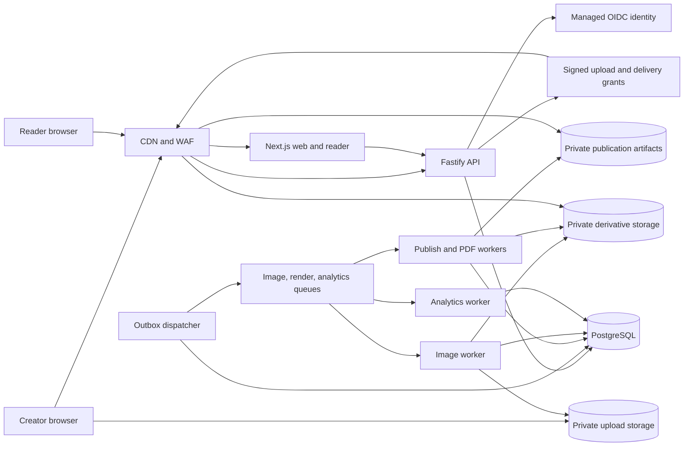
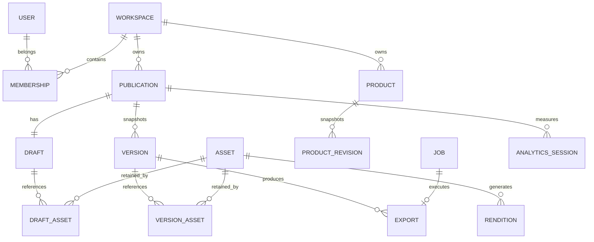

# Flipbook — Technical Design and Implementation Specification

> **Archived — superseded.** This AWS/cloud proposal was replaced by the local-monolith design before implementation. The current design is [docs/TECHNICAL_DESIGN.md](../TECHNICAL_DESIGN.md). Kept for decision history only.

**Status:** Proposed engineering baseline, ready for implementation planning  
**Version:** 1.0 · **Date:** 27 October 2026  
**Product specification:** [Flipbook PRD](../PRD.md)  
**Audience:** Frontend, backend, platform, design, and quality engineering

This document defines the high-level design (HLD), low-level design (LLD), contracts, operational behavior, and implementation sequence for Flipbook. It makes concrete engineering decisions for the PRD’s MVP and describes extension points for later releases. Estimates and service objectives are planning assumptions, not measured results. No application has been implemented or performance-tested as part of this document.

## Contents

1. [Engineering decisions and scope](#1-engineering-decisions-and-scope)
2. [Capacity, limits, and service objectives](#2-capacity-limits-and-service-objectives)
3. [High-level architecture](#3-high-level-architecture)
4. [Technology and deployment choices](#4-technology-and-deployment-choices)
5. [Module boundaries](#5-module-boundaries)
6. [Canonical document and template model](#6-canonical-document-and-template-model)
7. [Layout and rendering rules](#7-layout-and-rendering-rules)
8. [Persistence model](#8-persistence-model)
9. [HTTP API contracts](#9-http-api-contracts)
10. [Editor and autosave implementation](#10-editor-and-autosave-implementation)
11. [Publishing and lifecycle implementation](#11-publishing-and-lifecycle-implementation)
12. [Image upload and processing](#12-image-upload-and-processing)
13. [Reader implementation](#13-reader-implementation)
14. [PDF generation](#14-pdf-generation)
15. [Jobs, retries, and consistency](#15-jobs-retries-and-consistency)
16. [Analytics](#16-analytics)
17. [Identity, isolation, and security](#17-identity-isolation-and-security)
18. [Infrastructure and delivery](#18-infrastructure-and-delivery)
19. [Observability and operations](#19-observability-and-operations)
20. [Verification and release criteria](#20-verification-and-release-criteria)
21. [Implementation sequence](#21-implementation-sequence)
22. [Later-release designs](#22-later-release-designs)
23. [Decision register and remaining product decisions](#23-decision-register-and-remaining-product-decisions)

## 1. Engineering decisions and scope

### 1.1 Recommended architecture

Build a TypeScript modular monolith with separately deployable web, API, and background-worker processes. Use PostgreSQL as the source of truth, object storage for media and generated files, a CDN for delivery, and durable queues for expensive jobs. Deploy one region across two availability zones initially.

The most important design decisions are:

| Decision | Implementation | Reason |
|---|---|---|
| Shared content representation | A versioned JSON document schema used by the editor, reader, and export worker | Avoid separate content implementations drifting apart |
| Shared renderer | React DOM components with fixed-page and reflow modes | Keep text selectable, links functional, and content accessible |
| Safe publishing | Immutable snapshots plus an atomic pointer to the current published version | Draft changes and failed jobs cannot alter live content |
| Editor concurrency | Optimistic concurrency using a draft revision and idempotent save batches | Prevent silent overwrites without introducing real-time collaboration |
| Structured layouts | Template slots backed by a bounded grid; no arbitrary CSS or HTML | Make editing predictable and PDF rendering supportable |
| PDF generation | Isolated Chromium workers using Playwright and the shared fixed-page renderer | Reuse browser typography and page layout |
| Product reuse | Versioned catalog records copied into blocks; explicit refresh later | Published prices and descriptions never change unintentionally |
| Async reliability | Transactional outbox, at-least-once queue delivery, idempotent workers | Recover from crashes between database and queue operations |
| Public delivery | Uncached publication authorization/resolution plus short-lived signed asset URLs | Enforce unpublish without exposing permanent public object URLs |

### 1.2 Scope interpretation and PRD clarifications

These are proposed defaults where the PRD is open or internally broader than its MVP list. They are engineering assumptions, not additional approved product commitments.

| Topic | MVP decision |
|---|---|
| Creator device | Full editing on desktop/tablet at viewport width ≥ 1,024 CSS px; narrow screens show publication library, preview, and export controls with a message to use a larger screen for editing |
| Reader behavior | Paged fixed-layout view on larger screens; reflowed scroll view on phones; reader can choose the readable scroll view on any device |
| Page animation | Simple optional slide transition; realistic page curl is deferred |
| PDF | A4 portrait, RGB, screen-oriented export; no print-production guarantee |
| Publishing visibility | Link-accessible without login; `noindex` by default; public URLs are not confidential links |
| Reader PDF downloads | Enabled in MVP; publisher toggle is reserved for release 1.1 |
| Product actions | External HTTPS product links; no cart or payment integration |
| Products | Manual catalog entry; CSV import is release 1.1, despite appearing in the PRD’s illustrative journey |
| Product details | Product card plus an accessible reader dialog for full description and image gallery |
| Team editing | One owner per workspace at launch; schema includes memberships, but invitations and multi-user editing are deferred |
| History | Retain publish snapshots from MVP for correctness; history/restore UI is release 1.1 |
| Analytics | Views, sessions, depth, engagement time, and product clicks in MVP; “unique readers” is labeled as measurable sessions, not unique people |
| Languages | English UI; Unicode content with curated Latin-script fonts; RTL layouts and broader font coverage require a later template pack |

### 1.3 Invariants

1. Every tenant-owned resource belongs to exactly one workspace; cross-workspace references are rejected.
2. A reader receives one published snapshot and never a mixture of draft and published data.
3. A published version’s document, product values, template revisions, and asset digests are immutable.
4. Every accepted draft mutation increments its revision exactly once; retrying the same mutation does not increment it again.
5. No job is required to run exactly once; duplicate execution must be safe.
6. Publish success is announced only after all required reader artifacts and layout checks succeed and the live pointer is committed.
7. A delayed publish worker cannot reverse a later unpublish, archive, delete, or newer publish request.
8. A PDF is tied to a specific version, render build, and export profile; it never reads the current mutable draft.
9. Removing an asset from a library does not break a retained draft or published version.
10. Authentication failure, render failure, analytics failure, and queue delay never silently discard edits.

## 2. Capacity, limits, and service objectives

### 2.1 Initial planning envelope

| Dimension | Assumption |
|---|---|
| Workspaces | 1,000 initially |
| Publications | 10,000 total; approximately 20 pages per typical publication |
| Active editors | 100 concurrent, burst to 200 |
| Reader sessions | 100,000/day; peak 100 publication-open requests/second |
| Analytics | Approximately 2 million events/day; peak 1,000 events/second |
| PDF demand | 1,000 exports/day; burst 20 jobs/minute |
| Stored assets | Approximately 1 million original/derived objects; actual bytes depend on image reuse |

At 200 editors saving once every two seconds, expect approximately 100 draft writes/second. A 20 KiB typical mutation batch produces about 2 MiB/second of request data. At two million 300-byte analytics payloads/day, payload data alone is approximately 600 MB/day; database rows, indexes, and WAL add overhead. Load and cost measurements must validate these assumptions before production sizing.

### 2.2 Enforced MVP limits

| Resource | Limit and behavior |
|---|---|
| Publication | 100 pages; 50 blocks/page; 2 MiB canonical uncompressed JSON |
| Save batch | 100 operations and 128 KiB request; split larger edits into ordered batches |
| Title / subtitle | 160 / 300 characters |
| Text | 20,000 characters/text block; schema depth ≤ 12; ≤ 2,000 rich-text nodes/block |
| Product | Name 200, summary 500, long description 10,000 characters; maximum 8 images |
| Image | JPEG, PNG, or static WebP; 20 MiB upload; decoded image ≤ 40 megapixels; dimension ≤ 12,000 px |
| Upload concurrency | 3 per creator; 10 outstanding upload reservations/workspace |
| Workspace storage | Initial configurable 10 GiB quota, including originals and retained derivatives; reserve budget before upload |
| Export | Maximum 100 pages; output ≤ 100 MiB; running job hard timeout 180 seconds |
| Mutating API | Default 120 requests/minute/user with burst allowance; dedicated save budget supports one request/second |
| Publish / export | 5 new publish requests/minute/publication; 2 active exports/workspace; at most 10 newly queued exports/hour/workspace |
| Queue admission | 20 pending render jobs/workspace; return 429 with retry guidance beyond quota |

All limits are server-enforced configuration with matching UI messages. Drafts may be incomplete, but they must always be structurally valid and within storage limits. Publishing performs stricter content validation.

### 2.3 Service objectives

| Operation | Initial objective | Measurement |
|---|---|---|
| Creator/reader availability | 99.9% monthly | Synthetic valid requests plus application success ratio |
| Autosave API | p95 ≤ 500 ms, excluding upload time | Server request latency at planning load |
| Unsaved editing window | ≤ 5 seconds while online and healthy | Time since first pending local edit |
| Editor interactive | p75 ≤ 3 seconds | Representative 20-page document on documented device/network profile |
| Reader first meaningful content | p75 ≤ 3 seconds | Real user measurements on a defined mobile profile |
| Reader navigation | p95 ≤ 100 ms after required data/assets load | Client navigation measurements |
| Publish | p95 ≤ 20 seconds for typical 20-page publication | Accepted request to live-pointer commit, including queue wait |
| PDF | p75 ≤ 30 seconds for typical 20-page publication | Accepted request to download-ready, including queue wait |
| Analytics freshness | ≤ 5 minutes under normal load | Accepted event to dashboard aggregate |
| Unpublish | New reader resolution denied after commit; existing signed grants expire within 60 seconds | Authorization and expiration checks |
| Recovery | RPO ≤ 5 minutes; RTO ≤ 4 hours | Restore drill using database and object backups |

“Typical” test fixture: 20 pages, 60 images, ≤ 20 MiB of PDF image renditions, two fonts, and no content beyond the supported limits. These are release targets to measure, not promises that a selected service configuration already achieves them.

## 3. High-level architecture



The API, dispatcher, and workers are deployments of the same backend codebase with explicit module boundaries. Workers own CPU-intensive or asynchronous work; the API handles authorization, validation, and short transactions. PostgreSQL stores authoritative metadata and documents. Object storage contains immutable bytes; it does not decide who can read them.

### 3.1 Request paths and trust boundaries

| Host/path | Destination | Cache/access policy |
|---|---|---|
| `app.example.com/*` | Creator web application | HTML and authenticated data `private, no-store` |
| `app.example.com/api/v1/*` | Creator API | Session cookie, workspace authorization; no shared caching |
| `read.example.com/m/{slug}` | Reader server render | Resolve live publication on every request; `no-store` |
| `read.example.com/api/v1/reader/*` | Reader API | Public but publication/version-gated; `no-store` |
| `media.example.com/*` | Private storage via CDN | Trusted signed URL required on every request; no unsigned fallback |
| `*/_next/static/*` | Versioned application assets | Public immutable caching; contains no publication data |

`example.com` is illustrative; actual domains are deployment configuration. Separate host-only creator cookies from the reader host. The render worker runs with outbound networking restricted to storage and internal services; user-supplied links are never fetched while rendering.

### 3.2 Source of truth and derived state

- PostgreSQL owns users, membership, drafts, product revisions, asset records, publication pointers, job state, and analytics aggregates.
- A version’s database snapshot is authoritative for its content; generated reader manifests, thumbnails, and PDFs are reproducible derivatives.
- Source assets and exact version-referenced derivatives are immutable objects addressed by digest and object version.
- The CDN caches bytes only. It never caches the authorization result for draft access or the current live publication pointer.
- Browser memory and IndexedDB provide local recovery; neither is authoritative for a successfully saved server revision.

## 4. Technology and deployment choices

| Concern | Choice | Implementation notes |
|---|---|---|
| Language | TypeScript, strict mode | Shared DTO/schema package; server-only modules cannot enter browser bundles |
| Web | React with Next.js App Router | Server render reader entry; client components for editor and reader controls |
| API | Fastify | REST, JSON Schema validation, structured errors, generated OpenAPI |
| Validation | Authored JSON Schemas plus generated TypeScript types | Same supported schema subset on client, API, and workers; never compile user-provided schemas |
| Rich text | Tiptap core with restricted extensions | Persist supported JSON nodes; render with an application-owned allowlist |
| Frontend state | Zustand for editor; TanStack Query for server queries | Avoid a second authoritative copy of the document in query cache |
| Layout interactions | dnd-kit plus accessible move/resize controls | Dragging is an optional input method |
| Database | Managed PostgreSQL; `pg` driver and parameterized SQL | SQL migrations, explicit transactions, JSONB documents |
| Media | S3 private buckets and Sharp processing | Originals quarantined; safe derivatives served to readers |
| PDF/preflight | Playwright with bundled Chromium | Pin browser, renderer, fonts, and container digest together |
| Queue | SQS standard queues plus dead-letter queues | Separate render, media, and analytics workloads |
| Identity | Cognito OIDC authorization code flow with PKCE | Managed login; opaque application sessions |
| Runtime | ECS Fargate containers behind ALB and CloudFront | Independent web/API/render/media scaling |
| Infrastructure | Terraform | Separate staging and production accounts/projects and state |
| Telemetry | OpenTelemetry, CloudWatch, structured JSON logs | Correlate request, publication, job, and render build |
| Verification | Vitest, Playwright, axe-core, k6 | Unit, database/integration, browser, accessibility, and load suites |

Select mutually compatible supported stable releases at bootstrap and pin exact versions in the lockfile and image digests. Record the Node.js, PostgreSQL, Next.js/React, Fastify, Tiptap, Playwright/Chromium, Sharp, and font versions in `docs/dependency-baseline.md`. Major upgrades require the renderer compatibility checks in section 20; this design does not depend on a floating `latest` tag.

Next.js supports separating server-rendered content from interactive client components, which fits a light reader and a heavier editor. Fastify supports schema-based request validation and response serialization. These capabilities inform the choices above; the architecture remains an application design decision. [Next.js component boundaries](https://nextjs.org/docs/app/getting-started/server-and-client-components), [Fastify validation](https://fastify.dev/docs/latest/Reference/Validation-and-Serialization/).

### 4.1 Alternatives considered

| Alternative | Reason for the selected approach |
|---|---|
| Separate microservices per domain | Adds distributed transactions and operational overhead before independent ownership or scaling is needed |
| Canvas-only editor/reader | Makes accessible text, selection, search, and PDF semantics harder; DOM rendering fits supported layouts |
| Arbitrary HTML templates | Expands security and fidelity problems; structured slots cover the initial product layouts |
| Generate PDFs synchronously in API requests | Ties browser CPU/memory and job timeouts to user-facing API capacity |
| CRDT collaboration from launch | PRD MVP is single-owner; revision checks solve accidental multi-tab overwrites with less complexity |
| Redis as required infrastructure | PostgreSQL plus durable queues cover launch needs; introduce caching only with measured benefit |

## 5. Module boundaries

| Module | Owns | Calls/contracts |
|---|---|---|
| Identity | User provisioning, sessions, membership checks | OIDC adapter; workspace repository |
| Publications | Metadata, draft mutations, lifecycle | Document validator; references; outbox |
| Catalog | Products and immutable product revisions | Asset ownership validator |
| Assets | Upload reservation, asset state, renditions | Object storage, media queue |
| Templates | Curated template registry and migrations | Shared schema and renderer |
| Publishing | Snapshot creation, preflight, live activation | Renderer, artifact storage, version repository |
| Exports | Export deduplication, status, download grants | Render queue, version repository |
| Reader | Live resolution, version gates, product projection | Publication/version read model, URL signer |
| Analytics | Event admission, deduplication, sessions, aggregates | Analytics queue and dedicated tables |
| Operations | Outbox dispatch, cleanup, reconciliation, reports | Restricted service roles and audit trail |

Modules may share one database but cannot update another module’s tables directly outside approved transaction services. For example, `PublishService` owns the transaction that checks a draft and creates a version and job; the worker cannot bypass publication lifecycle rules by updating a pointer directly.

## 6. Canonical document and template model

### 6.1 Data contracts

The document is content plus constrained presentation data. It never stores raw HTML, executable expressions, signed URLs, storage credentials, or arbitrary CSS. JSON Schemas use `additionalProperties: false`; tagged unions distinguish block types.

```ts
type ID = string; // UUID; generated on client for editor nodes, server for resources
type TemplateRef = { id: string; revision: number };
type GridRect = { column: number; row: number; columns: number; rows: number };
type ImageUse = {
  assetId: ID;
  alt: string;
  decorative: boolean;
  crop: { x: number; y: number; width: number; height: number }; // normalized 0..1
};
type RichText = { type: "doc"; content: RichNode[] };
type RichNode = {
  type: "paragraph" | "heading" | "text" | "bulletList" |
        "orderedList" | "listItem" | "hardBreak";
  text?: string;
  attrs?: { level?: 2 | 3; href?: string };
  marks?: Array<{ type: "bold" | "italic" | "link"; attrs?: { href: string } }>;
  content?: RichNode[];
}; // The actual schema constrains attributes by node/mark type.
type ProductContent = {
  name: string;
  summary: string;
  description: RichText;
  images: ImageUse[];
  price: null | { minorUnits: string; currency: string };
  sku: string | null;
  category: string | null;
  badge: string | null;
  destinationUrl: string | null;
};
type BlockBase = {
  id: ID;
  slotId: string;
  rect: GridRect;
  style: { colorToken: string; backgroundToken: string; textSize: "sm" | "md" | "lg" };
};
type Block = BlockBase & (
  | { type: "text"; content: RichText }
  | { type: "image"; content: ImageUse | null }
  | { type: "product"; content: ProductContent;
      source: { productId: ID; revision: number } | null }
  | { type: "button"; label: string; href: string }
  | { type: "divider" }
);
type MagazinePage = {
  id: ID;
  title: string;
  template: TemplateRef;
  blocks: Block[]; // Array order is the semantic/reading order.
};
type MagazineDocument = {
  schemaVersion: 1;
  metadata: { title: string; subtitle: string; publisher: string; language: "en";
              cover: ImageUse | null };
  theme: { id: string; revision: number };
  pageFormat: "A4_PORTRAIT";
  pages: MagazinePage[];
};
```

These TypeScript types illustrate the contract; the checked-in JSON Schemas are authoritative. Each rich-text node must have the correct shape: text nodes cannot have children; headings require level 2/3; links require a validated HTTPS URL; all other attributes are rejected. Empty image slots and missing product fields may exist in drafts and must be resolved before publish.

### 6.2 Product values and identity

- Money is an integer minor-unit string plus a validated currency code. Use a versioned currency-exponent table; never assume all currencies have two decimals or calculate with floating point. Enforce non-negative values within signed 64-bit storage range.
- Selecting a catalog product copies its current revision into the block’s `content`. The `source` is provenance, not a live lookup at render time.
- Editing an embedded product changes that block only. The UI offers a distinct action to edit the catalog record; no implicit write-through occurs.
- Readers see full product content in a detail dialog. Fixed-page/PDF cards render name, summary, primary image, optional price, badge, and CTA. Long description and gallery remain visible in the digital detail dialog; a creator must add a product-feature page to include extended details in the PDF. Preview explicitly identifies this difference.
- Default CTA text is “View product.” Missing URL means no CTA; a price or URL is not required to publish. A product name, summary, and at least one ready image are required.
- Same catalog product used twice gets two block IDs; analytics records placement using block ID and can also aggregate by source product ID.

### 6.3 Templates

Each template revision is a code-reviewed registry entry containing page format, slot definitions, permitted block types, initial grid rectangles, minimum sizes, image aspect ratios, text budgets, and mobile reading order. Theme revisions identify immutable font files and color/type/spacing tokens.

| Template | Initial composition | Constraints |
|---|---|---|
| Cover | Hero image, title, subtitle, publisher | One title; optional image only if template variant permits |
| Product feature | Large image/product block, summary, detail text | One featured product; explicit optional story area |
| Product grid | 2, 4, or 6 product cards | Card dimensions follow selected count; reflows to one column on phones |
| Editorial/story | Heading, body, image, caption | Body must fit fixed-page area; editor offers another page on overflow |
| Category divider | Heading, supporting copy, background image | Background image may be decorative |
| Closing/contact | Text, image/logo slot, action buttons | HTTPS links in MVP; no form or arbitrary embeds |
| Blank | Empty 12-column grid with accessible reading order | Add supported blocks; same bounds and overlap rules |

New registry revisions never mutate existing definitions. A page remains pinned to its template revision. “Change template” creates an explicit document edit, maps compatible slots, and asks the creator to review unmapped blocks before applying. Undo restores the old page atomically.

Tiptap supports JSON persistence; Flipbook uses a restricted subset and an application renderer so arbitrary editor extensions cannot expand published content unexpectedly. [Tiptap content persistence](https://tiptap.dev/docs/guides/output-json-html).

## 7. Layout and rendering rules

### 7.1 Fixed-page coordinates

The canonical page is A4 portrait: 210 × 297 mm. Use a 12 mm safe inset, leaving a 186 × 273 mm content area. Layout uses 12 columns and 36 rows with a 2 mm gap. Track size is `(available - totalGaps) / trackCount`; rectangles use zero-based integer starts and positive spans, fully inside the grid.

Blocks render as positioned DOM regions from these rectangles. Resizing snaps to whole tracks and respects slot minimums. Foreground rectangles cannot overlap in MVP; the page background is a separate theme/image layer. Dropping a block into an occupied area is rejected with an accessible explanation. Semantic reading order is maintained separately through the block array and can be changed using move-up/down controls.

For a browser preview, render the canonical page at its natural CSS dimensions and scale the enclosing surface to fit. Convert drag coordinates through the inverse scale before calculating grid positions. Do not save viewport pixels or zoom level in document content. The PDF uses the same physical dimensions without a preview scale transform.

### 7.2 Mobile/reflow mode

At widths below 768 CSS px, use semantic DOM in reading order with automatic height. Remove fixed positioning and fixed page height; show page separators/titles and maintain the same logical page IDs. Product grids collapse to one column. Images preserve their selected crop and aspect ratio with responsive widths. Text remains at least 16 CSS px for body content.

The reader can select scroll mode on larger screens. Paged mode offers zoom and a clearly accessible switch to scroll mode. Neither mode changes page content or page count. Phone layout fidelity means identical content, theme, crop, and order; it does not mean a scaled-down A4 page.

### 7.3 Renderer contract

```ts
renderDocument({
  document,
  assets,       // immutable asset metadata and a mode-specific URL resolver
  registry,     // exact template/theme revisions
  mode,         // "editor" | "reader-fixed" | "reader-flow" | "pdf"
  renderBuild,  // immutable renderer/font bundle identifier
});
```

The shared package returns semantic React elements. Editor selection handles and reader navigation are wrappers around rendered content. Server output escapes strings; links pass through a shared URL allowlist. Render output has stable `data-page-id` and `data-block-id` attributes for diagnostics and automated assertions.

### 7.4 Overflow, image crop, and font behavior

- Rich text never silently shrinks, truncates, or flows to another page in fixed mode. Measure each region after fonts and images finish loading; overflow blocks publish/PDF export with page/block IDs and remediation text.
- Images may deliberately clip inside their crop viewport; this is distinct from text overflow. Store normalized crop rectangles, validate `x + width ≤ 1` and `y + height ≤ 1`, and apply the same crop transform in every renderer.
- Product-card subregions have explicit sizes. Long summaries or names fail layout validation; the creator can shorten copy, select another layout, or use a feature page.
- Layout checks include horizontal overflow, vertical overflow, page boundaries, missing glyphs for supported fonts, and unrenderable asset references.
- Fonts are curated, self-hosted, licensed for web embedding and PDF embedding, and bundled with the render build. Missing fonts fail preflight rather than falling back silently.
- Server preflight is authoritative. Client measurements provide fast feedback but cannot approve publication by themselves.

## 8. Persistence model

### 8.1 Modeling decisions

Store the mutable publication document as one bounded JSONB value. Pages and blocks are embedded objects with stable IDs, not separate relational rows in MVP. A document-level revision provides atomic changes spanning multiple blocks/pages. This deliberately refines the PRD’s conceptual Page/Block entities into embedded persistence.

Normalize identity, membership, assets, product revisions, publication versions, jobs, and reference indexes. This supports tenant isolation, integrity checks, queries, and safe cleanup. PostgreSQL document updates rewrite data and create WAL; the 2 MiB document limit and measured save workload are important. Split pages into separate rows only if profiling establishes a need and document-wide transaction semantics are preserved.

### 8.2 Entity relationships



### 8.3 Table contracts

IDs are UUIDs. Timestamps are UTC `timestamptz`. Tenant tables include `workspace_id NOT NULL`; their foreign keys include that workspace ID. `created_at` defaults to database time. “JSON” below means validated JSONB; validation runs in the domain service and rejects unsupported schema versions.

| Table | Required columns beyond tenant ID | Keys, indexes, and notes |
|---|---|---|
| `users` | `id`, `issuer`, `subject`, `email`, `display_name`, `created_at`, `disabled_at?` | PK `id`; unique `(issuer,subject)`; identity is not keyed by email |
| `workspaces` | `id`, `name`, `storage_limit_bytes`, `reserved_bytes`, `used_bytes`, `created_at`, `deleted_at?` | PK `id`; byte counters non-negative; reserve under row lock |
| `memberships` | `user_id`, `role`, `created_at`, `revoked_at?` | PK `(workspace_id,user_id)`; role `owner/editor/viewer`; index active memberships by user |
| `sessions` | `token_hash`, `user_id`, `csrf_secret`, `created_at`, `last_seen_at`, `idle_expires_at`, `absolute_expires_at`, `revoked_at?` | No workspace ID: user session spans memberships; PK token hash; index expiry and user |
| `publications` | `id`, `slug`, `library_title`, `state`, `current_version_id?`, `generation`, `created_by`, `created_at`, `updated_at`, `deleted_at?` | Unique slug; PK `(workspace_id,id)`; index `(workspace_id,updated_at DESC,id)` |
| `publication_drafts` | `publication_id`, `revision`, `document`, `document_hash`, `updated_by`, `updated_at` | PK `(workspace_id,publication_id)`; document ≤ 2 MiB; revision starts at 1 |
| `publication_versions` | `id`, `publication_id`, `version_number`, `draft_revision`, `requested_generation`, `document`, `document_hash`, `schema_version`, `render_build`, `state`, `manifest_key?`, `error_code?`, `requested_by`, `created_at`, `activated_at?` | PK `(workspace_id,id)`; unique `(workspace_id,publication_id,version_number)`; version number allocated under publication lock |
| `assets` | `id`, `state`, `original_key`, `original_object_version?`, `original_sha256?`, `declared_bytes`, `actual_bytes?`, `mime?`, `width?`, `height?`, `created_by`, `created_at`, `deleted_at?`, `error_code?` | PK `(workspace_id,id)`; index workspace/date and state; originals immutable after finalization |
| `asset_renditions` | `asset_id`, `profile`, `object_key`, `object_version`, `sha256`, `bytes`, `width`, `height`, `mime` | PK `(workspace_id,asset_id,profile)`; profile includes processor build version |
| `draft_assets` | `publication_id`, `asset_id` | PK all columns; FKs to draft and asset; rebuilt in each successful draft mutation |
| `version_assets` | `version_id`, `asset_id`, `rendition_profile`, `object_key`, `object_version`, `sha256` | PK `(workspace_id,version_id,asset_id,rendition_profile)`; exact immutable rendition reference |
| `products` | `id`, `current_revision`, `created_at`, `updated_at`, `deleted_at?` | PK `(workspace_id,id)`; current revision FK deferred to revision row |
| `product_revisions` | `product_id`, `revision`, `content`, `created_by`, `created_at` | PK `(workspace_id,product_id,revision)`; immutable content; source links remain valid after product archival |
| `product_revision_assets` | `product_id`, `revision`, `asset_id` | PK all columns; retains assets required by retained catalog revisions |
| `jobs` | `id`, `kind`, `resource_id`, `state`, `attempt`, `lease_token?`, `lease_until?`, `next_attempt_at?`, `progress`, `error_code?`, `created_at`, `updated_at`, `completed_at?` | PK `(workspace_id,id)`; index `(kind,state,next_attempt_at)`; state machine in section 15 |
| `exports` | `id`, `version_id`, `profile_hash`, `render_build`, `state`, `job_id`, `object_key?`, `object_version?`, `sha256?`, `bytes?`, `created_by`, `created_at` | Unique `(workspace_id,version_id,profile_hash,render_build)`; no duplicate finished export for same inputs |
| `outbox` | `id`, `workspace_id`, `event_type`, `payload`, `created_at`, `dispatched_at?`, `lease_until?`, `attempts` | Global PK `id`; partial index on pending dispatch; payload has IDs, not entire documents |
| `idempotency_records` | `actor_id`, `route_key`, `key`, `request_hash`, `status_code`, `response`, `created_at`, `expires_at` | PK `(workspace_id,actor_id,route_key,key)`; response committed with business mutation; retain 7 days |
| `audit_log` | `id`, `actor_id?`, `action`, `resource_type`, `resource_id`, `request_id`, `details`, `created_at` | Append-only; redact tokens/content; index resource/date; 90-day initial retention |
| `analytics_events` | `received_day`, `event_id`, `publication_id`, `version_id`, `session_id`, `type`, `page_id?`, `block_id?`, `active_ms?`, `received_at` | Daily partitions; PK `(received_day,event_id)`; session/time index; 30-day retention |
| `analytics_event_dedup` | `event_id`, `expires_at` | Global unique event ID for seven days, preventing cross-day retries from duplicating events |
| `analytics_sessions` | `publication_id`, `version_id`, `session_id`, `started_day`, `started_at`, `last_seen_at`, `viewed_page_ids`, `active_ms`, `clicked`, `completed` | PK `(workspace_id,publication_id,version_id,session_id)`; 30-day retention |
| `analytics_daily` | `publication_id`, `version_id`, `day`, `views`, `sessions`, `engaged_sessions`, `active_ms`, `page_depth_sum`, `completed_sessions`, `product_clicks` | PK `(workspace_id,publication_id,version_id,day)`; retain 13 months; recomputed idempotently |
| `content_reports` | `id`, `publication_id`, `reason`, `details?`, `state`, `created_at`, `resolved_at?` | Public input creates report only; restricted operations role can read/review |

Use opaque JSON fields only for document-like structures and job/error detail. State, ownership, timestamps, and query dimensions have explicit columns and indexes. No broad GIN index on entire publication documents is needed for MVP.

### 8.4 Critical constraints and transaction pattern

The following SQL illustrates the required core constraints; migrations must also implement the remaining table contracts, access grants, policies, and indexes above.

```sql
CREATE TABLE publications (
  workspace_id uuid NOT NULL REFERENCES workspaces(id),
  id uuid NOT NULL,
  slug text NOT NULL UNIQUE,
  library_title text NOT NULL,
  state text NOT NULL CHECK (state IN ('active','archived','deleted')),
  current_version_id uuid,
  generation bigint NOT NULL DEFAULT 0,
  created_by uuid NOT NULL REFERENCES users(id),
  created_at timestamptz NOT NULL DEFAULT now(),
  updated_at timestamptz NOT NULL DEFAULT now(),
  deleted_at timestamptz,
  PRIMARY KEY (workspace_id,id)
);

CREATE TABLE publication_drafts (
  workspace_id uuid NOT NULL,
  publication_id uuid NOT NULL,
  revision integer NOT NULL DEFAULT 1 CHECK (revision > 0),
  document jsonb NOT NULL,
  document_hash text NOT NULL,
  updated_by uuid NOT NULL REFERENCES users(id),
  updated_at timestamptz NOT NULL DEFAULT now(),
  PRIMARY KEY (workspace_id,publication_id),
  FOREIGN KEY (workspace_id,publication_id)
    REFERENCES publications(workspace_id,id),
  CHECK (jsonb_typeof(document) = 'object'),
  CHECK (octet_length(document::text) <= 2097152)
);

CREATE TABLE publication_versions (
  workspace_id uuid NOT NULL,
  id uuid NOT NULL,
  publication_id uuid NOT NULL,
  version_number integer NOT NULL CHECK (version_number > 0),
  draft_revision integer NOT NULL,
  requested_generation bigint NOT NULL,
  document jsonb NOT NULL,
  document_hash text NOT NULL,
  schema_version integer NOT NULL,
  render_build text NOT NULL,
  state text NOT NULL CHECK (state IN ('building','ready','failed','superseded')),
  manifest_key text,
  error_code text,
  requested_by uuid NOT NULL REFERENCES users(id),
  created_at timestamptz NOT NULL DEFAULT now(),
  activated_at timestamptz,
  PRIMARY KEY (workspace_id,id),
  UNIQUE (workspace_id,publication_id,id),
  UNIQUE (workspace_id,publication_id,version_number),
  FOREIGN KEY (workspace_id,publication_id)
    REFERENCES publications(workspace_id,id)
);

ALTER TABLE publications ADD CONSTRAINT current_version_same_publication
  FOREIGN KEY (workspace_id,id,current_version_id)
  REFERENCES publication_versions(workspace_id,publication_id,id)
  DEFERRABLE INITIALLY DEFERRED;

CREATE INDEX publications_workspace_updated
  ON publications(workspace_id,updated_at DESC,id)
  WHERE deleted_at IS NULL;
```

Use triggers or restricted update functions to prevent updates to immutable version content/hash/build fields and product-revision content. State transitions remain mutable through the owning service. Application transitions additionally require the pointed version to be `ready`; a database trigger enforces that constraint and requires `current_version_id IS NULL` for archived/deleted publications.

Transactions lock in this order when applicable: workspace quota → publication → draft → job → assets in UUID order. Keep network/storage calls outside database transactions. Use `READ COMMITTED` with explicit row locks and conditional revision/generation updates; retry deadlock/serialization failures at most three times with jitter and the same idempotency key. PostgreSQL isolation behavior makes explicit conflict handling necessary. [PostgreSQL transaction isolation](https://www.postgresql.org/docs/current/transaction-iso.html).

### 8.5 Tenant access and RLS

The API authenticates the session, verifies an active membership and permitted role, and opens a transaction. It sets the verified workspace as a transaction-local setting, never from an unchecked request header.

```sql
-- Run on the same checked-out connection inside BEGIN/COMMIT.
SELECT set_config('app.workspace_id', $1, true);

ALTER TABLE publication_drafts ENABLE ROW LEVEL SECURITY;
ALTER TABLE publication_drafts FORCE ROW LEVEL SECURITY;
CREATE POLICY workspace_isolation ON publication_drafts
  USING (workspace_id = nullif(current_setting('app.workspace_id', true),'')::uuid)
  WITH CHECK (workspace_id = nullif(current_setting('app.workspace_id', true),'')::uuid);
```

Apply equivalent policies to every tenant table. The runtime database role must not own tables, be superuser, or have `BYPASSRLS`; migration credentials are separate. RLS isolates tenants but does not replace role authorization. Connection-pool reuse cannot retain tenant settings because they are transaction-local. PostgreSQL documents both default-deny behavior and owner/bypass exceptions; those exceptions must be covered in integration checks. [PostgreSQL row security](https://www.postgresql.org/docs/current/ddl-rowsecurity.html).

Public reader access uses a separate read role with execute permission only on narrowly scoped functions such as `resolve_live_publication(slug)` and `resolve_live_asset(slug, version_id, asset_id, profile)`. The functions enforce active state, current version, and reference membership, return only reader-safe fields, use a fixed search path, and are not granted to `PUBLIC`. Background jobs use dedicated roles and set a workspace derived from the trusted job row. They cannot use a queue-supplied workspace alone to authorize arbitrary resources.

### 8.6 Retention and deletion

- Draft reference rows are updated atomically with each draft mutation. Version/product reference rows retain exact assets independently of library visibility.
- Asset deletion is initially a soft removal from the picker; referenced objects remain readable to authorized publications.
- Publication deletion immediately revokes live access, cancels activation of queued jobs, and starts a 30-day recovery window. There is no user-facing restore UI in MVP; authorized support can restore the draft during that window with an audit record.
- After the window, purge publication rows/artifacts and version references in dependency order. Garbage collection deletes assets only when no draft, retained product revision, retained publication version, active job, or pending upload references them.
- Garbage collection is a mark-and-recheck process with a 24-hour delay; reference creation locks the asset and rejects `purging` state. Never rely on a stale reference count alone.
- Upload reservations expire after one hour; quarantined abandoned bytes are removed within 24 hours. Reconcile quota counters daily against object inventory and database records.
- Backups retain deleted content until their configured expiration; the UI/privacy documentation must describe that operational retention.

## 9. HTTP API contracts

### 9.1 Conventions

- JSON REST under `/api/v1`. Tenant routes start `/workspaces/{workspaceId}`. Authentication derives the user; the workspace path is verified against membership.
- Success returns `{ data, requestId }`; list data includes `{ items, nextCursor }`. Default page size 25, maximum 100; stable cursor encodes `(updated_at,id)` for publication lists.
- Times are ISO 8601 UTC strings. Money and byte counts that can exceed JavaScript’s safe integer range use decimal strings. Draft and product revision counters use bounded integers.
- Create/command endpoints require `Idempotency-Key: <UUID>`; the scope is workspace, actor, and route/resource. Retain results seven days. The same key with a different canonical body hash returns `409 IDEMPOTENCY_KEY_REUSED`.
- Reads return ETags where useful; mutable API and reader payloads use `Cache-Control: private, no-store` or public-path `no-store`. ETags support revision preconditions, not shared caching.
- Error bodies contain stable codes and field locations; no stack traces, SQL, credentials, or private object keys.
- OpenAPI is generated from the authoritative route schemas during CI and used to generate the typed web client. Breaking changes require `/v2` or a backward-compatible migration window.

```json
{
  "error": {
    "code": "DRAFT_REVISION_CONFLICT",
    "message": "This publication changed in another session.",
    "retryable": false,
    "details": { "expectedRevision": 17, "actualRevision": 18 }
  },
  "requestId": "req_example"
}
```

### 9.2 Endpoint inventory

In the following tables, `W` means `/workspaces/{workspaceId}`, `P` means `W/publications/{publicationId}`. These are documentation abbreviations, not literal routes.

| Method and route | Request | Response / behavior |
|---|---|---|
| `GET /auth/login` | Optional allowlisted return path | 302 to OIDC login; state, nonce, PKCE |
| `GET /auth/callback` | Authorization code and state | Validate exchange, create session, 302 to app |
| `POST /auth/logout` | CSRF header | Revoke session, expire cookie, 204 |
| `GET /me` | Session | User and active workspaces; CSRF token |
| `GET W/publications` | `cursor`, `limit`, `status`, `q` | Paginated library; `q` title search capped at 100 chars |
| `POST W/publications` | `{ title, themeId, themeRevision, initialTemplateId }` | 201 publication + empty/initial draft; generated stable slug |
| `GET P` | — | Library metadata, draft revision, live version, latest job status |
| `GET P/draft` | — | Full document, revision, hash, ETag |
| `POST P/draft/mutations` | Batch in section 9.3 | 200 accepted revision; stale precondition returns 412 |
| `POST P/duplicate` | `{ source: "draft" | "published", title }` | 201 new draft-only publication and slug; copy document, regenerate page/block IDs, preserve asset references within workspace |
| `POST W/publications/recover` | `{ title, document, sourcePublicationId }` | 201 draft from local recovery after full validation; cannot introduce cross-workspace assets |
| `POST P/validate` | `{ expectedRevision }` | 200 structural/content findings with paths; client layout results are advisory |
| `POST P/publish` | `{ expectedRevision }` | 202 `{ versionId, jobId, capturedRevision }` |
| `POST P/unpublish` | Empty object | 200 lifecycle state; generation increment and pointer revoked |
| `POST P/archive` | Empty object | 200 archived; also unpublishes |
| `POST P/unarchive` | Empty object | 200 active draft; does not republish |
| `DELETE P` | Confirmed UI action, idempotency key | 202 soft-delete and asynchronous cleanup |
| `GET W/templates` | `pageFormat`, optional `category` | Curated immutable template/theme definitions and thumbnails |
| `GET W/products` | `cursor`, `limit`, `q` | Product summary and current revision |
| `POST W/products` | `{ content: ProductContent }` | 201 product with revision 1 |
| `GET W/products/{productId}` | Optional revision | Product revision content |
| `PUT W/products/{productId}` | `{ expectedRevision, content }` | 200 new immutable revision; 409 if outdated |
| `DELETE W/products/{productId}` | — | 204 soft-remove from catalog; existing blocks unchanged |
| `GET W/assets` | Optional `publicationId`, cursor | Ready workspace assets; MVP UI filters to publication-relevant/recent assets |
| `POST W/assets/uploads` | `{ fileName, bytes, declaredMime }` | 201 asset ID + constrained upload POST fields, 5-minute expiry |
| `POST W/assets/{assetId}/complete` | `{ uploadedObjectVersion }` | 202 image-processing job after server HEAD verification |
| `GET W/assets/{assetId}` | — | Upload/processing status, dimensions, signed preview URLs when ready |
| `DELETE W/assets/{assetId}` | — | 204 soft-remove; reference-aware retention |
| `POST P/exports` | `{ versionId, profile: "screen-a4-v1" }` | 202 queued or 200 existing ready export |
| `GET W/exports/{exportId}` | — | Status, stage, error, estimated queue information if available |
| `POST W/exports/{exportId}/retry` | Empty object | 202 same export, new attempt after retryable/cleared error |
| `GET W/exports/{exportId}/download` | — | 302 to 60-second signed URL after owner/member authorization |
| `GET W/jobs/{jobId}` | — | Job stage, attempts, progress, structured error |
| `GET P/analytics` | `from`, `to` in UTC dates; maximum 366 days | Aggregate views/sessions/depth/clicks and freshness timestamp |

| Public reader route | Request | Response / behavior |
|---|---|---|
| `GET /reader/publications/{slug}` | — | Current manifest, initial signed image URLs, reader event token; 404 if unavailable |
| `GET /reader/publications/{slug}/versions/{versionId}/pages/{pageId}` | — | Generated page fragment and referenced asset metadata; current-version gate |
| `POST /reader/publications/{slug}/assets/resolve` | `{ versionId, assetIds: [...] }`, max 50 | Fresh signed URLs only for assets referenced by this current published version |
| `GET /reader/publications/{slug}/pdf` | — | 302 if current PDF ready; 202 retry-after/status if generation ongoing; 404 if unavailable |
| `POST /reader/events` | `{ token, events: [...] }`, max 20 / 16 KiB | 202 after durable queue admission; 429 rate limit; 503 if queue unavailable |
| `POST /reader/publications/{slug}/reports` | `{ reason, details? }`, bounded text | 202 report receipt; rate limiting; no reporter account required |

Reader PDF requests never create unbounded jobs. Successful publish queues one default PDF generation; reader requests inspect that job. A failed generation shows a temporary-unavailable state; creator/operator controls retry.

### 9.3 Mutation contract

`POST P/draft/mutations` requires `If-Match: "draft-17"` and an idempotency key matching `mutationId`. The server requires the body’s `baseRevision` to match that ETag. Missing precondition returns 428; a stale precondition returns 412 with `DRAFT_REVISION_CONFLICT`.

```json
{
  "mutationId": "5d9061ad-fbdf-4c03-86aa-bb21b423cc51",
  "baseRevision": 17,
  "operations": [
    {
      "op": "setMetadata",
      "value": {
        "title": "Spring Collection",
        "subtitle": "Products for everyday living",
        "publisher": "Example Brand",
        "language": "en",
        "cover": null
      }
    },
    {
      "op": "movePage",
      "pageId": "376175d2-39d1-45f7-b1ec-96e13637080a",
      "beforePageId": null
    }
  ]
}
```

Supported operations are `setMetadata(value)`, `setTheme(value)`, `insertPage(page,beforePageId)`, `replacePage(pageId,page)`, `removePage(pageId)`, `movePage(pageId,beforePageId)`, `insertBlock(pageId,block,beforeBlockId)`, `replaceBlock(pageId,blockId,block)`, `removeBlock(pageId,blockId)`, and `moveBlock(pageId,blockId,beforeBlockId)`. A null `before...Id` appends. IDs must exist where referenced, and replace operations cannot change identity. Duplicating a page is an insertion with new page/block IDs. Reordering uses IDs rather than array-index patches.

Operations are applied sequentially to one in-memory copy and committed atomically. The resulting document must pass structural/schema, ownership, bounds, identity-uniqueness, and size validation. Do not persist partially successful batches. Full semantic completeness and font-measured overflow are publish checks.

```json
{
  "data": {
    "mutationId": "5d9061ad-fbdf-4c03-86aa-bb21b423cc51",
    "revision": 18,
    "documentHash": "sha256:canonical-document-hash",
    "savedAt": "2026-10-27T10:00:00Z"
  },
  "requestId": "req_example"
}
```

### 9.4 Errors and validation findings

| HTTP | Code examples | Client action |
|---|---|---|
| 400 | `INVALID_JSON`, `INVALID_OPERATION` | Correct request; no automatic retry |
| 401 | `SESSION_EXPIRED` | Preserve local changes, reauthenticate |
| 403 | `ACTION_FORBIDDEN`, `CSRF_INVALID` | Explain permission/session problem |
| 404 | `RESOURCE_NOT_FOUND`, `PUBLICATION_UNAVAILABLE` | Do not reveal another tenant’s resource existence |
| 409 | `PUBLICATION_ARCHIVED`, `IDEMPOTENCY_KEY_REUSED`, `PRODUCT_REVISION_CONFLICT`, `VERSION_CHANGED` | Refresh state or resolve conflict; never blindly repeat an overwrite |
| 412 / 428 | `DRAFT_REVISION_CONFLICT` / `REVISION_REQUIRED` | Pause saves and resolve concurrency / provide precondition |
| 413 | `DOCUMENT_TOO_LARGE`, `UPLOAD_TOO_LARGE` | Explain exact limit |
| 422 | `CONTENT_INVALID`, `ASSET_NOT_READY`, `LAYOUT_OVERFLOW`, `SCHEMA_UNSUPPORTED` | Highlight page/block or field |
| 429 | `QUOTA_EXCEEDED`, `RATE_LIMITED` | Respect `Retry-After`; keep local edits |
| 503 | `DEPENDENCY_UNAVAILABLE` | Retry eligible requests with same idempotency key |

A validation finding is `{ code, severity: "error" | "warning", path, pageId?, blockId?, message, suggestedAction }`. Publish blocks on errors. Warnings such as low effective image resolution or unusually long copy require review but do not invent invalid state. URL syntax checks reject unsafe protocols; they do not claim that an external merchant URL is reachable or that a price is current.

## 10. Editor and autosave implementation

### 10.1 Component and state structure

```text
EditorRoute
  EditorProvider(document, serverRevision, permissions)
    EditorToolbar: title, save status, undo, redo, preview, publish
    PageRail: thumbnails, add, duplicate, reorder, delete
    CanvasViewport: fit, zoom, selected page
      SharedPageRenderer
      SelectionOverlay / ResizeHandles
    Inspector: selected block properties, products, image crop
    TemplatePicker / AssetPicker / ProductPicker
    ValidationPanel / ConflictDialog / PublishStatus
```

Zustand holds the editable document, selection, zoom, undo history, pending operations, in-flight batch, server revision, and save status. Keep UI state outside the persisted document. TanStack Query manages product/asset lookups and job polling; it must not overwrite an actively edited document through automatic refetch.

Render only the selected editor page plus lightweight page thumbnails. A thumbnail is a cached generated image or a lazily rendered small preview; do not mount 100 rich-text editors. Instantiate a Tiptap editor only for the active text block and tear it down cleanly on selection changes.

### 10.2 Save state machine

States: `clean → dirty → saving → clean`, with `offline`, `retrying`, `conflict`, and `auth-required` branches. Changes typed during `saving` create a new pending batch without modifying the frozen in-flight batch.

1. Each user gesture emits a semantic edit transaction and its inverse. Update the local document immediately.
2. Persist the local snapshot, base server revision, and unacknowledged batches to IndexedDB after a 250 ms debounce.
3. Debounce network save by 800 ms, with a maximum five-second wait from the first pending edit. Flush on page switch, preview, or publish; do not rely on unload requests.
4. Coalesce repeated edits to the same block when safe. Only one network mutation batch per publication/editor session may be in flight.
5. Freeze operations, `baseRevision`, body hash, and `mutationId` before sending. New edits remain pending.
6. On success, advance the acknowledged server revision, remove only the acknowledged batch, and send pending work with the new base revision.
7. On an ambiguous timeout, retry the exact same body/key. Server idempotency lookup occurs before stale-revision evaluation so a lost response is safely replayed.
8. On transient failure, retry after 1, 2, 4, 8, then at most 30 seconds with jitter; use `Retry-After` when present. Show the pending edit state throughout.
9. On conflict, stop automatic saves, preserve local work, fetch the current server document, and show explicit choices: use server copy, save local work as a new publication, or download the local recovery JSON. Do not auto-merge rich text or use last-write-wins.
10. On session expiry, keep the recovery record, complete sign-in, then compare the server revision before resuming.

IndexedDB is partitioned by user/workspace/publication/editor-session ID. Recovery only appears to the same authenticated user. Remove acknowledged recovery records after clean close or seven days; logout clears local drafts after a clear prompt when unsaved work exists. Local storage is a best-effort recovery layer, so show a warning if browser storage is unavailable or full.

### 10.3 Server save transaction

```text
authenticate; authorize workspace editor action; validate request shape
BEGIN
  acquire idempotency scope/key (serialize competing identical requests)
  if result exists: verify request hash, return stored result after COMMIT
  lock publication; reject archived/deleted
  lock draft; compare If-Match/baseRevision
  apply all operations to existing document
  validate resulting schema, template constraints, IDs, workspace references
  update document + hash; increment revision once
  refresh draft_assets; update library_title and publication updated_at
  store idempotency result in this transaction
COMMIT
return accepted revision
```

Implement key serialization using a unique idempotency row inserted within the same transaction; concurrent insert waits for the winning transaction, then reads its committed result. Rollbacks leave no successful result. Do not leave a permanently “in-progress” idempotency record after an aborted transaction.

### 10.4 Undo, redo, and multi-tab behavior

- Maintain one editor history, maximum 100 transactions or 10 MiB, whichever comes first. Coalesce typing within 500 ms; commit on blur, command, or selection change. Respect IME composition boundaries.
- Undo and redo emit normal saveable mutations. They do not decrement server revisions. Disable Tiptap’s independent history stack when integrating transactions with global history.
- Image uploads cannot be undone as network operations; undo removes the block reference. Unreferenced assets remain available in the picker and later cleanup rules apply.
- Use `BroadcastChannel` to inform same-browser tabs that another tab is editing. Offer read-only/open-anyway behavior, but rely on server revision checks for correctness across tabs/devices.
- Reload recovery compares stored base revision with the server. If equal, replay unsaved operations; if unequal, invoke the conflict UI. Never overwrite the server silently.
- Preview can show local unsaved content with an explicit status. Publish is disabled until all local edits are acknowledged; the request specifies that acknowledged revision.

## 11. Publishing and lifecycle implementation

### 11.1 Separate lifecycle dimensions

`publications.state` is `active`, `archived`, or `deleted`. A publication is live only when state is active and `current_version_id` points to a ready version. “Draft” and “Published” in the library are derived labels. A published publication can simultaneously have unpublished draft changes and a publish job in progress.

Version states are `building → ready`, `building → failed`, or `building → superseded`. Ready historical versions remain ready but are not publicly reachable through the current reader gate. New publish requests use monotonically increasing publication `generation` values. Unpublish, archive, and delete increment generation too. A generation is a fencing token that prevents late worker activation.

### 11.2 Publish sequence

```mermaid
sequenceDiagram
    participant E as Editor
    participant A as API
    participant D as PostgreSQL
    participant Q as Outbox and Queue
    participant W as Publish Worker
    participant S as Private Storage
    E->>A: Publish expectedRevision and idempotency key
    A->>D: Lock publication and draft; validate revision
    A->>D: Increment generation; capture immutable version
    A->>D: Insert job, version asset references, outbox, result
    D-->>A: Commit
    A-->>E: 202 versionId and jobId
    Q->>D: Claim pending outbox message
    Q->>W: Deliver publish job
    W->>D: Acquire fenced job lease; read snapshot
    W->>W: Render, check overflow, produce page artifacts
    W->>S: Upload immutable artifacts and verify digests
    W->>D: Lock publication; compare generation and lease
    alt Still active and generation matches
        W->>D: Mark ready; swap live pointer; enqueue default PDF
        W-->>E: Status polling observes success
    else A later lifecycle action won
        W->>D: Mark superseded; do not activate
    end
```

### 11.3 Snapshot transaction

1. Authenticate and authorize publish. Resolve idempotency before revision checks.
2. Lock publication and draft. Require active lifecycle and the requested saved revision.
3. Run schema and publish-content validation: title/publisher, at least one page, required template slots, product required fields, valid links, image readiness, alt text or decorative flag, and permitted template/theme revisions.
4. Lock referenced assets in stable order, reject deleted/purging/unready assets for new publication, and capture exact rendition digests/object versions. Existing already-published versions retain soft-deleted assets.
5. Copy the draft, including all embedded product values, into a version. Assign a version number and approved render build; canonicalize and hash content deterministically.
6. Increment publication generation. Store the captured generation in the version. Insert asset references, publish job, outbox message, and idempotency response in the same transaction.
7. Commit and return 202. Later edits are allowed and do not change the captured version.

The worker checks layout using the pinned build, generates thumbnails and page fragments, and writes an artifact manifest. It validates object existence/digests before the activation transaction. That transaction locks publication, version, and job, checks its lease token and generation, marks the version ready, and switches `current_version_id`. It also queues the default PDF and writes an audit event atomically.

If a newer publish request is accepted while an older one builds, only the newer generation can activate. If the newer request fails, the previously live version remains live; the older pending version does not become an implicit fallback. The creator explicitly retries/re-publishes the desired draft.

### 11.4 Artifact contract

```text
publications/{workspaceId}/{publicationId}/{versionId}/{artifactBuild}/
  manifest.json
  pages/{pageId}.html
  thumbnails/{pageId}.webp
  images/{assetId}/{renditionDigest}.{ext}
  export/screen-a4-v1/{pdfDigest}.pdf
```

All objects remain private. Page fragments contain generated semantic markup without scripts, forms, inline event handlers, or arbitrary styles. The manifest includes publication metadata, ordered page IDs, safe product detail data, image metadata, asset logical IDs, content hashes, and pinned stylesheet/font build identifiers. It does not include private source keys, credentials, draft fields, or signed URLs.

The reader API decorates authorized responses with short-lived delivery URLs. Fragments are generated with the same shared renderer used in preview and PDF; pinning markup/CSS/font artifacts prevents a later application deployment from restyling old publications. The reader chrome may evolve independently. Keep archived renderer builds available for regenerating an existing version’s PDF.

### 11.5 Unpublish, archive, delete, and race handling

- Unpublish locks the publication, increments generation, clears the live pointer, and writes an audit record. Repeating it is safe.
- Archive performs the same revocation and sets archived state. Unarchive restores active state with no live pointer; publishing requires an explicit action.
- Delete marks deleted, revokes the pointer, increments generation, and queues cleanup. Jobs check this state before expensive work and again before committing results.
- Revocation is immediate for new HTML/manifest/asset-grant requests after transaction commit. Previously issued signed URLs can start new transfers until their maximum 60-second expiry. A transfer already started or content already downloaded cannot be recalled.
- Reader clients revalidate status on focus/visibility return and before requesting new pages/assets. Existing in-memory content cannot be forcibly erased from an offline browser.
- Read errors, publish failures, and worker restarts cannot leave a partially written version live because activation occurs only after artifact completion.

### 11.6 Critical failure cases

| Failure | Required behavior |
|---|---|
| Queue unavailable after snapshot commit | Pending outbox retries; UI shows queued status |
| Layout overflow | Job fails with page/block diagnostics; old live version remains |
| Asset deleted while build starts | Reference lock/captured version prevents physical deletion; soft library removal does not erase bytes |
| Storage write succeeds, worker crashes before activation | Retry reuses verified immutable artifacts or writes a new attempt prefix; only a valid lease can activate |
| Activation succeeds, queue acknowledgement fails | Redelivery observes terminal job and acknowledges without republishing |
| Unpublish during render | Generation mismatch prevents activation |
| Republish during PDF generation | PDF remains tied to its version; public download resolves only the new current version |
| Database unavailable during reader resolution | Return unavailable response; never serve an ungated cached publication |

## 12. Image upload and processing

### 12.1 Upload protocol

1. Creator requests a reservation with name, declared MIME type, and byte count. API authorizes membership, checks quota under a workspace lock, creates an asset in `uploading`, and returns a five-minute constrained S3 POST policy.
2. Policy pins the exact quarantine key, permitted content length, content type, and encryption requirements. Browser uploads directly to storage and shows byte progress.
3. Creator calls completion. API verifies object existence, actual length, and storage object version using server credentials. The client’s filename/MIME/object version is not accepted as proof.
4. Capture the exact uploaded object version and mark `processing`; create the media job/outbox transactionally. Repeated completion returns the original job.
5. Worker reads that captured version, validates magic bytes, performs a full bounded decode, computes SHA-256, and creates derivatives.
6. On success, commit rendition metadata and `ready` state, reconcile reserved versus actual storage, and expose signed preview URLs. On failure, set a stable error code and release unused reservation budget.

Use bucket versioning or an equivalent immutable finalize copy so reusing an unexpired upload URL cannot replace bytes already approved by the worker. A new upload creates a new asset ID. No API accepts arbitrary remote image URLs in MVP.

### 12.2 Image processing rules

- Accept JPEG/PNG/static WebP only. Reject SVG, HTML, animated/multi-frame inputs, truncated files, and unsupported color/decode data.
- Enforce a 40-megapixel input cap during decoding, per-job memory/time limits, and dimensions before producing derivatives. Sharp exposes input pixel limits; set the product’s stricter limit explicitly. [Sharp constructor controls](https://sharp.pixelplumbing.com/api-constructor/).
- Apply orientation before recording dimensions/crop coordinates, strip EXIF/GPS and unnecessary metadata from derivatives, and normalize color to sRGB.
- Preserve the original private upload. Publish only regenerated derivatives.
- Produce thumbnail at up to 320 px width; reader images at up to 480, 960, and 1,600 px; PDF image at up to 2,400 px. Never upscale. Preserve alpha where needed; use WebP/JPEG for opaque reader images and PNG where required for PDF alpha.
- Store profile IDs with the processor build, for example `reader-960-v1`. If a newer build changes output, it creates a new rendition profile; retained versions continue referencing old digests.
- Asset alt text is authored per image use because the same image can have different meaning in different pages. The picker may provide a suggested default, but block-level meaning wins.
- Warn below approximately 120 effective pixels/inch for a large PDF placement; do not claim 300 DPI print quality for screen-oriented exports.

### 12.3 Upload UX and errors

`uploading → processing → ready` or `failed`. Blocks with pending images show progress and allow replacing/removing the reference. Publish is blocked until every required asset is ready. Failed uploads explain format, size, corruption, quota, or connectivity issues. Retry creates a new upload reservation if the previous upload was invalid; retrying processing of a known valid immutable original reuses the same asset and a new job attempt.

## 13. Reader implementation

### 13.1 Entry and page loading

1. Reader route resolves slug through the public reader gate. It uses explicit request-time/no-store data fetching and response headers; do not rely on framework cache defaults.
2. Server render returns title, publisher, cover/first page, navigation landmarks, social metadata appropriate to visibility, and the minimal reader client bundle.
3. Manifest provides ordered page IDs and image dimensions; reserve layout space before images arrive. Load the current page and prefetch adjacent pages, not every large image in the publication.
4. In scroll mode, append page fragments progressively. Keep loaded text in the DOM for accessibility; lazily load images. Offer a “Load all pages” action for browser search/offline preparation, subject to limits.
5. Requests for a version that is no longer current return `409 VERSION_CHANGED`; show an “Updated edition available” action. Do not combine newly fetched pages with old version pages.
6. On initial unavailable/archived/deleted slug, show a generic unavailable page with 404 and `no-store`. Do not expose draft titles or owner details.

### 13.2 Navigation and detail behavior

- URL state uses `?page={pageId}&view=paged|scroll`; deep links resolve IDs within the current version, falling back to the first page if an old page disappeared.
- Previous/next controls, page number, and page list are accessible buttons/links. Keyboard arrows act only when focus is in reader navigation, not inside text selection or an input.
- Touch swipes require a clear horizontal gesture; vertical scroll remains native. Respect reduced motion and disable motion rather than removing navigation.
- Product details use a focus-managed dialog with product heading, full description, gallery, optional price, and direct HTTPS CTA. Escape closes; focus returns to the originating card.
- Outbound links use `rel="noopener noreferrer"` when opening a new tab. The actual merchant URL remains the destination; analytics failure never blocks navigation.
- Share uses the platform share capability when available and a copy-link fallback. Public URLs remain stable across publish updates.

### 13.3 Media authorization and caching

Generate reader media URLs only after checking publication active state, current version, and asset membership in that version. Public grants expire after 60 seconds; clients refresh near expiry or on a signed-URL failure by calling the gate again. Author previews use separate authenticated grants and do not weaken reader access.

Use private S3 origins with origin access control and CloudFront trusted key groups. Signed delivery is required for every media/artifact behavior; no public-bucket or alternate unsigned path may bypass it. Immutable object bytes may have long CDN retention, while downstream response headers prevent a browser from treating a signed resource as a permanent authorization grant. Never cache the grant response or reader manifest at the CDN.

CloudFront verifies signed URL policy and expiration when requests arrive; expiration does not terminate an already-started download. This is why the revocation contract explicitly bounds future grants and does not promise erasure of downloaded bytes. [CloudFront signed URL behavior](https://docs.aws.amazon.com/AmazonCloudFront/latest/DeveloperGuide/private-content-signed-urls.html).

### 13.4 Accessibility and SEO

One page-level publication heading, semantic section headings, alt/decorative image handling, visible focus, skip navigation, sufficient theme contrast, and status announcements are required. Avoid rendering duplicate fixed/reflow content simultaneously to assistive technology. Reader controls meet the PRD’s accessibility target; publication content must also pass the supported theme/content checks.

Default `noindex` avoids treating link sharing as opt-in search indexing. It does not provide access control. Creator routes and draft previews are always `noindex` and authenticated. Public search indexing and custom metadata controls are release 1.1 decisions.

## 14. PDF generation

### 14.1 Input, deduplication, and output

Export key = `versionId + profileHash + renderBuild`. The `screen-a4-v1` profile fixes A4 portrait, RGB output, backgrounds enabled, selected image rendition policy, fonts, and link behavior. API first returns an existing ready export or in-progress job for that key. Failed exports can be retried through an explicit command, preserving version identity.

The worker loads the immutable version and exact render build, never the live draft or mutable catalog. It builds a standalone print document with all pages and local render asset mappings. Browser requests are fulfilled from this prepared asset set; arbitrary external network requests are blocked.

### 14.2 Render pipeline

1. Acquire the export job lease; check version availability and workspace lifecycle.
2. Load and verify the snapshot and required asset digests; fetch storage objects outside the browser.
3. Start a fresh non-privileged Chromium context in the worker’s sandbox. Disable service workers, external navigation, downloads other than the controlled PDF operation, and user-provided scripts.
4. Load the archived trusted render bundle with the validated document, pinned fonts, and in-memory/local assets.
5. Wait for document readiness, `document.fonts.ready`, and every required image’s decode completion. Do not use a generic network-idle event as proof of readiness.
6. Run the same authoritative overflow/bounds/font checks as publishing. Fail with actionable page/block diagnostics if invalid.
7. Render the PDF with CSS page-size preference and backgrounds. Compute page count, file hash, and output size.
8. Validate expected page count, nonzero content, representative text extraction, and link annotations. Upload to an immutable artifact key.
9. Commit ready status and digest only while holding the current job lease. Close the context/browser in a `finally` path; clean temporary files.

```css
@page { size: A4 portrait; margin: 0; }
.print-page {
  width: 210mm;
  height: 297mm;
  box-sizing: border-box;
  padding: 12mm;
  break-after: page;
  print-color-adjust: exact;
  -webkit-print-color-adjust: exact;
}
.print-page:last-child { break-after: auto; }
```

```ts
const pdfBytes = await page.pdf({
  preferCSSPageSize: true,
  printBackground: true,
  scale: 1,
  tagged: true,
  outline: true,
});
```

Playwright documents these PDF options and uses print-media CSS for PDF generation. Tagged output is a starting point; it does not establish PDF/UA conformance without separate validation. [Playwright PDF API](https://playwright.dev/docs/api/class-page#page-pdf).

### 14.3 Fidelity contract

- One canonical magazine page equals one PDF page, in the same order.
- Fixed-page preview and PDF share dimensions, templates, crop rules, theme, font files, and line-height tokens.
- Supported text stays selectable; do not rasterize entire pages as images.
- Product/action links use stable external URLs, not temporary media grants.
- Reader chrome, dialogs, page-turn effects, and analytics code are excluded. Only content placed on canonical pages is exported; full product-gallery/detail dialogs are digital-only unless the author places that content on pages.
- Internal reader navigation is not a PDF page element; bookmarks/outline may be generated from page titles.
- Published PDFs remain immutable. Updating a magazine creates a new version/export. The creator can download a retained version they are authorized to access.
- Font licensing, advanced scripts, gradients, and print finishing must stay within the supported template/theme capabilities. Professional print settings remain out of MVP.

### 14.4 Worker resources and failure handling

Start with 2 vCPU / 4 GiB per render task and one Chromium job at a time; profile before raising concurrency. Keep at least two production render tasks for availability. At 20 jobs/minute and an assumed 20-second service time, average concurrency is roughly 6.7, so the burst target requires about nine warm/available slots to keep utilization below 80%; autoscaling from two tasks alone cannot guarantee the short queue-time target.

Use separately configured publish and PDF queues/worker services from the same render image. Reserve capacity for publish jobs so export bursts do not prevent publication updates. Autoscale on oldest-message age and pending jobs per worker, with bounded per-workspace admission.

Transient storage/browser-start failures retry; deterministic overflow/unsupported-font errors fail without automatic retries. OOM or repeated browser crashes quarantine the fixture for inspection. Surface phases `queued`, `loading-assets`, `rendering`, `validating`, `uploading`, `ready`; avoid a fabricated smooth percentage.

## 15. Jobs, retries, and consistency

### 15.1 Queue envelope

```json
{
  "messageVersion": 1,
  "eventId": "7a78f3b5-7803-4e1d-a635-c1f1554f54af",
  "jobId": "6d79f0ae-82f8-475a-8f1a-6f6aeebf04df",
  "workspaceId": "f6cd1df8-d565-43f5-bc71-547ab3e19d4d",
  "kind": "publication.publish",
  "resourceId": "df925b7d-9de6-4ee8-b797-13636b8e469a",
  "traceId": "trace_example"
}
```

Queues carry identifiers and small metadata only. The worker loads authoritative job/resource rows and verifies their relationship. Media, publish, PDF, and analytics queues have independent dead-letter queues, alarms, and concurrency budgets.

### 15.2 Outbox and leases

1. Business transactions insert an outbox row with the resource/job state change.
2. Dispatcher claims pending rows using `FOR UPDATE SKIP LOCKED`, sets a short dispatch lease, commits, and sends messages.
3. Mark dispatched only after queue acknowledgement. A crash after send produces a duplicate, which workers tolerate. Expired dispatch leases are reclaimable.
4. Worker atomically claims a queued/retry-due job or a job with an expired lease, increments attempt, and creates a random `lease_token`.
5. Heartbeat the database lease and queue visibility every 20 seconds; initial lease/visibility is 60 seconds. All result/status writes require the same lease token. If lease renewal fails or ownership is lost, terminate work and do not commit artifacts as authoritative.
6. Delete the queue message only after a terminal database result or confirmation another terminal attempt already completed it. If another worker owns a live lease, defer the duplicate message; do not discard the only remaining recovery signal.

SQS standard delivery can duplicate messages, including around visibility windows. Database job leases, idempotency, and fenced completion are therefore required independently of the queue visibility timeout. [SQS visibility and duplicate delivery](https://docs.aws.amazon.com/AWSSimpleQueueService/latest/SQSDeveloperGuide/sqs-visibility-timeout.html).

### 15.3 Retry policy and repair

Job states: `queued → running → succeeded`, `running → retry_wait → running`, `running → failed`, or any nonterminal state → `cancelled` when lifecycle invalidates it. Publish supersession marks its job cancelled and version superseded.

- Retry transient errors up to three execution attempts with delays of 5, 30, and 120 seconds as applicable before a subsequent attempt; stop at the attempt limit. Persist `next_attempt_at` and dispatch retry via outbox/scheduler. Terminal errors are not retried automatically.
- Queue retention starts at four days; DLQ retention 14 days; malformed/unsupported messages go to DLQ with diagnostics. Configure queue receive-count redrive high enough that duplicate lease deferrals do not exhaust execution attempts; database attempt count is authoritative.
- A reconciler runs each minute and re-enqueues queued jobs without dispatch, expired running jobs, and due retries through an idempotent outbox key. Alarm on growing age rather than hiding a stuck job indefinitely.
- Artifacts include attempt identity until the successful result is committed; stale workers cannot overwrite the winning output. Garbage collect orphan attempts after 24 hours.
- Manual replay requires checking the source snapshot and lifecycle, writing an audit event, and resetting only the intended failed job. Never bulk-replay a DLQ blindly.

### 15.4 Consistency matrix

| Data | Guarantee |
|---|---|
| Draft changes + revision + references + idempotency result | One database transaction |
| Version capture + job + outbox | One database transaction |
| Artifact bytes + database activation | Upload/verify first, then fenced DB pointer commit; orphan cleanup on failure |
| Published content | Immutable snapshot; live pointer resolved on each new reader request |
| Product edits | New catalog revision; existing placements unchanged until explicit edit |
| Analytics | At-least-once transport, event deduplication, eventual aggregates |
| Quota accounting | Transactional reservation plus periodic reconciliation |

## 16. Analytics

### 16.1 Collection contract

Analytics is first-party and optional according to deployment policy and any required reader consent. With collection disabled or not permitted, the reader still works fully and emits no behavioral events. Do not infer that pseudonymous events are automatically exempt from privacy requirements.

When enabled, the reader obtains a signed event token scoped to publication, version, and a random in-memory session ID. Add `POST /reader/publications/{slug}/session` with `{ previousToken? }` to issue/renew the token. Token validity is 30 minutes; renewal retains the ID only for the same active version/session, with a two-hour maximum lifetime. Start a new session after 30 minutes of inactivity. Do not persist cross-publication identifiers or fingerprint devices.

Events contain `{ eventId, type, pageId?, blockId?, activeMs? }`; the server derives workspace/publication/version/session from the token and timestamps admission itself. It rejects page/block IDs not in that immutable version. A previously issued token may submit events from a recently replaced version until token expiry, but cannot read old publication content or obtain asset grants.

### 16.2 Event semantics

| Event | Trigger | Deduplication/validation |
|---|---|---|
| `publication_view` | First page has meaningful content visible for ≥ 1 second | At most one view per publication/version/session |
| `page_view` | Page visible for ≥ 1 second, covering ≥ half of the smaller of page height or viewport height | Count page once per session for depth; repeated browsing can remain raw events |
| `product_click` | User activates outbound product CTA | Record block/source product placement; debounce accidental repeated activation within one second |
| `engagement_tick` | Every 10 seconds while document is visible and interaction occurred within prior 60 seconds | `activeMs` in 0..10,000; monotonic heartbeat sequence within session; clamp to elapsed server time |

Batch at most 20 events or five seconds; use a keepalive/sendBeacon-compatible JSON body for best-effort final delivery. Retry with original event IDs. API returns 202 only after SQS has accepted the batch; delivery after browser shutdown is not guaranteed. The publication reader never waits for analytics to navigate or open a merchant link.

### 16.3 Processing and metrics

Worker transaction inserts into global event deduplication, writes accepted raw events, and updates the session projection under a session-row lock. Duplicate IDs produce no new counters. Reject replay older than seven days based on the trusted admission timestamp. Partition raw data by admission day; never repartition a retry using worker execution time.

Every five minutes, recompute affected daily aggregates from session projections and accepted events, then replace the relevant buckets transactionally. This prevents increment-only drift on replay. Assign session/depth/engagement metrics to the UTC date the session started; update that bucket for sessions crossing midnight. Count click events by admission date and label that distinction in the analytics API contract.

| Metric | Definition |
|---|---|
| Views / sessions | Distinct measurable sessions with a valid `publication_view`; one view per session in MVP |
| Average page depth | Sum of distinct logical pages viewed per session ÷ sessions |
| Completion rate | Sessions that viewed the last page ÷ sessions; label as last-page reach, not proof all content was read |
| Average active time | Sum of capped foreground active time ÷ sessions |
| Product clicks | Accepted outbound product CTA activations after event deduplication |
| Product click-through rate | Sessions with ≥ 1 product CTA activation ÷ sessions |
| Engaged publication | Publication with ≥ 1 session containing a product click or views of ≥ min(3, total pages) logical pages |

Do not label sessions as unique people. Cross-day unique-reader counts cannot be calculated by summing daily uniques. Dashboard includes UTC date range, collection coverage note, and `updatedAt`; no claim of complete measurement when blockers/consent/network loss reduce coverage.

### 16.4 Abuse controls and retention

Bound event batches and rate-limit by token and coarse short-lived network signal. No raw IP, full referrer URL, email, or merchant query string is stored in analytics rows. Operational network logs have separate short retention and restricted access. Tokens reduce casual fabrication but do not prove a human viewed a public page; bot filtering and anomaly flags must avoid presenting analytics as financial-grade truth.

Retain raw events/session detail 30 days, dedup IDs seven days, daily aggregates 13 months. Partition maintenance is automated and monitored. At sustained 10 million events/day or if analytics impacts transactional latency, move event storage/aggregation to a dedicated analytics database or warehouse; retain the event contract and ingestion queue.

## 17. Identity, isolation, and security

### 17.1 Authentication and authorization

Use managed login with OIDC authorization code plus PKCE, state, nonce, and exact allowlisted callbacks. Verify issuer, audience, signature, expiry, and nonce during login. Create an opaque 256-bit application session; store only its hash in PostgreSQL. Browser cookie is `Secure`, `HttpOnly`, `SameSite=Lax`, host-only, and scoped to the creator application. Keep IdP tokens out of localStorage and reader pages. [Cognito authorization flow](https://docs.aws.amazon.com/cognito/latest/developerguide/authorization-endpoint.html).

Default session idle timeout is 12 hours, absolute timeout seven days. Validate disabled/revoked user state on authenticated calls; rotate sessions after login or privilege changes. CSRF protection uses an unpredictable session-bound token on mutating creator requests plus Origin validation. OIDC callback uses its own state validation. Logout invalidates the server session.

| Capability | Owner | Editor, when enabled | Viewer, when enabled | Public reader |
|---|---|---|---|---|
| View drafts/assets | Yes | Yes | Yes | No |
| Edit document/products/assets | Yes | Yes | No | No |
| Publish/export/unpublish | Yes | Yes | No | No |
| Archive/delete publication | Yes | No | No | No |
| Manage membership/workspace | Yes | No | No | No |
| Read current published version | Yes | Yes | Yes | Yes, if live/access permitted |
| Download generated PDF | Yes | Yes | Yes | Current live PDF when reader downloads enabled |

Only owner accounts are created by the MVP UI. Authorization code still uses an explicit capability map; it does not assume every authenticated user owns every workspace. User provisioning and workspace creation are idempotent on `(issuer,subject)` to handle concurrent login callbacks.

### 17.2 Concrete controls by attack surface

| Surface | Required controls |
|---|---|
| Tenant/resource IDs | Membership check, scoped repository queries, composite foreign keys, RLS, tests with two tenants |
| Text and templates | Strict rich-text schema, escape text, allowlisted marks/URLs, no arbitrary CSS/HTML/JavaScript |
| Generated HTML | Only the trusted renderer produces fragments; validate/sanitize at the render boundary; CSP without unsafe user-script execution |
| URL input | HTTPS only, length limit 2,048, reject credentials/control characters and unsafe protocols; never fetch merchant URLs during publish |
| Image upload | Exact-key constrained upload, immutable captured object version, magic-byte/full-decode checks, pixel/memory limits, private originals |
| PDF worker | Non-root sandboxed browser, bounded CPU/memory/time, isolated job context, external network blocked, no customer-supplied scripts |
| Storage/CDN | Private buckets, origin access control, trusted signed URLs, short public grants, no alternate public endpoints |
| Sessions | OIDC checks, cookie security, CSRF/Origin controls, expiry/revocation, hashed session tokens |
| Secrets | Managed secret store/KMS, workload IAM, per-service least privilege, rotation; never log URL signatures or authentication headers |
| API abuse | Schema/body limits, rate limits, queue admission quotas, WAF, bounded pagination and text search |
| Content abuse | Public reporting, restricted review queue, audited takedown that uses the same unpublish generation fence |

CSP should begin with `default-src 'self'`, restrict scripts to trusted application/build sources with nonces where necessary, and explicitly permit only owned media/font endpoints. Reader `frame-ancestors` disallows embedding in MVP; release 1.1 embed support needs its own policy. Set HSTS, `X-Content-Type-Options: nosniff`, and a restrictive referrer policy.

### 17.3 Data handling

Encrypt traffic and storage. Keep production customer content out of staging fixtures and routine logs. Record only identifiers/error codes in telemetry. Access to support recovery, content reports, or original assets requires an audited operational role. Define workspace/account export and deletion procedures before launch; do not claim regulatory certification from these design controls alone.

## 18. Infrastructure and delivery

### 18.1 Environments and topology

Use developer, staging, and production environments with separate databases, buckets, queues, IdP clients, secrets, and telemetry namespaces. Production runs in one selected region across two availability zones. Choose the region based on customer residency and latency needs before provisioning; the design does not infer geography from the author’s location.

Production baseline:

- Public edge: DNS, TLS certificates, CloudFront, WAF, and ALB. ALB origin access is limited to the approved edge path using security rules and origin verification.
- Private application subnets: at least two API tasks and two web tasks across availability zones. Container health/readiness distinguishes process health from ability to accept work.
- Separate media, publish-render, PDF-render, analytics, and dispatcher/reconciler services; render services use the same signed image with different queue configuration.
- Managed PostgreSQL with multi-AZ failover, encryption, automated backups, and point-in-time recovery. No direct internet access to the database.
- S3 buckets/prefixes for quarantine, immutable originals/derivatives, publication artifacts, and infrastructure state; encryption and public-access blocking enabled.
- VPC endpoints for storage/queue/secret traffic where available; controlled egress for identity exchange and approved dependencies. PDF browser traffic remains restricted even if its host can reach required services.
- IAM task roles per workload; API cannot delete arbitrary stored publications, and public reader code cannot read upload originals.

Keep storage region, database region, and worker region aligned initially. Multi-region active-active authoring is outside MVP scope because it complicates revisions, publication pointers, and access revocation.

### 18.2 Repository structure

```text
flipbook/
  apps/
    web/                    # Creator routes and public reader routes
    api/                    # Fastify bootstrap and HTTP adapters
    worker-media/           # Image queue consumer
    worker-render/          # Publish and PDF consumers
    worker-analytics/       # Events, sessions, aggregation
    worker-operations/      # Outbox, retries, reconciliation, cleanup
  packages/
    contracts/              # JSON Schemas, generated types/OpenAPI client
    document/               # Pure operations, validation, canonical hashing
    renderer/               # Shared semantic components and print rules
    templates/              # Immutable template/theme/font registry
    editor/                 # Editor components/state/history integration
    domain/                 # Services, repositories, transaction orchestration
    storage/                # Object store, signing, queue adapters
    observability/          # Logging, metrics, tracing
    test-fixtures/          # Synthetic publications, images, malicious inputs
  db/migrations/
  infra/terraform/
  docs/adr/
  tests/integration/
  tests/e2e/
  tests/load/
```

Dependencies flow from application adapters to domain modules to contracts/ports. The renderer depends on document/contracts/templates, not API/database packages. Browser packages cannot import server credential/storage implementations. Enforce these restrictions in lint/build configuration.

### 18.3 Local development contract

Bootstrap must provide documented scripts for dependency installation, local infrastructure start, migrations, fixture seed, web/API startup, worker startup, and test execution. The intended command names are `dev:infra`, `db:migrate`, `db:seed`, `dev`, `test:unit`, `test:integration`, `test:e2e`, and `test:load`; they do not exist yet and must be implemented in milestone 0.

Use local PostgreSQL, S3-compatible storage, and a queue adapter/emulator. Supply a development-only identity adapter behind a build/environment guard; production startup must fail if it is configured. At least one staging test must exercise actual managed identity, signed CDN delivery, S3 policies, and queue behavior because local emulators do not establish production equivalence.

Seed synthetic products and all six curated templates plus blank layout. Include a representative 20-page publication, a 100-page limit case, long-text/unsupported-font examples, and image-upload failure fixtures.

### 18.4 CI/CD pipeline

1. Validate formatting/types, dependency boundaries, JSON Schemas, API backward compatibility, and lockfile integrity.
2. Run focused unit and real-PostgreSQL integration checks, including tenant isolation and publish/save races.
3. Build versioned application and renderer images; pin Chromium/fonts and produce dependency inventory/image scan results.
4. Apply backward-compatible expand migrations in staging. Deploy API/workers capable of reading both current and previous supported schema/build formats.
5. Run critical browser journeys and render fixtures in staging, including real signed asset access and PDF inspection.
6. Deploy production migrations first, then compatible API/workers/web; use gradual traffic/service rollout with error/latency alarms and rollback.
7. Contract/remove old schema only in a later release after old processes and in-flight jobs have drained and retained document migration requirements are satisfied.

Application rollback does not automatically roll back destructive schema changes. Migrations must use expand/contract, avoid long table locks, build large indexes concurrently where appropriate, and be rehearsed with representative data. Keep renderer builds referenced by retained versions deployable even after normal application rollback windows expire.

### 18.5 Schema and renderer evolution

- Every document has an explicit schema version. Unsupported future versions fail with a clear error; do not drop unknown content.
- Implement deterministic, pure migration functions from version N to N+1, with fixtures and loss checks. Upgrade a draft under its normal revision transaction.
- Never mutate historical version snapshots in place. A security patch or unsupported historical build may require generating replacement artifacts through an audited process and explicit version/build tracking.
- Retain old template/theme revisions. Removing a template from the picker does not remove its ability to render retained publications.
- Additive API fields must preserve older clients; mobile/browser tabs can remain open during deployments. Return a reload-required response for an unsupported editor schema rather than corrupting saves.

### 18.6 Capacity and cost controls

Track storage by originals, renditions, version artifact copies, and PDFs. Track rendering CPU-seconds/job, queue wait, CDN bytes/session, API requests/session, PostgreSQL storage/WAL, and analytics rows/day. Use those measurements for cost attribution; no vendor-price estimate is implied here.

Monthly variable cost can be modeled as:

`stored GiB × storage rate + delivered GiB × CDN rate + render task-seconds × compute rate + API/database/queue/telemetry usage`.

Control cost with image optimization, deduplicated exports, workspace quotas, artifact garbage collection, raw analytics retention, bounded logs, and admission limits. Do not keep every input image at maximum PDF resolution for every reader request. Dedicated service extraction is justified by measured queue/latency/ownership needs, not publication count alone.

## 19. Observability and operations

### 19.1 Telemetry

| Signal | Required dimensions | Alert/action |
|---|---|---|
| API error and latency | Route template, status/code, environment | Alert on sustained error-budget burn or p95 regression |
| Autosave outcomes | Accepted, conflict, failed, latency; no document body | Investigate elevated save failures immediately |
| Publish/export duration | Queue wait, execution stage, pages, render build | Alarm on old jobs and rising deterministic failure rates |
| Queue health | Oldest age, depth, active workers, DLQ count | Scale/recover workers; inspect DLQ root cause |
| Worker resources | CPU, memory, OOM, browser crash, lease loss | Reduce concurrency or isolate failing fixture |
| Database | Connections, lock wait, replication/failover, storage/WAL | Fix long transactions and capacity limits |
| Asset pipeline | Upload/processing success, decode failures, quota discrepancy | Investigate parser failures or reservation leaks |
| Analytics | Admission errors, processing lag, aggregate freshness | Keep reader functional; show dashboard freshness |
| Authorization | Denied actions, anomalous grant issuance, cross-tenant attempts | Security review with redacted audit evidence |

Carry `requestId`, `traceId`, `jobId`, publication/version IDs, attempt number, and render build through logs/traces. Do not use workspace/publication IDs as unbounded metric labels; put them in logs/traces. Job status shown to creators must derive from persisted state, not a worker’s ephemeral log.

### 19.2 Operational runbooks

| Incident | First response | Recovery condition |
|---|---|---|
| Saves failing | Check DB connectivity/locks and release regression; preserve browser recovery | Save latency/error rate normal; affected drafts recoverable |
| Publish queue stalled | Check dispatcher, outbox age, worker health, lease renewals | Reconciler redispatches safe jobs; no stale generation activates |
| PDFs failing after release | Pause affected render build, inspect fixture, route new jobs to compatible build | Golden fixtures and representative customer-safe reproductions pass |
| Broken image derivative | Quarantine processor build; regenerate from retained original under a new profile | New versions use verified derivative; historical references handled explicitly |
| Accidental publication exposure | Unpublish/takedown using normal transaction; revoke new grants | Reader gate denies access; existing grants expire within documented bound |
| Storage quota mismatch | Pause new reservations for affected workspace; reconcile inventory | Counter matches retained objects/reservations before reopening admission |
| Analytics backlog | Scale ingestion/processing or shed optional events with visible metric gap | Freshness restored; replay does not duplicate aggregates |
| Database restore | Stop writes, restore point-in-time, validate pointers/assets/outbox, restart in order | Draft/version integrity and tenant checks pass; jobs reconcile safely |

### 19.3 Backups and recovery

Retain database backups/PITR for 35 days and enable object versioning. Immutable asset versions referenced by retained publications must not be deleted by a generic age-based bucket lifecycle rule. Back up infrastructure definitions, template/font bundles, renderer images, and required encryption/signing-key configuration through appropriate secret/key recovery procedures.

Run a quarterly restore drill into an isolated environment. Check document counts/hashes, current-version pointers, referenced object versions, authentication integration, and outbox/job reconciliation. Measure RPO/RTO against the objectives in section 2. Those targets apply to a within-region data/service restore; regional-disaster recovery requires a separately validated replication/backup design and is not assumed by the single-region MVP.

If the database is restored to an earlier point, later objects may become orphaned; do not delete them until reconciliation and the recovery investigation finish. Quiesce old writers/workers before restoring to avoid two environments accepting authoritative writes.

## 20. Verification and release criteria

This section specifies implementation verification to build and run. It does not report tests as already executed.

### 20.1 Coverage by layer

| Layer | Required cases |
|---|---|
| Pure document logic | Every operation/inverse, ID uniqueness, bounded grid, template mapping, JSON size/depth, canonical hash determinism, money formatting, schema migration |
| API contracts | Valid/invalid bodies, response projection, pagination, authorization, idempotency body mismatch, stable errors, precondition handling |
| PostgreSQL integration | Composite FK tenant isolation, runtime RLS behavior, save collision, idempotency race, publish fencing, quota reservation race, outbox atomicity |
| Worker integration | Duplicate/reordered messages, lost lease, storage timeout, crash after upload, crash after DB commit, retry exhaustion, cancellation, reconciler recovery |
| Editor browser | Rich text/IME, image crop, add/remove/duplicate/reorder, drag and keyboard alternatives, undo/redo, offline/reload recovery, multi-tab conflict, auth expiry |
| Reader browser | Desktop/phone layouts, deep links, navigation, product dialog, reduced motion, direct merchant links, expired media grant, changed/unpublished version |
| PDF | All template variants, exact page count, no blank trailing page, no clipping, fonts, alpha images, image crop, extractable text, URLs, large bounded publication |
| Security | Cross-tenant IDs, malicious rich text/URLs, SVG disguised as image, oversized decode, upload overwrite, SSRF attempts, session/CSRF failure, unsigned CDN access |
| Accessibility | Automated checks plus keyboard and screen-reader review of editor, reader, dialogs, validation, and error recovery |
| Performance | Planning concurrency, representative 20-page fixture, 100-page boundary, render bursts, slow/mobile network, large images, analytics load |

Render regression checks compare screenshots of pinned fixtures and inspect generated PDFs. Store approved baseline images with template/renderer versions. Pixel differences alone are insufficient: separately verify text presence, links, dimensions, ordering, and overflow diagnostics.

### 20.2 PRD acceptance traceability

| PRD criterion | Design implementation | Release evidence |
|---|---|---|
| 1. Create/template/pages/reorder | Sections 6, 9, 10 | Browser journey creates and reorders multiple template pages |
| 2. Edit text/images/products | Sections 6, 7, 10, 12 | Saved values and crop verified after reload and in reader |
| 3. Autosave/reload persistence | Section 10 | Interrupted request, duplicate retry, and reload recovery checks |
| 4. Preview before publish | Sections 7, 10 | Preview uses shared renderer; unpublished state clearly indicated |
| 5. Publish checklist | Sections 9, 11 | Missing fields, unsafe links, unavailable images, overflow block activation |
| 6. Public responsive reader | Section 13 | Logged-out mobile/desktop journeys on supported browsers |
| 7. Draft edits isolated | Section 11 | Live snapshot unchanged until new version activation |
| 8. Touch/keyboard/product links | Sections 7, 13 | Keyboard, swipe, focus, and CTA destination checks |
| 9. PDF fidelity | Section 14 | Page count, visual inspection, selectable text, clipping/link checks |
| 10. Unpublish | Sections 11, 13 | Gate denies new access; signed grants expire within 60 seconds |
| 11. Analytics | Section 16 | Known event fixture produces exact expected dashboard metrics |
| 12. Recoverable errors | Sections 9–15 | Injected network, auth, storage, worker, and validation failures |

### 20.3 Critical concurrency scenarios

1. Two save batches with the same base revision: exactly one succeeds; the other conflicts without lost edits.
2. The same batch delivered twice after a lost response: the original revision/result returns; no double mutation.
3. Publish A followed by publish B, with A finishing last: B alone can activate.
4. Publish followed by unpublish/archive/delete before rendering finishes: no worker reactivates the publication.
5. Worker lease expires, another worker takes over, first worker later finishes: only the current lease can commit.
6. Asset deletion races with publish/reference creation: asset is retained or new reference is rejected consistently; never a dangling published image.
7. Export finishes for an old version after republish: public download returns only the current version’s export.
8. API transaction commits while queue is unavailable: outbox eventually dispatches exactly the intended work, allowing duplicates safely.

### 20.4 Launch gates

Launch requires all PRD acceptance journeys, isolation/concurrency cases, PDF/template fixtures, and accessibility checks to pass; no unresolved critical/high-impact defects; a successful staging restore drill; production alarms/runbooks in place; and measured performance against the agreed launch profile. Record any unmet target as a product/engineering decision with an owner and explicit release impact.

Security scanners and generated tests do not establish correct access control by themselves. Manual review must include reader gating, tenant boundaries, the render sandbox, and lifecycle races.

## 21. Implementation sequence

Use vertical milestones with demonstrable behavior. Estimates below describe scope and dependencies, not calendar commitments; staffing and design readiness must be considered when scheduling.

| Milestone | Deliverables | Exit criteria | Depends on |
|---|---|---|---|
| 0. Foundation | Repo/packages, pinned dependencies, environments, schema tooling, CI, identity/session, workspace/RLS, logs | Two isolated synthetic workspaces; local/staging startup documented; cross-tenant access rejected | Region/domain and identity setup |
| 1. First complete publication | Canonical document, one cover/product template, manual product entry, one image pipeline, basic editor save, publish snapshot, reader, one PDF | Create → edit → save → publish → read → download works with shared content | 0 |
| 2. Full editor and templates | All curated templates + blank, constrained drag/resize, crop, page operations, rich text, undo/redo, autosave recovery/conflicts | PRD editor journeys and recovery cases pass; no template clipping | 1 |
| 3. Reliable publishing and delivery | Outbox/reconciler, worker leases, generation fencing, all lifecycle actions, artifact/grant gating, PDF retries/dedup | Concurrent publish/unpublish and failed-job scenarios pass | 1, with 2 content fixtures |
| 4. Reader and analytics completion | Reflow/paged modes, accessible product dialog, deep links/share, sessions/events/aggregates, dashboard | Logged-out reader flows and known analytics fixture pass | 2, 3 |
| 5. Production readiness | Quotas, abuse reports, operational tooling, restore drills, load/accessibility/security review, deployment rollback | Section 20 launch gates satisfied | 0–4 |

### 21.1 Module deliverable checklist

Every implemented module must ship its route/JSON Schemas, migration/index/policy changes, service/repository code, error contract, telemetry, meaningful verification, and operator documentation where jobs/state need repair. Frontend delivery includes empty/loading/error/success/conflict states, keyboard behavior, and accessible labels.

For example, the publish work package is complete only when it includes the command API, snapshot transaction, reference capture, outbox message, worker preflight/artifacts, generation/lease checks, public resolution, status UI, failure diagnostics, race verification, and replay runbook. A successful happy-path screenshot alone is insufficient evidence.

### 21.2 Product flows that must be designed before implementation closes

- Workspace empty state and first-publication setup.
- Template gallery and blank-page entry.
- Editor default, selected text/image/product, crop, reorder, and overflow states.
- Save pending/saved/failed/offline/conflict/recovery states.
- Preview in fixed and phone/reflow modes.
- Publish checklist, queued build, success, failure, and updated edition.
- Reader entry, navigation, product details, unavailable publication, and PDF pending/failed states.
- Library duplicate/archive/delete confirmations and analytics empty/partial-data states.

## 22. Later-release designs

These are extension contracts, not MVP implementation requirements.

### 22.1 CSV product import

Upload CSV as a separate validated asset type, cap rows/file size, parse in a worker, normalize encoding, show mapped-column preview, and return row-level errors. Start with create-only imports; an explicit update mode uses a workspace-scoped stable SKU/external ID and a dry-run change report. Commit rows in bounded batches with import ID/row idempotency. Existing publication blocks remain unchanged until explicit refresh. Neutralize spreadsheet formula prefixes when exporting CSV. Do not fetch arbitrary remote image URLs without a separately designed SSRF-safe ingestion service.

### 22.2 Collaboration, history, and access controls

Add invitation acceptance/expiry, membership lifecycle, and last-owner protection. Keep optimistic concurrency until simultaneous document coediting is actually required; adding multiple members does not make the MVP editor a collaborative CRDT editor.

History lists immutable versions. Restore copies a selected version into the draft using an expected draft revision, increments revision, and preserves the live version until republish. A real-time collaboration release would need a CRDT document model, presence, per-operation authorization, durable update logs, and migration; JSON snapshots alone do not provide conflict-free merging.

Private/password publications require server authorization before manifest or signed asset issuance. Store password hashes with a modern password-hashing function, rate-limit attempts, and use scoped expiring viewer sessions. Access-mode changes increment the publication generation and revoke new grants. Unlisted/noindex remains distinct from password/private access.

### 22.3 PDF profiles and custom fonts

Introduce new page formats through schema/template revisions. Page size changes require creator preview and preflight of that new layout; do not silently scale A4 content to Letter or a landscape canvas. Export profiles can change image compression while keeping canonical geometry, but any geometry change is a publication layout decision. Custom font uploads need license acknowledgement, file validation, coverage checks, sandboxing, and immutable embedding; retain curated fonts until those controls exist.

### 22.4 Search, catalog refresh, scheduling, and domains

- Reader search indexes plain text extracted from the version snapshot; search results point to stable page/block IDs. No separate search service is needed at the 100-page limit.
- Product refresh compares source revision with embedded content, shows a field-level change preview, and applies accepted changes as draft operations. It never modifies a live version.
- Scheduled publish captures a specific saved revision and generation intent. Scheduler dispatches a durable job at the requested UTC instant; cancellation/newer edits require explicit behavior and generation checks. Time zone is recorded with the user’s scheduling intent.
- Custom domains require ownership verification, managed TLS, tenant/domain uniqueness, lifecycle cleanup, and host-header validation. Embeds need an explicit frame/CSP policy and a viewer authorization strategy.
- Ecommerce connectors ingest into catalog revisions through an adapter with cursor checkpoints, rate limits, webhook deduplication, and clear stale-data indicators. Payment/checkout remain external unless separately specified.

## 23. Decision register and remaining product decisions

### 23.1 Decisions adopted by this proposal

| ADR | Decision | Revisit when |
|---|---|---|
| ADR-001 | Modular monolith with separate worker deployments | Modules need independent ownership/release or measured scaling isolation |
| ADR-002 | PostgreSQL JSONB document with atomic revision | Document/save size or lock contention exceeds launch targets |
| ADR-003 | DOM renderer, bounded template grid, fixed and reflow modes | Validated creative needs exceed constrained templates |
| ADR-004 | Immutable published snapshots with generation fence | Multi-region authoring or more complex approval workflows are introduced |
| ADR-005 | Explicit product snapshots | Live pricing is required and its reader/PDF semantics are agreed |
| ADR-006 | Playwright/Chromium PDF workers | Fidelity, accessibility, or print-production requirements exceed supported output |
| ADR-007 | Transactional outbox plus idempotent job leases | Throughput requires a dedicated event/log platform |
| ADR-008 | Short-lived media grants and uncached live resolution | Reader origin cost is material and a revocation-preserving edge design is justified |
| ADR-009 | Session-based first-party analytics | Stronger measurement needs justify a separate consent/identity model |

### 23.2 Product decisions that can change implementation scope

| Decision | Current design default | Owner / consequence |
|---|---|---|
| Primary market/customer | Small business and brand marketing teams | Product: changes onboarding, templates, and catalog integrations |
| Full phone editing | Deferred; phone reading supported | Product/design: supporting phone authoring expands editor interaction scope |
| Realistic page curl | Deferred; accessible paged/scroll reading | Product/design: requires a visual prototype and accessibility/performance review |
| PDF use case | Screen sharing and ordinary printing | Product: press-ready/PDF conformance requirements change renderer validation and scope |
| Live product prices | Embedded values until explicit update/republish | Product: live feeds conflict with stable offline PDF semantics |
| Visibility/default downloads | Link-accessible, noindex, PDF enabled | Product: private access at launch adds viewer authentication and settings |
| Team roles/approvals | Single owner at launch | Product: launch team workflows add invitations and review states |
| Hosting region/residency | Deployment parameter; single region | Business/platform: must be selected before production data is created |
| Analytics policy/retention | Optional first-party session metrics; stated defaults | Product/privacy: finalize collection, disclosure, and deletion behavior before launch |
| Languages and fonts | English UI and curated Latin-script fonts | Product/design: additional scripts require font and layout fixtures |
| Billing/limits | Configurable quotas without billing integration | Product: monetization adds entitlement and billing lifecycle work |

Implementation can start with the defaults above. Any change must update the affected API/schema, renderer rules, lifecycle behavior, and verification cases together so that the editor, digital reader, and PDF remain consistent.


