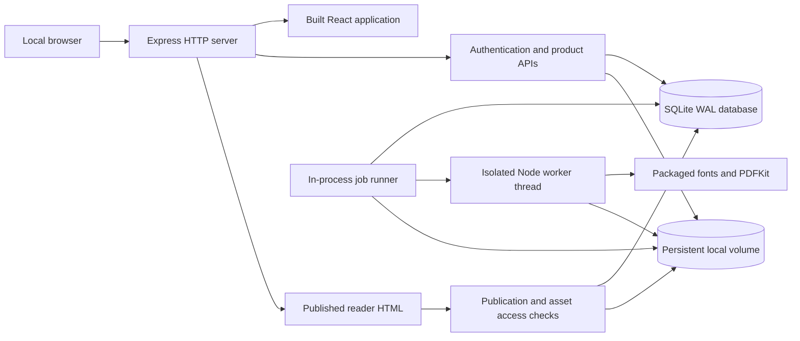
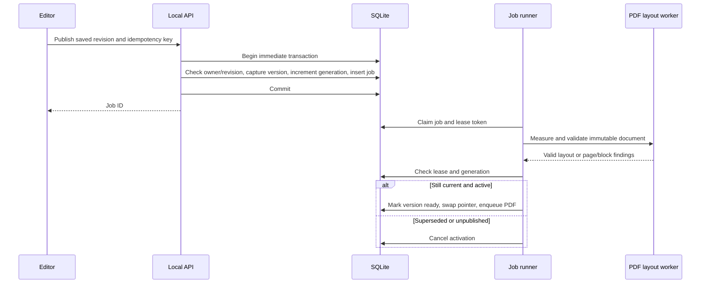

# Flipbook — Local Monolith Technical Design

> **Archived — superseded.** This is version 2.0 of the local design, before the WebGL reader and advanced editor were added. The current design is [docs/TECHNICAL_DESIGN.md](../TECHNICAL_DESIGN.md) (v4.0). Kept for decision history only.

**Version:** 2.0 · **Updated:** 27 October 2026  
**Architecture:** One repository, one application container, SQLite, persistent local files  
**Product requirements:** [README.md](../PRD.md)  
**Implementation:** [flipbook/](../../flipbook/)  
**Installation guide:** [flipbook/README.md](../../flipbook/README.md)

This design replaces the earlier cloud deployment proposal following the decision to implement and run the full MVP locally. It describes the implemented architecture and its operational limits. AWS services, PostgreSQL, a separate message broker, hosted identity, a CDN, and Chromium are not runtime requirements. Verification results are recorded in the implementation README as checks finish.

## 1. Scope and engineering decisions

The MVP is a local publishing studio: users create an account, manage reusable product information and images, compose magazines from page templates, publish a browser reader, and generate a downloadable PDF. The application runs entirely on the user’s computer. Published URLs work where that local server is reachable; a `localhost` link is not internet hosting.

| Concern | Decision | Rationale |
|---|---|---|
| Repository | One package/repository with frontend, backend, shared code, scripts, and tests | Simple installation and a single dependency lockfile |
| Runtime | One Node.js application container | Keeps local process and configuration overhead low |
| Frontend | React and Vite; built files served by Express | No separate frontend runtime in normal use |
| Backend | Express 5, ES modules | Straightforward REST routes and domain modules |
| Database | Node.js built-in SQLite, WAL mode | No database container or database account setup |
| Files | Named Docker volume mounted at `/app/data` | Uploads, originals, and PDFs survive container replacement |
| Jobs | SQLite jobs table, one polling runner, one CPU worker thread at a time | Durable retries without Redis or SQS |
| PDF | PDFKit + Sharp + locally packaged fonts | Creates text/vector PDFs directly; no browser installation |
| Authentication | Local accounts, scrypt passwords, opaque cookie sessions | No cloud identity credentials or external login dependency |
| Access model | Each account owns one isolated personal workspace | Matches the single-owner MVP |
| Publishing | Immutable version document plus live-version pointer and generation fence | Draft edits never silently change the reader |
| Analytics | First-party events in SQLite, queried on demand | Appropriate for local usage without extra services |
| Implementation language | JavaScript ES modules and JSX | Runs directly on Node; shared validation is enforced at runtime |

The source is a modular monolith. Modules are logical boundaries inside a single application, with no service-to-service network calls. A monorepo does not require multiple deployable services.

## 2. Supported environment and resource budget

### Host prerequisites

- macOS on Apple Silicon or Intel: Docker Desktop, or Colima with Docker CLI and Compose.
- Ubuntu/Debian Linux: Docker Engine and Compose plugin.
- Windows: WSL2 with Docker Desktop integration; run the Bash scripts inside WSL2.
- Internet access is needed for initial package/image installation. Normal authoring and export use local dependencies after installation.
- Native development additionally needs Node.js 24 and npm; Docker users do not need host Node, npm, SQLite, or PDF tools.

### Local resource targets

| Item | Default/target |
|---|---|
| Application containers | 1 |
| External service containers | 0 |
| Application memory cap | 1 GiB in Compose |
| CPU cap | 2 CPUs |
| PDF worker JS heap | 384 MiB; native image buffers also consume container memory |
| Background job concurrency | 1 |
| Suggested Docker/Colima VM | 2 CPUs, 4 GiB RAM, 20 GiB disk allocation |
| Persistent data | One named volume; budget additional disk for image originals/backups |
| Web port | `127.0.0.1:3000`, configurable through `FLIPBOOK_PORT` |
| Deployment target | One local host and a small number of simultaneous users/editors |

These are configuration limits and planning targets, not benchmark results. A low-memory machine may need smaller publications or more memory for exports. The original PRD’s cloud-scale load assumptions do not apply to this local deployment.

### Enforced content bounds

- 100 pages/publication, 50 blocks/page, approximately 2 MiB document/request limit.
- Title 160 characters; subtitle 300; publisher name 160.
- Product name 200, summary 500, description 10,000; up to eight images/product.
- Text block 20,000 characters; font size 10–64 logical pixels.
- JPEG, PNG, static WebP; 20 MiB input; 40-megapixel decoder limit; maximum dimension 12,000 px.
- One GiB accounted media per account; originals plus processed image bytes count toward storage.
- At most 10 queued/running jobs per account admitted by publish.
- PDF timeout 180 seconds; maximum output 100 MiB.

## 3. High-level architecture



All application components inside the diagram run in the same container. The PDF worker is a thread with its own JS heap; it is not another service/container. SQLite and files are colocated on the persistent volume. The HTTP server continues responding while CPU-intensive PDF work runs in the worker thread.

### Data flow

1. Browser loads the compiled React application from Express.
2. Local account login establishes a session cookie and a CSRF token.
3. Editor saves the canonical document to SQLite through an authenticated revision-checked API.
4. Uploads are validated and re-encoded by Sharp; files are stored on the local volume.
5. Publish captures an immutable document version and creates a durable job in the same SQLite transaction.
6. The runner validates fixed-page layout using the PDF renderer. On success it atomically switches the live pointer and creates the PDF export job.
7. The public reader resolves that live version and gates every image/PDF request against publication state.
8. PDF jobs write an immutable attempt file and record the winning path only after checking job ownership and publication lifecycle.

## 4. Repository and module map

```text
flipbook/
  client/
    main.jsx                 React library/editor/catalog/analytics UI
    api.js                   HTTP, CSRF, image-upload helpers
    style.css                Creator application styles
  server/
    index.mjs                HTTP routes, authorization boundaries, startup
    db.mjs                   SQLite initialization and transaction helpers
    auth.mjs                 Passwords, sessions, CSRF/origin checks, rate limits
    seed.mjs                 Synthetic starter products/images/publication
    jobs.mjs                 Durable queue runner and fenced job completion
    pdf-worker.mjs           PDF layout measurement and PDFKit generation
    reader.mjs               Server-rendered published reader shell
  shared/
    document.mjs             Templates, document construction, validation
    layout.mjs               Canonical page/grid geometry
    render.mjs               Safe HTML page renderer and page CSS
  public/
    reader.js                Reader navigation, product dialog, analytics
    reader.css               Reader shell styles
  scripts/                   Install/start/stop/logs/doctor/backup/dev
  tests/                     Meaningful contract and integration checks
  Dockerfile
  compose.yaml
  package.json
  package-lock.json
```

The shared document validator is used by the editor and server. The HTML renderer escapes user text and emits only supported block markup. PDFKit has a separate rendering adapter over the same content and geometry; this is intentionally documented as two adapters, not one browser engine producing identical pixels.

## 5. Canonical document contract

```ts
type Document = {
  schemaVersion: 1;
  title: string;
  subtitle: string;
  publisher: string;
  language: 'en';
  theme: 'editorial' | 'modern' | 'botanical';
  pages: Page[];
};
type Page = {
  id: string;
  template: 'cover' | 'feature' | 'grid' | 'story' | 'divider' | 'closing' | 'blank';
  title: string;
  blocks: Block[]; // semantic reading order
};
type Block = {
  id: string;
  type: 'text' | 'image' | 'product' | 'button' | 'divider';
  rect: [column: number, row: number, columns: number, rows: number];
  text: string;
  size: number;
  bold: boolean;
  align: 'left' | 'center' | 'right';
  assetId: string | null;
  alt: string;
  decorative: boolean;
  crop: { x: number; y: number; zoom: number };
  product?: ProductContent;
  url?: string;
};
type ProductContent = {
  name: string; summary: string; description: string;
  price: string; currency: string;
  sku: string; category: string; badge: string;
  url: string; images: string[];
};
```

IDs are UUIDs. All page/block IDs in a document must be unique. Document content contains asset IDs, never arbitrary filesystem paths. Product prices are decimal strings for display, with no payment arithmetic in this application. Currency is a validated three-letter code and formatting uses the currency’s decimal convention. The supported editor currency picker offers USD, EUR, GBP, INR, CAD, AUD, JPY, and AED.

Selecting a product copies its content into that page block. Catalog edits do not propagate to existing blocks or published versions. Users can explicitly select a catalog product again to refresh that placement. This gives reliable offline PDF values and avoids unexpected price/copy changes.

Product cards contain name, summary, primary image, optional price/badge, and merchant link. The full description and additional images appear in the digital reader’s product dialog. Put extended text/images on pages when they must appear in the PDF; reader dialogs themselves are not exported.

## 6. Layout, templates, and rendering

### Fixed-page layout

The logical canvas is 794 × 1,123 units, corresponding approximately to an A4 page at 96 CSS pixels/inch. The canvas has 45-unit padding and a 12-column × 36-row grid with seven-unit gaps. Every block uses integer grid coordinates.

```text
columnStep = (794 - 2 × 45 + 7) / 12
rowStep    = (1123 - 2 × 45 + 7) / 36
x          = 45 + column × columnStep
y          = 45 + row × rowStep
width      = columnSpan × columnStep - 7
height     = rowSpan × rowStep - 7
```

Blocks must stay within bounds and cannot overlap. Drag and resize actions snap to grid units. The inspector exposes the same coordinates numerically, which also provides a keyboard-accessible way to position/resize. Reading-order controls change the block array independently from visual position.

### Templates

| Template | Contents |
|---|---|
| Cover | Eyebrow, image, title, subtitle |
| Product feature | Heading and one large product card |
| Product grid | Heading and four product cards |
| Editorial/story | Heading, large image, body copy |
| Category divider | Eyebrow, headline, image |
| Closing/contact | Heading, copy, HTTPS action |
| Blank | Empty constrained grid |

Templates instantiate editable blocks; after insertion the creator owns the content and arrangement. They are code-owned definitions in schema/renderer version 1. Future layout changes must create an explicit renderer/schema revision and preserve retained version behavior rather than silently changing existing definitions.

### Fonts and themes

Instrument Serif provides editorial headings and DM Sans provides interface/body text. Font files are packaged from Fontsource and served locally. The PDF worker embeds these font files. Theme definitions control paper, ink, accent, and heading family. User-uploaded fonts and arbitrary CSS are outside this release.

### Responsive reader

Desktop defaults to paged viewing. Small screens default to semantic scroll/reflow viewing: fixed positions are removed, blocks become a single column, images receive readable heights, and text stays legible. A reader can switch modes. Reflow preserves content and reading order; it does not reproduce the exact fixed-page coordinates.

## 7. SQLite persistence design

Database: `/app/data/flipbook.sqlite`. Settings: `journal_mode=WAL`, `foreign_keys=ON`, `busy_timeout=5000`, `synchronous=FULL`. Write transactions use `BEGIN IMMEDIATE` and commit all related state together. Never hold a write transaction across image processing, filesystem I/O, or PDF work.

SQLite WAL permits readers alongside a writer but still has one writer at a time. The data volume must be local to the host; a network filesystem is not supported for this design. [SQLite WAL documentation](https://www.sqlite.org/wal.html).

### Tables

The executable schema is in [db.mjs](../../flipbook/server/db.mjs). This table summarizes its implementation contract.

| Table | Key fields and role |
|---|---|
| `schema_migrations` | Applied schema version and time; initial schema is version 1 |
| `users` | UUID, unique normalized email, display name, salted password hash, creation time |
| `sessions` | Hashed opaque token, user FK, CSRF secret, expiry |
| `publications` | Owner FK, unique slug, title, mutable document JSON, revision, lifecycle state, live-version ID, generation, timestamps |
| `versions` | Publication FK, immutable document JSON, captured revision/generation, build status, timestamp |
| `assets` | Owner FK, original/processed paths, MIME, dimensions, accounted bytes, timestamp |
| `products` | Owner FK, current reusable product content JSON, revision, timestamps |
| `jobs` | Owner/publication/version FKs, kind, status, stage, attempts, lease token/expiry, next attempt, error, winning artifact path |
| `idempotency` | Composite user/scope/key PK, body hash, stored response, creation time |
| `events` | Unique event ID, publication/version FKs, session ID, type, page/block ID, active time, timestamp |
| `reports` | Publication FK, bounded report text, timestamp |

Indexes support owner publication lists, queued jobs, event date queries, and one job per version/kind. Pages and blocks are embedded in the bounded JSON document, so one revision represents an atomic complete draft. This local implementation has no PostgreSQL RLS; every authenticated query/reference must explicitly check the current owner.

### Ownership and references

- Every creator API scopes the publication/product/asset/job to the authenticated account.
- Every asset ID in a document is checked before save/publish.
- A reader asset route checks current publication state, version, asset membership in that document, and asset owner.
- Asset IDs are immutable; replacing an image creates a new asset record/file.
- Product deletion removes the catalog record; embedded product copies remain intact.
- Publication deletion is soft deletion and immediately removes reader access. The local data backup retains recovery material.
- Original images are private and are never served by public reader routes.

Future database changes must be explicit versioned migrations executed before HTTP readiness; do not rely on `CREATE TABLE IF NOT EXISTS` to modify existing columns. Back up before migrations. Migration rollback requires a compatible code version or restoring a consistent volume backup.

## 8. Authentication and request security

Passwords are hashed with Node’s scrypt using a random per-password salt. Session tokens are random 256-bit values; only their SHA-256 hashes are stored. Session cookies are HttpOnly and SameSite=Lax. For the localhost HTTP configuration they are not marked Secure; an HTTPS deployment must enable `COOKIE_SECURE=true` and change the public URL/origin configuration.

Each mutating authenticated request needs the session’s CSRF token in `X-CSRF-Token`. Origin checks allow the configured local public origin and controlled development origins. No permissive cross-origin API is enabled. Login/registration and uploads have in-memory rate limits. Passwords and tokens are not logged.

The server sets no-store headers on API and reader documents, prevents framing, and uses nosniff/referrer headers. User text is escaped in generated HTML. Links accept HTTPS without embedded credentials. The server does not fetch merchant URLs or arbitrary image URLs. Raw SVG/HTML uploads are rejected.

This is a local application. Internet-facing service operation additionally requires HTTPS, hardened account lifecycle/reset, sustained abuse controls, deployment monitoring, and a privacy/retention decision. The Compose binding to `127.0.0.1` is intentional.

## 9. API contracts

All routes below are under `/api` unless explicitly stated. Success uses JSON values directly. Error shape: `{ error, code?, findings?, revision? }`. Validation findings carry `{ message, pageId?, blockId? }`. Authentication errors return 401; ownership misses return 404; revision conflicts 409; invalid content 422; limits 413/429.

### Creator APIs

| Method/path | Input | Behavior |
|---|---|---|
| `GET /health` | None | Database readiness and application version |
| `POST /auth/register` | Name, email, password | Creates local account and synthetic starter content; session cookie + CSRF |
| `POST /auth/login` | Email, password | Verifies account and creates session |
| `POST /auth/logout` | CSRF | Revokes session and clears cookie |
| `GET /session` | Cookie | Current user and CSRF token |
| `GET /publications` | Cookie | Owner’s non-deleted publications |
| `POST /publications` | Title, theme, idempotency key | Creates publication and initial cover draft |
| `GET /publications/:id` | Cookie | Document, revision, lifecycle, latest jobs |
| `PUT /publications/:id/draft` | Document, expected revision, idempotency key | Atomic replacement with optimistic concurrency |
| `POST /publications/:id/duplicate` | Optional local recovery document, idempotency key | New draft/slug and fresh page/block IDs |
| `POST /publications/:id/publish` | Saved revision, idempotency key | Captures version and returns durable publish job |
| `POST /publications/:id/unpublish` | Idempotency key | Clears pointer and increments generation |
| `POST /publications/:id/archive` | Idempotency key | Archives and unpublishes |
| `POST /publications/:id/unarchive` | Idempotency key | Returns to active draft; does not republish |
| `POST /publications/:id/delete` | Idempotency key | Soft-deletes and revokes reader access |
| `POST /publications/:id/export` | None beyond authentication/CSRF | Returns the current live version’s existing/new PDF job |
| `GET /jobs/:id` | Cookie | Status, stage, parsed error, no private file path |
| `POST /jobs/:id/retry` | CSRF | Requeues eligible failed job; rejects obsolete publish generation |
| `GET /jobs/:id/download` | Cookie | Downloads authorized ready PDF |
| `GET /products` | Cookie | Reusable catalog |
| `POST /products` | Product content | Creates validated product |
| `PUT /products/:id` | Content and expected revision | Updates catalog; stale revision conflicts |
| `DELETE /products/:id` | CSRF | Removes catalog record without modifying page snapshots |
| `GET /assets` | Cookie | Image library metadata |
| `POST /assets` | Raw image bytes, MIME, encoded filename, CSRF | Validates/processes image and returns new asset |
| `GET /assets/:id` | Cookie | Owner’s processed image |
| `GET /publications/:id/analytics` | UTC from/to dates | Local session/depth/click/time totals and daily sessions |

### Public reader APIs

| Route | Behavior |
|---|---|
| `GET /m/:slug` | Server-rendered current publication, navigation, product details data |
| `GET /api/reader/:slug/status` | Live version ID, or unavailable |
| `GET /api/reader/:slug/assets/:id?version=...` | Current-version-gated processed image |
| `GET /api/reader/:slug/pdf` | Ready PDF, 202 while preparing, or explicit error |
| `POST /api/reader/events` | Signed reader token + bounded event |
| `POST /api/reader/:slug/reports` | Bounded content report, rate limited |

### Save example

```http
PUT /api/publications/{id}/draft
Content-Type: application/json
X-CSRF-Token: {session-csrf}
Idempotency-Key: {uuid-for-this-batch}

{"revision":17,"document":{"schemaVersion":1,"title":"Spring edit","...":"..."}}
```

Success: `{ "revision": 18, "savedAt": "2026-10-27T10:00:00.000Z" }`. A retry must use the same body/key. The idempotency lookup occurs before revision comparison, so a successfully committed request whose response was lost is replayed safely. A key reused with different content returns 409.

## 10. Editor low-level design

The editor has a page rail, scaled fixed-page canvas, selection/resize overlay, contextual inspector, insertion toolbar, publication settings, preview, and publish/job status. Page templates and block content are plain serializable objects.

### Editing behavior

- Add, duplicate, remove, and reorder pages. The last remaining page cannot be deleted through the UI.
- Edit text in the inspector or by double-clicking a text element; adjust size, weight, and alignment.
- Add/replace images, set alternative text/decorative status, and adjust crop focus/zoom.
- Add a catalog product to a block or edit its embedded fields independently.
- Add supported text/image/product/button/divider blocks into available grid space.
- Drag/resize selected blocks or set numerical coordinates. Overlapping drag destinations are rejected.
- Undo/redo restores document snapshots; retain up to 100 history entries in the current editing session.
- Preview supports fixed pages and phone/reflow layout. Publication settings expose publisher, subtitle, theme, live URL, and unpublish.

### Autosave and recovery

1. Apply the edit to the current in-memory document and record an undo snapshot.
2. Persist local recovery content and its base server revision in browser localStorage, scoped to user/publication.
3. Debounce a network save by 900 ms; a five-second periodic flush prevents endless typing from postponing all saves.
4. Freeze one request body/key while it is in flight. Further edits remain in the local document.
5. On acknowledgement, advance revision and remove only the acknowledged recovery state. If newer edits exist, save them next.
6. On ambiguous network failure, retry the frozen body/key; do not invent a new key for the same attempt.
7. On revision conflict, pause writes. Offer saving local content as another publication or explicitly discarding local edits and using the saved server version.
8. On reload, restore compatible local edits; if the server revision differs, enter conflict resolution.
9. Publish waits for outstanding saves and references the acknowledged revision.

Browser storage is best effort and can be full or cleared. A visible warning is required if recovery persistence fails. It is not a backup. Logout clears this account’s local recovery entries. Closing the tab with unsaved content triggers a browser warning.

The MVP does not merge simultaneous edits automatically. Multiple tabs/accounts do not imply real-time collaboration.

## 11. Publishing state and transactional consistency

Publication lifecycle: `active`, `archived`, or `deleted`. A publication is live only when active with a ready `live_version`. It can have a live version and newer draft content simultaneously.



Every publish request increments `generation`. Unpublish, archive, and delete increment it too. The worker can activate only the generation it captured. Therefore a delayed job cannot undo a later lifecycle action. If a new publish fails, the previous live version remains available.

The immutable document includes embedded product values. Readers do not query the current catalog while rendering a published page. Original asset IDs/files are immutable and retained, so replacing an image in a draft does not alter live content.

### Reader revocation

Local reader documents and asset/PDF responses are no-store. Every public image/download resolves active publication state and current-version membership. No permanent public object URLs exist. New requests are denied immediately after unpublish commits. Already-downloaded data and already-started transfers cannot be recalled. Open readers recheck status periodically and show an updated-edition/unavailable message.

## 12. Image pipeline

The browser uploads raw file bytes to an authenticated endpoint, with upload progress. The server limits bytes before decoding, verifies actual format using Sharp, rejects animated/unsupported images, and enforces decoded pixel/dimension limits. It applies orientation, strips derivative metadata, resizes to at most 2,400 × 2,400 without upscaling, and writes a WebP derivative.

Both original and processed bytes are retained in the local volume. Readers and editors receive the processed derivative; PDFKit receives a PNG conversion inside the worker because its image support is JPEG/PNG. That conversion remains internal and does not change source content. [PDFKit image support](https://pdfkit.org/docs/images.html).

The local MVP has one processed resolution rather than a cloud rendition service. For larger deployments, add multiple responsive renditions through a storage adapter while preserving asset immutability and publication references.

## 13. PDF export design

### Why PDFKit

PDFKit supports positioned text, font embedding, text measurement, image placement, outlines, and link annotations. It avoids a browser process and its installation/runtime overhead. It embeds the same packaged fonts used by the HTML renderer. [PDFKit text and fonts](https://pdfkit.org/docs/text.html).

### Pipeline

1. Load an immutable version and resolve all assets against the job’s owner.
2. Start a bounded Node worker thread with only the document, approved asset paths, and approved font paths.
3. Convert image derivatives to PNG in memory and register the packaged fonts.
4. Convert canonical grid rectangles to A4 PDF coordinates.
5. Measure text using the selected fonts/line heights. Compute product image/copy regions. Reject text overflow or a product image area below the supported minimum.
6. Draw page background, images/crops, text, product cards, buttons, and footers; add merchant link annotations and page outlines.
7. Check expected page count and output byte limit. Return the PDF bytes or structured findings.
8. Write to an attempt-specific temporary file and atomically rename to the immutable attempt path.
9. Commit the winning path only if the worker still owns its job lease and lifecycle permits completion.

Publish preflight uses this layout measurement before activating a version. PDF export uses the same PDF adapter and captured version afterward. Exact PDF results are cached by the unique `(version_id, kind=pdf)` job. Duplicate requests return the existing job/result.

### Fidelity and limits

- A canonical page maps to exactly one A4 portrait PDF page.
- Text remains text, not a flattened page screenshot. Images are embedded; URLs remain clickable.
- Paper/ink/accent, content, order, grid positions, crop intent, and fonts are shared with the reader.
- Browser and PDF engines can differ in line breaking and font rasterization. Supported template fixtures must be visually compared; the document does not promise pixel-identical HTML/PDF output.
- Reader navigation, popups, and animations are excluded from the PDF. Put all required offline content onto pages.
- RGB screen-oriented output only; no CMYK/bleed/crop marks/PDF-UA conformance claim.
- Unsupported glyphs/scripts and very long content need explicit validation/fixtures before adding language support.

## 14. Durable job runner

SQLite stores both the business change and the job in one transaction, so a separate outbox/broker is unnecessary for this single-database local runtime.

Job states: `queued`, `running`, `succeeded`, `failed`, `cancelled`. The runner polls once per second, prioritizes publish checks over PDFs, and runs one job at a time. Claim increments attempt and assigns a random lease token with a 60-second expiry. The main thread extends the lease every 15 seconds while the PDF worker runs. Process restart can reclaim expired running jobs.

Completion checks the lease token and publication generation/state. Deterministic content/layout failures surface immediately. Transient failures retry up to three executions with persisted delay; the user can retry an eligible failed job through the UI. A cancelled/superseded publish must be replaced by a fresh publish command.

The worker thread has a 180-second hard deadline. It is terminated on timeout/completion/error. A stale attempt’s file has a distinct name and cannot overwrite another attempt’s committed PDF. Orphan-file cleanup is maintenance work; never delete a file referenced by a ready job/version.

## 15. Reader and analytics

The reader is server-rendered HTML using the shared safe page renderer and a small browser script. It offers previous/next navigation, jump-to-page, touch swipes in paged mode, scroll mode, product details with gallery, share/copy link, and PDF download. Product dialogs manage focus and close with Escape. Reduced-motion preferences are respected.

A publication link is stable across updates. Image routes reject a request for a noncurrent version. An already-open reader periodically detects version changes and offers a reload instead of mixing old and new content.

### Metrics

The server signs an event token scoped to publication, version, random visit/session ID, and two-hour expiry. Events carry unique IDs and are inserted once. Page and block IDs must exist in that version. Events do not include email or raw IP in the analytics table.

| Metric | Definition |
|---|---|
| Reader sessions/views | One accepted view event per session |
| Pages/session | Distinct logical pages seen divided by sessions |
| Product clicks | Outbound product CTA events |
| Active time | Bounded foreground heartbeat contributions |
| Click-through rate | Sessions with a product click divided by sessions |
| Daily sessions | View events grouped by UTC date |

The dashboard supports date windows. Events are retained 30 days and totals are computed directly for local scale. Sessions are not unique people. Network loss, blocked scripts, and closed tabs can make measurement incomplete. Local analytics is not a billing-grade measurement system.

## 16. Installation, startup, and storage

### Commands

```bash
cd outputs/flipbook
./scripts/install.sh       # First-time prerequisite setup, image build, startup
./scripts/start.sh         # Build if needed and start; wait for health
./scripts/stop.sh          # Stop, preserving data
./scripts/logs.sh          # Follow bounded application logs
./scripts/doctor.sh        # Check runtime, Compose configuration, service state
./scripts/backup.sh        # Stop briefly, archive the complete volume, restart
```

With a working Docker/Compose installation, the equivalent startup is `docker compose up -d --build --wait`. `scripts/common.sh` also detects Docker Desktop’s bundled CLI and Compose binary when they are not on PATH.

On macOS, the installer reuses Docker Desktop when installed; otherwise it installs Homebrew if necessary, then Colima, Docker CLI, and Compose. Colima is the lightweight default for a new runtime. Ubuntu/Debian installation uses Docker’s signed official package repository. Host runtime installation may require administrator approval, a first-launch dialog, or group membership activation; the script explains those steps instead of pretending they can always be completed unattended.

Docker Desktop includes its engine, CLI, and Compose. Compose healthchecks are needed because a running process alone does not establish readiness. [Docker installation](https://docs.docker.com/compose/install/), [Compose readiness](https://docs.docker.com/compose/how-tos/startup-order/).

### Persistent volume

```text
/app/data/
  flipbook.sqlite
  flipbook.sqlite-wal
  flipbook.sqlite-shm
  .secret                    Local event-signing secret
  assets/{uuid}.original
  assets/{uuid}.webp
  exports/{version}.{attempt}.pdf
  backups/
```

The volume survives `docker compose stop`, normal `down`, and image rebuilds. `docker compose down -v` deletes persistent data and must not be used as a routine stop command. Do not copy only the SQLite main file while it is open in WAL mode. The backup script stops the application before archiving the complete volume.

### Container controls

The app runs as the non-root Node user, with a read-only root filesystem, dropped capabilities, no-new-privileges, a writable data volume, and temporary memory-backed `/tmp`. Logs rotate. Health checks query the HTTP readiness route. The published host port binds only to loopback.

## 17. Development and delivery

Native development: `npm ci`, `npm run dev`. Vite serves the interface and proxies API/reader requests to the local Express process. Normal production-like native use: `npm run build` then `npm start`. Native data defaults to `./data`; Docker uses its named volume.

The multi-stage Docker build installs from the lockfile, builds the frontend, removes development dependencies, and copies only runtime source/dependencies/assets into the final image. No Chromium download is involved. Tests and development data are excluded from the build context.

Before release: validate source syntax, build the UI, run document/API/job tests, check Compose configuration, run the actual container when an engine is available, and exercise the browser journey. Dependency upgrades must retain the lockfile and repeat PDF/template compatibility checks.

## 18. Verification requirements

| Area | Required evidence |
|---|---|
| Authentication | Registration/login/logout, wrong password, CSRF and cross-account denial |
| Editing | Template/page/block operations, text/images/products, undo/redo, saved reload |
| Persistence | Same mutation retried once, stale revision rejected, local recovery |
| Publishing | Draft remains separate; generation fencing prevents late activation |
| Images | MIME/decode/size limits, private originals, cross-account asset rejection |
| PDF | Correct page count, selectable text, embedded images, merchant links, visible supported layouts |
| Reader | Logged-out access, phone reflow, details/gallery, navigation, revoked assets after unpublish |
| Analytics | Deduplication, valid dimensions, expected session/click/depth totals |
| Docker | Build, healthy startup, restart persistence, backup archive validity |

The test record must distinguish native application checks from Docker checks. A successful native build does not prove container startup, and a stopped/unavailable Docker engine is an environment limitation to report explicitly.

## 19. PRD mapping and boundaries

The implemented MVP covers local accounts, publication library/lifecycle, six curated templates plus blank pages, text/image/product editing, page ordering, constrained movement/resizing, autosave/recovery/conflicts, undo/redo, previews, immutable publish versions, responsive reader, product actions/details, PDF generation/download, and basic session/product analytics.

The product-level capabilities remain the same after moving to a local architecture. The following are still later-release features: CSV import, ecommerce connectors, invitations/roles, simultaneous coediting, version-history UI, password-protected reader, scheduled publishing, custom domains, website embeds, print-production profiles, custom fonts, billing, and wider language/RTL support.

Internet hosting is a separate deployment step. A future hosted version can retain the document model and UI while introducing explicit workspace membership, a server database, an object-storage adapter, a durable external queue where needed, and a managed identity/access policy. Those services are not prerequisites for the local MVP.
